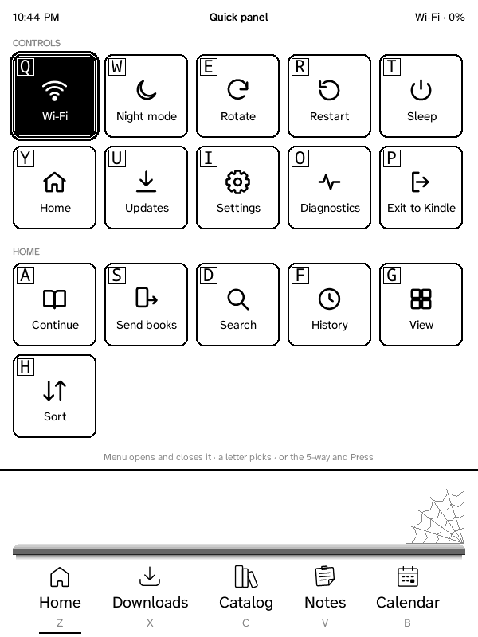
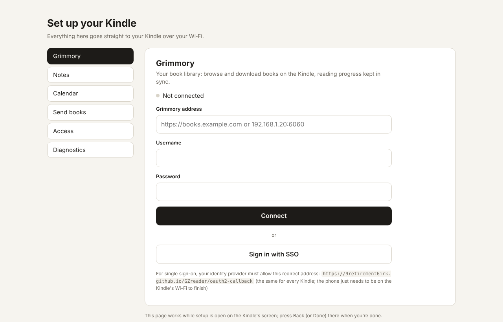
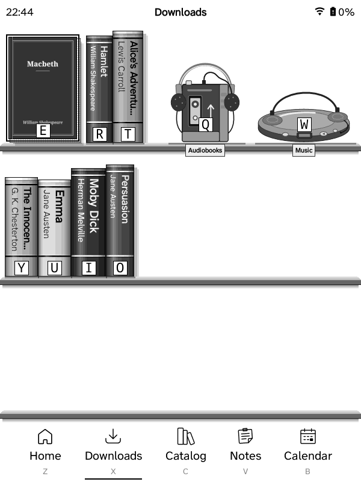

# GZreader — Grimmory + ZenOS + KOReader for the Kindle Keyboard

A trimmed KOReader for older Kindles: the Kindle 2, Kindle Keyboard (3) and
DX (keyboard), the Kindle 4 (5-way, no keyboard), the Kindle Touch and the
Paperwhite 3 (touch), that reads books, pulls them from a [Grimmory](https://grimmory.org) server
and keeps reading position, bookmarks, highlights and notes in sync with it. ZenOS is the
interface. Releases and updates: <https://github.com/9retirement6irk/GZreader>.

Based on KOReader `v2026.07.1` and ZenOS `4.2.0`. Version: see `GZREADER_VERSION`.

## What's in it

| Kept | Why |
| --- | --- |
| `zenos.koplugin` | The interface (Home, Downloads, navbar). English only. |
| `coverbrowser.koplugin` | Required by ZenOS's library views. |
| `statistics.koplugin` | Feeds ZenOS's Home reading-stats widgets. |
| `autosuspend.koplugin` | Battery. |
| `gzreader.koplugin` | GZreader itself: the setup page (QR code or address + PIN: connections, sending books), library browser, downloads, progress, bookmark and highlight sync, Reading menu, read aloud, updates. |

Added: an English dictionary (Open English WordNet, CC BY 4.0, 11 MB).

Removed: the other 32 bundled plugins (including KOReader's own progress
sync), SSH/SFTP binaries, KOReader's OTA updater (it would replace this
build with stock KOReader), the 16 MB CJK fallback font, UI translations and
KOReader's first-run quickstart document (ZenOS's setup guide replaces it).

## Install

You need a **jailbroken** Kindle with **KUAL** (the Kindle Unified Application
Launcher), a computer with a USB cable, and about 100 MB free on the Kindle.
(Nooks, test build: see the steps for the [1st Edition](GZREADER.md#nook-1st-edition-test-build) and the [Simple Touch](GZREADER.md#nook-simple-touch-test-build).)

### 1. Jailbreak the Kindle and install KUAL

Turn on **airplane mode** first, so the Kindle doesn't update itself to a firmware the
jailbreak can't handle.

| Kindle | Jailbreak | KUAL file |
| --- | --- | --- |
| Kindle 2, Kindle Keyboard (3), DX | the legacy jailbreak for its firmware ([MobileRead Kindle Developer's Corner](https://www.mobileread.com/forums/forumdisplay.php?f=150)) | `KUAL-KDK-1.0.azw` → `documents` folder |
| Kindle 4, Kindle Touch | the legacy jailbreak for its firmware (same forum) | `KUAL-KDK-1.0.azw2` → `documents` folder (Kindle Touch: or the KUAL booklet with MRPI) |
| Paperwhite 3 (7th gen) | [kindlemodding.org](https://kindlemodding.org/jailbreaking/): LanguageBreak for firmware 5.14.3 – 5.16.2.1.1, older methods for older firmware | `Update_KUALBooklet_HDRepack.bin` installed with MRPI |

On the Paperwhite, see your firmware in **Settings → Device Options → Device Info**.
There is no software jailbreak for firmware **5.16.3 or newer**: a Paperwhite already on
it can only be used if it was jailbroken before updating. After jailbreaking, follow
kindlemodding.org's steps to install KUAL and MRPI
([guide](https://kindlemodding.org/jailbreaking/post-jailbreak/installing-kual-mrpi/))
and its hotfix, so a firmware update doesn't undo the jailbreak.

When it works, a **KUAL** book appears in the Kindle's library.

### 2. Download GZreader

From the [latest release](https://github.com/9retirement6irk/GZreader/releases/latest),
take the package for your Kindle (the others won't start on it):

| Kindle | Package |
| --- | --- |
| Kindle 2, Kindle Keyboard (3), DX / DX Graphite | `gzreader-kindle-legacy-<version>.zip` |
| Kindle 4, Kindle Touch | `gzreader-kindle-<version>.zip` |
| Paperwhite 3, firmware **5.16.3 or newer** | `gzreader-kindlehf-<version>.zip` |
| Paperwhite 3, firmware 5.6.1 – 5.16.2.x | `gzreader-kindlepw2-<version>.zip` |

### 3. Copy it to the Kindle

1. Connect the Kindle to the computer with USB; it shows up as a drive.
2. Unzip the package on the computer. Inside are the folders `koreader`, `extensions`
   and, in the Kindle 2/3/DX package, `launchpad`; the other packages also have
   `documents` with one file, `GZreader.sh` (the GZreader item on the Kindle's home
   screen).
3. Copy those folders to the **top of the Kindle's drive**, merging with any folders
   of the same name already there (your books in `documents` and KUAL's own
   `extensions` folder stay; GZreader adds `documents/GZreader.sh` and
   `extensions/koreader`). If an old KOReader is installed, its `koreader` folder is
   replaced.
4. **Eject** the Kindle safely and unplug it.

### 4. Start GZreader

- **Any Kindle:** open the **KUAL** book, then **GZreader → Start GZreader**. (*Start
  GZreader (no framework)* stops the Kindle's own software while GZreader runs: more
  free memory, and the Kindle restarts its home screen when you exit.)
- **Kindle 2, 3, DX** also: press **Shift, G, G** (the last book), **Shift, G, L** (the
  library) or **Shift, G, N** (without the Kindle's framework).
- **Kindle Touch, Paperwhite and newer:** a **GZreader** item with GZreader's logo
  is on the Kindle's own home screen (`documents/GZreader.sh` from the package; on a
  Kindle that can run these launchers, e.g. with kindlemodding.org's jailbreak and
  hotfix); tapping it starts GZreader. If it isn't there, start from KUAL once: GZreader
  puts it back.

### 5. The first start

A setup guide runs. Its first page, **Set up from your browser**, shows a QR code:
scan it with your phone, or type the address under it into any browser on the
same Wi‑Fi and enter the PIN, to connect Grimmory, Notes (Memos) and Calendar,
or to send books, or pick *Skip for now*. You can come back to it any time:
the quick panel → **Send books** (Menu, or on a touch Kindle swipe down from the
top). The guide then asks about the library view, tabs, sleep
screen, clock and usage statistics.

Books you download or send go to the **GZreader** folder at the top of the Kindle's
drive; the **Downloads** tab shows them.

### Updating

GZreader checks for a new release once a day and offers it; or open **Settings →
General → Updates**. Updating keeps your books, settings, connections and reading
progress. (Installing a newer package over USB the same way also works.)

### Uninstalling

Delete the `koreader` folder, `extensions/koreader`, `launchpad/koreader.ini` (Kindle
2/3/DX) and `documents/GZreader.sh` (Kindle Touch, Paperwhite). The **GZreader** folder
with your books stays until you delete it.

### If something goes wrong

- **GZreader isn't in KUAL:** check that `extensions/koreader` is on the drive (not
  `extensions/extensions/koreader` or inside another folder).
- **It flashes and returns to the Kindle's home screen:** most likely the package for
  another Kindle or firmware; take the one from the table above. `koreader/crash.log`
  on the drive says why.
- **The setup page doesn't open:** the phone or computer must be on the same Wi‑Fi
  as the Kindle, and the Kindle's Wi‑Fi must be on. Type the address exactly as the
  Kindle shows it (with `:8642` if it shows one), starting `http://` if the browser
  insists on `https://`.
- **Something else:** Settings → General → **Send diagnostic log to a browser** (or
  *Save diagnostic log*, which puts it on the drive) and attach it to an issue.

## Usage statistics

GZreader sends anonymous usage statistics to its developer's
[Tianji](https://tianji.dev) server, so problems on real Kindles can be found
and fixed. You choose the level in the setup guide or in
**Settings → General → Usage statistics**:

| Level | What's sent |
| --- | --- |
| **Basic** (default) | GZreader's version, the Kindle model and firmware at each start; whether the previous run ended without closing normally; downloads that worked or failed; slow operations; keys the screen didn't answer |
| **Full** | Basic, plus time on Home, Downloads, Grimmory, in books and menus; menu entries used; reading sessions (format, picture book or not, minutes, pages, pages per minute, battery use per hour); read aloud; download size, speed and resumes; sync results and Grimmory's answer times; Wi‑Fi on-time |
| **Off** | Nothing is recorded or sent |

Never sent: book titles, authors, file names, your Grimmory address or account,
or anything you type. Each Kindle is counted by a random ID, not its serial
number. Statistics wait in a small file and go out in one batch at most every 15
minutes, only while Wi‑Fi is already on; GZreader never turns Wi‑Fi on for them.

## Updates

GZreader checks the latest release of github.com/9retirement6irk/GZreader
once a day (Settings → General → Updates, or Grimmory menu → GZreader
updates; the changelog is there too). Publishing an update is just making a
GitHub release:

1. Bump `GZREADER_VERSION` and add an entry to
   `plugins/gzreader.koplugin/gzreader_changelog.lua`, push.
2. On GitHub: Releases → Draft a new release → tag `v<version>` (for
   example `v1.0.4`; `v.1.0.4` also works) → Publish.

The "GZreader release packages" workflow then builds and attaches the full
installs (`gzreader-kindle-legacy-<version>.zip`,
`gzreader-kindle-<version>.zip`, `gzreader-kindlehf-<version>.zip`, `gzreader-kindlepw2-<version>.zip`) and
`gzreader-update.zip` (what every Kindle downloads, ~6 MB: Lua only, the same
for all of them). If a release has no
attached files, Kindles use the release's source code zip instead (~9 MB),
taking only `frontend/`, `reader.lua`, `koreader.sh` and the installed
plugins from it.

The download comes over HTTPS straight from GitHub (no hashing on the
Kindle); the zip must open and have a complete GZreader layout. Settings,
books, `.sdr` folders, history and the GZreader folder are never touched; if
anything fails, the previous files are put back. Then GZreader restarts.

## Which Kindle does what

| | Kindle 2, 3, DX | Kindle 4 | Kindle Touch | Paperwhite 3 | Nook 1st Edition (test) | Nook Simple Touch (test) |
| --- | --- | --- | --- | --- | --- | --- |
| Use | keyboard, 5-way | 5-way, Menu | touch | touch | the colour touchscreen's buttons and keyboard | touch |
| Wi‑Fi | Kindle 3; the Kindle 2 and DX have none: [sync with a computer](#sync-with-a-computer) | yes | yes | yes | yes | yes |
| Screen | 600 × 800 (DX 824 × 1200), 16 greys | 600 × 800, 16 greys | 600 × 800 | 1072 × 1448, 300 dpi | 600 × 800 + a 480 × 144 colour touchscreen | 600 × 800 (GlowLight: frontlight) |
| Faster drawing (shadow screen) | yes | yes | (not needed) | (not needed) | (not needed) | (not needed) |
| Audiobooks | yes | — (no audio) | yes (player buttons) | — (no audio) | — (not yet) | — (no audio) |
| Read aloud (Kindle voice) | yes (Shift + Sym) | — | yes (Listen in the quick panel) | — | — | — |
| Volume buttons | yes | — | — | — | — | — |
| Clock | UTC: set Settings → General → Time zone | same | the Kindle's own | the Kindle's own | the Nook's own | the Nook's own |

Other Kindles (Paperwhite 1, 2, 4, 5, 6, Voyage, Oasis, Kindle 2014–2024,
Scribe, Colorsoft) run the `kindle`, `kindlepw2` or `kindlehf` package
(README) as touch Kindles, like the Paperwhite 3. They're untested.

KOReader's own device code decides the model from the serial number (the DX
runs as KOReader's Kindle 2 class, with its bigger screen); GZreader adapts
each screen to keys, the 5-way or touch.

## Kindle 4 (5-way)

No keyboard and no touch screen: the 5-way, its centre button (Press),
Menu, Back, Home, the keyboard key and the page keys on both sides.

- **Tabs:** Down from the bottom of Home reaches the tab bar; Left and Right
  choose a tab, Press opens it.
- **Menu:** the quick panel at Home and in a book (see *The quick panel*
  below); in Notes and Calendar their options (new note, filter, refresh;
  today, Agenda / Day / Week / Month, refresh, settings).
- **Notes:** the 5-way moves between the sticky notes, Press opens one; in a
  note ▲ ▼ choose a checklist item or attachment and Press ticks or opens
  it; Menu: edit, pin. The editor shows the on-screen keyboard (the 5-way
  types on it); Menu goes to the toolbar (lists, checklists, headings,
  italic, bold, tags, Save, and who can see the note) and back.
- **Calendar:** the page keys go back and forth; the 5-way picks an event.
- The 8-bit screen has inverted grey levels, which KOReader's fast drawing
  code can't handle (like the Kindle 3's 4-bit one): GZreader draws into an
  ordinary buffer and copies it to the screen, about a sixth less processor
  time per key press in testing, and night mode costs nothing.

## Nook 1st Edition (test build)

GZreader also runs on Barnes & Noble's first Nook (2009): a 6" e-ink page
with a small colour touchscreen under it. **This is a test build:** it runs
on a real Nook (firmware 1.0.0 with nookDevs' Softroot 2.5.1): the setup
guide, Home, the colour screen's controls, Wi‑Fi, downloading books. Each
e-ink update is still a full refresh (below). Try it on a Nook you're
prepared to restore, and send back what happens (below).

How it works: the Nook's processor is the same family as a Kindle 3's, but
its kernel has the floating-point unit switched off and stops programs that
read unaligned memory, so the Nook gets its own build of KOReader's programs
(`gzreader-nook-1st-edition-<version>.zip`: floating point in software, no
unaligned reads), plus what the Nook's Android 1.5 lacks (a Linux C library
and BusyBox, from Debian 7). A start script pauses the Nook's own software
while GZreader runs and resumes it when you exit. It also wakes what Android
had put to sleep: the colour screen, its touch panel and Wi‑Fi. Nothing on
the Nook's system is changed for good: the script's changes are undone by
exiting or restarting the Nook.

### Both screens

- **The e-ink page** shows GZreader as on a Kindle 4, refreshed the way
  Android does it (through the Nook's kernel: each update a full refresh).
  Sending updates straight to the e-ink controller, with a faster waveform
  for each and no full-screen flash, froze a real Nook at the first
  refresh: the Nook keeps the controller asleep between updates, and GZreader
  didn't wake it. It now does, as the Nook itself does; it's still to be
  tried with `GZ_NOOK_EPD=direct` (below) until it has run on a Nook.
- **The colour touchscreen** is what you drive it with, and it changes with
  what you're doing:
  - **Controls** (Home, menus, lists): ▲ ▼ ◀ ▶ and **OK** (the Kindle 4's
    5-way), **Back**, **Menu** (the quick panel), **Home**, ◀◀ ▶▶ (page back / forward) and **•••** (the next
    panel).
  - **Reading info** (in a book): title, chapter, page, a progress bar, the
    time, battery and Wi‑Fi. Or **Cover**: the book's cover with its title,
    author and progress. Touch it to get the controls for a while.
  - **Keyboard** (typing: search, Notes, connecting): letters, numbers and
    symbols on the colour screen, so the page isn't covered by an e-ink
    keyboard. **Done** swaps it for the controls (▲ ▼ to reach the dialog's
    buttons), the ⌨ button brings it back.
  - Swipe left or right on it to turn pages; up or down for its next panel.
- **The page buttons** on both sides turn pages; **n** (under the colour
  screen) is Home; **power** puts the Nook to sleep and wakes it.

**Settings → Interface → Colour screen** chooses what shows when: while
reading (reading info, cover, controls or nothing), elsewhere (controls,
clock or nothing), when typing (colour keyboard, or the e-ink keyboard with
the arrows), whether a touch brings up the controls and for how long, swipe
to turn pages, how long until it goes dark (a touch lights it again; the
first touch only lights it), its brightness, and a **touch test** with
mirror / swap switches in case the touch is the wrong way round on your
Nook.

Wi‑Fi: GZreader uses the networks saved in the Nook's own settings. When
Android has switched Wi‑Fi off (it does when its screen goes off), the start
script switches it on and connects as Android would, and switches it off
again when you exit GZreader. (`GZ_NOOK_WIFI=off` leaves Wi‑Fi alone.)

Not in the test build: audiobooks and read aloud (the Nook has a speaker,
but GZreader plays audio with the Kindle's player), switching Wi‑Fi on and
off from GZreader's menus, and a launcher icon (start it with adb or a
terminal app, below).

### Root the Nook

GZreader needs root (to pause the Nook's software and reach the screens),
which on this Nook means a community rooting method. Read the guide for
yours in full first, charge the battery, and back up your books.

1. Find the serial number (Settings → About your nook, or under the back
   cover). **It decides the method:** methods for older Nooks can brick
   newer hardware.
2. Serial **below 1003**: nookDevs' [Softroot](https://nookdevs.com/Softroot)
   (an update file on a microSD card; adds ADB over USB).
3. Serial **1003 or above** (firmware 1.4.1 and later): nookDevs'
   [Rooting New Hardware](https://nookdevs.com/Rooting_New_Hardware), or the
   newer browser-based method in [Rooting the Barnes & Noble Nook 1st
   Generation](https://letsdecentralize.org/tutorials/root-nook.html) (ADB
   over Wi‑Fi).
4. Install [Android's platform tools](https://developer.android.com/tools/releases/platform-tools)
   (adb) on your computer and check that `adb shell id` says `uid=0(root)`.

### Install

1. Download **`gzreader-nook-1st-edition-<version>.zip`** from the
   [releases](https://github.com/9retirement6irk/GZreader/releases) and
   unzip it on your computer: you get a folder, `gzreader`. (Not
   `gzreader-nook-<version>.zip`: that one is built for the Kindle 2/3/DX's
   floating-point unit, which the Nook 1st Edition's kernel doesn't turn on
   (`/proc/cpuinfo` has no `vfp`), so it stops at once with exit code 132.
   The 1st Edition package is KOReader's programs rebuilt to do floating
   point in software: `.github/workflows/gzreader-nook.yml`.)
2. Check there's room (about 75 MB) in the Nook's app storage:
   `adb shell df /data`.
3. Copy it there (the Nook's USB storage can't run programs):

   ```
   adb push gzreader /data/gzreader
   ```

4. Copy books to the Nook as usual over USB. GZreader keeps its folder,
   `GZreader` (books, audiobooks, what it downloads), on the **microSD card**
   when one is in (more room), else on the Nook's own storage next to B&N's
   `my documents`. A card put in later: GZreader uses it from its next
   start (books already in the Nook's own `GZreader` folder stay there:
   move them over USB). To choose yourself:
   `adb shell "GZ_NOOK_HOME=/system/media/sdcard sh /data/gzreader/gzreader.sh"`.
   (Take `bravo_update.dat` off the card after rooting: holding the page
   button while turning the Nook on would install it again.)

### Start and exit

- From the computer: `adb shell sh /data/gzreader/gzreader.sh`
- On the Nook, with a terminal app (Android Terminal Emulator 1.0.x runs on
  Android 1.5): `su -c "sh /data/gzreader/gzreader.sh"`

GZreader starts with its setup guide, as on a Kindle. To go back to the
Nook's own software, choose **Exit to Nook** in the quick panel (Menu on the
colour screen). If anything goes wrong, holding power to restart the Nook
always brings back its own software.

To try GZreader's own e-ink refreshes (faster, no full-screen flash; an
earlier version froze a Nook, so only if you're ready to restart it, and
after the e-ink test below has gone through):
`adb shell "GZ_NOOK_EPD=direct sh /data/gzreader/gzreader.sh"`.
If the controller stops answering, GZreader goes back to the Nook's own
refreshes by itself ("direct e-ink refreshes off" in crash.log).

The e-ink test sends the e-ink controller the same commands one at a
time, writing each to
`/data/gzreader/eink-test.log` before it's sent (a small black square
near the top left, then the Nook's own redraw), and returns to the Nook
instead of starting GZreader:
`adb shell "GZ_NOOK_EINK_TEST=1 sh /data/gzreader/gzreader.sh"`.
If the Nook freezes, hold power to restart it, then send
`adb shell cat /data/gzreader/eink-test.log`: the last "step" line
without its "ok" is the command that hung.

### What to send back

`/data/gzreader/gzreader-start.log`, `/data/gzreader/koreader/crash.log`
and `/data/gzreader/koreader/gzreader.log` (`adb pull` each), with what you
saw on both screens. And the touch test's numbers if the touch was off.

## Nook Simple Touch (test build)

The same package runs on the Nook Simple Touch and the Simple Touch with
GlowLight (2011–2012): GZreader tells the Nooks apart by their screens.
Like the 1st Edition build, it has only been tried in GZreader's emulator so
far.

On the Simple Touch GZreader works **by touch, like on a Kindle Touch**:
ZenOS's tabs at the bottom, tap to turn pages, swipe down from the top for
the quick panel (Wi‑Fi, light, sleep, Send books and more). The page buttons on both sides turn pages, **n** is Home and power
sleeps and wakes. On the GlowLight model the frontlight is in the quick
settings. Each refresh goes to the e-ink driver with its own waveform
(grey without a flash for pages and menus, a flash now and then, fast black
and white where KOReader asks for it). If the touch lands on the wrong side,
**Settings → Interface → Touch orientation** mirrors it.

Not in the test build: audiobooks and read aloud (it has no speaker),
turning Wi‑Fi on and off (connect before starting GZreader).

### Root, install, start

1. Root it with **NookManager** (a bootable microSD card image; firmware
   1.2.x): back up the Nook with it first, then root. Guides:
   [NookManager on XDA](https://forum.xda-developers.com/t/root-nookmanager-graphical-rooter-for-1-2-x-and-beyond.2040351/),
   [a 2023 walkthrough](https://storiesofmaria.blogspot.com/2023/03/root-nook-simple-touch-with-updated.html).
2. Connect adb (over USB, or Wi‑Fi: `adb connect <the Nook's IP>`) and
   check that `adb shell id` says root (or that `su` works).
3. Install as for the 1st Edition: `adb push gzreader /data/gzreader`.
   GZreader's folder, `GZreader`, goes on the Nook's own storage (the
   **NOOK** drive over USB).
4. Start: `adb shell sh /data/gzreader/gzreader.sh`, or
   `su -c "sh /data/gzreader/gzreader.sh"` in a terminal app. Exit to Nook in the
   quick panel brings back the Nook's own software (press **n** if its
   screen doesn't redraw by itself).

Send back the same logs as for the 1st Edition, and a photo if the screen
looks wrong.

## Touch Kindles (Kindle Touch, Paperwhite 3)

The Kindle Touch (4th generation) and the Paperwhite 3 (7th generation)
run the same GZreader with ZenOS's touch interface:

- **Tabs** at the bottom: Home, Downloads, Grimmory, Notes, Calendar.
- **Swipe down from the top** for the quick panel (below), with a light
  slider on Kindles with a frontlight. A tap below it closes it.
- **Hold a book** at Home or in Downloads for its options (Open, Delete,
  More options).
- **Notes:** New note, Filter and More are buttons under the title; a note
  opens with a tap, checklist items tick with a tap, and Edit, Pin, More and
  Close are buttons at the bottom. The editor shows the on-screen keyboard;
  its toolbar (lists, checklists, headings, italic, bold, tags) and Save are
  above the text, and the visibility (Private, Signed-in users, Public) is a
  button in the title.
- **Calendar:** ◀, Today, ▶ and More under the title (or swipe left and
  right); tap an event for its details, a day in Week or Month to open it.
- **The setup page:** tap Done on the Kindle when you're done (instead of
  Back).
- **On the Kindle's own home screen** (firmware 5), GZreader shows as a
  "GZreader" book with its logo (`documents/GZreader.sh`); tapping it starts
  GZreader. It replaces ZenOS's "ZenOS" one from earlier versions.
- **Reading:** tap the right side for the next page, the left side for the
  previous one, the top for the menu (contents, bookmarks, search, fonts…);
  swipe up for the page browser. ZenOS shows a few tips the first time.
- **Audio:** the Kindle Touch plays audiobooks; the player has buttons for
  chapters, ±30 s, play / pause, sleep timer, volume, the description and
  close (Settings → Reader → Test audiobook playback finds what works on
  its firmware). It also reads aloud with the Kindle's voice: in a book,
  swipe down from the top and tap **Listen** in the quick panel (again to
  stop); the first time, a short test finds the Kindle's voice. The
  Paperwhite has no speaker or headphone jack, so neither is offered there.
- Everything is sized for the screen (the Paperwhite's 1072 × 1448 at 300
  dpi): Home's text is the same size as on a Kindle 3. The Kindle's own time zone is used (the time zone setting is for the
  Kindles without one).

## The quick panel

One panel of square tiles, on every Kindle and Nook: **Menu** opens it (on a
touch Kindle, swipe down from the top). Each tile has a letter for the
keyboard; the 5-way moves between them too. A highlighted tile shows white on
black when it's on (Wi‑Fi, night mode, a bookmark on this page).

- **Controls:** Wi‑Fi, Night mode, Rotate, Restart, Sleep, Home, Updates,
  Settings, Diagnostics (when diagnostics is on in Settings) and Exit to Kindle
  (Exit to Nook).
- **Home:** Manage book (the highlighted book), Continue, Send books, Search,
  History, View, Sort and Music.
- **This book** (while reading): Sync with Grimmory, Contents, Bookmark,
  Bookmarks, Go to page, Search book, Font (the list of fonts), Layout (size,
  margins, spacing: KOReader's bottom panel), Fit pictures, Read aloud and
  Music.

On a touch Kindle with a frontlight the panel also has a light slider (tap or
drag it; − and + step), and
holding a book at Home or in Downloads opens Manage book.



## Keyboard (Kindle 2, 3, DX)

The Kindle 2 and DX have a number row, so 1–9 switch the tabs there too.

| Where | Key | Does |
| --- | --- | --- |
| Home / lists | Z, X, C, V, B | Switch the bottom tabs, counted from the left: Z Home, X Downloads, C Grimmory, V Notes, B Calendar (also Alt + Q, W, E, R, T…: Alt + the top row is how the Kindle Keyboard types 1–9). Shown under each tab. |
| Home | Q, W…; A, S, D… | Q the book you're reading, W, E, R… the books in the strip, A, S, D… the strip's tabs (shown in squares). |
| Any list or menu | Q, W, E, … | Pick the entry with that letter (shown next to it), in lists, the ZenOS settings and KOReader's menus. |
| KOReader's menus | Alt + Q, W, E, … | Switch the menu's tabs. |
| Home / lists | Menu | The quick panel (Controls and Home tiles; see *The quick panel*). Each tile has a letter. Menu or Back closes it. |
| Home / Downloads, book highlighted | Menu → Q | Manage book: Open, Delete from this Kindle (asks first; Grimmory keeps it), More options (ZenOS's book menu). |
| Reading | Menu | The quick panel with This book: sync, contents, bookmark, bookmarks, go to page, search, font, layout, fit pictures, read aloud, music. |
| Reading | Hold Menu | ZenOS page browser. |
| Reading | AA | Fonts and layout. |
| Reading | Shift + Sym | Read aloud / stop. |
| Reading | Back | Return from a followed link or TOC jump; otherwise go to Home. |
| Settings, audiobook player, tab views | Home | Home (the default tab). The audiobook keeps playing. |
| Anywhere | Volume buttons | Speaker volume for audiobooks and read aloud (a note shows the level). |
| Note editor | Menu | To the formatting toolbar and back; the cursor stays where it is. |

## The setup page (from your browser)

One page in your browser sets up everything. The Kindle shows a QR code, its
address and a 6-digit PIN:

- **With a phone:** scan the QR code. No PIN needed.
- **With any browser** (a computer, a tablet, a phone without a camera): type
  the address into the browser, for example `192.168.1.20` (some Kindles show
  `192.168.1.20:8642`: type that). The browser asks for the PIN on the Kindle's
  screen. After 5 wrong PINs the PIN stops working; the QR code still works,
  and opening the page again on the Kindle makes a new PIN.

The page is served by the Kindle itself over your Wi‑Fi (browser and Kindle on
the same network). It fits any screen: tabs along the top on a phone, down
the side on a computer. There's a tab for each connection (it opens at the one
you came from; without JavaScript they're one under the other):




- **Grimmory**: connect with a password or single sign-on, or disconnect.
- **Notes (Memos)**: the Memos address and an access token, or disconnect.
- **Calendar**: your calendars, each with *Show its events*; calendar links
  can be renamed, given a new link (Proton's links change when you reshare)
  or removed; add new links (several at once); connect or disconnect a CalDAV
  account.
- **Music** (Kindles with audio): *Sign in with Plex* (Plex's own sign-in
  page, which comes back to the setup page), the Plex server to use, sign out.
- **Send books**: pick books in the browser (EPUB, PDF, MOBI, AZW3, FB2, CBZ,
  TXT, DOCX…, up to 1 GB each) and they go straight into the GZreader folder
  (the Downloads tab). No Grimmory needed. A name already there gets
  "(2)"; a book is written to a temporary file first, so a dropped Wi‑Fi
  leaves nothing half-copied; it is refused when the Kindle is short of
  space.
- **Access**: the key for a Cloudflare rule (below).
- **Diagnostics** (while diagnostic logging is on, Settings → General →
  Diagnostic logging): download the diagnostic log.

Each change shows a short note on the Kindle, and the page shows what
happened and stays open for the next thing. Press **Back** on the Kindle when
you're done (or leave it 10 minutes): a summary shows what changed, and the
page stops working. The QR code's address has a random code in it, and the typed address needs
the PIN; passwords
and tokens are sent once to the Kindle and only Grimmory's login tokens,
the Memos token and the CalDAV password are kept (never logged).

Where to open it: the setup guide's first page (**Set up from your browser**),
the quick panel → **Send books**, the Grimmory, Notes and Calendar tabs'
*Connect with QR code*, Settings → Connections → Grimmory / Memos / Calendar.

## Sync with a computer

The Kindle 2 and the Kindle DX have no Wi‑Fi. GZreader notices (from the
model) and syncs through a web page on a computer instead, with the Kindle
plugged in over USB: <https://9retirement6irk.github.io/GZreader/sync/>
(Chrome or Edge, on Windows, Mac, Linux or a Chromebook; other browsers can't
write to a USB drive). Any other Kindle can sync this way too: Settings →
Connections → Sync through a computer.

1. On the Kindle: Menu → Sync → **Connect to computer**. KOReader turns the
   Kindle's USB drive off while it runs, so GZreader steps aside and waits;
   after you eject the Kindle it starts again by itself. (Or Menu → Exit to
   the Kindle.)
2. Plug the Kindle into the computer (unplug and plug it again if it was
   already plugged in), open the page and choose the Kindle's
   drive (or its `documents/GZreader` folder). Nothing else can be set up
   before a Kindle is chosen.
3. Enter the Kindle's **PIN**. The first time, you choose one: the sign-ins
   (Grimmory, Memos, Plex, calendars) are kept on the Kindle, encrypted with
   it, so any computer can sync the Kindle with just the PIN. (Or "Don't keep
   sign-ins on the Kindle": they last until the tab is closed.)
4. Three tabs:
   - **Connections**: Grimmory (password or single sign-on), Notes (a Memos
     access token), calendars, Plex.
   - **Content**: what to bring, browsed as in the Kindle's Grimmory tab:
     Books and Audiobooks (Recently added, A–Z, Libraries, Shelves, Authors,
     Series, search) and Music (Plex albums A–Z, playlists, search). Each is
     marked when it's on the Kindle or in its queue already; "Coming with the
     next sync" lists the Kindle's queue and what was chosen here.
   - **Sync**: how much room is left on the Kindle and what takes it (books,
     audiobooks, music, the library copy, notes' pictures), how much the next
     sync brings, and **Sync**.
5. Eject the Kindle and unplug it; GZreader starts again (or start it) and
   takes in what was brought ("Synced with your computer"). Books and
   audiobooks open at their place on Grimmory the first time, and Home's
   Grimmory reading stats show Grimmory's numbers as of the sync.

Sleep screen pictures: the Content tab's **Sleep screen pictures** adds your
own (made to fit the Kindle's screen, in grey) to the drive's `screensavers`
folder with the sync, takes off ones that are there, and chooses when they
show: the book's cover while reading and a picture from Home and menus, or a
picture always.

Usage statistics (if they're on, Settings → General → Usage statistics) wait
on the Kindle; when GZreader steps aside for the USB drive it leaves them in
`.gzsync/usage/`, and the page sends them at the level chosen on the Kindle,
then deletes them. Off: nothing is left or sent.

**Test mode**: <https://9retirement6irk.github.io/GZreader/sync/?test> works
with a pretend Kindle kept in the browser, to try the page (and your
connections) without a Kindle.

The PIN: the sign-ins file (`.gzsync/keys.json`) is encrypted with AES-256-GCM
under a key made from the PIN (PBKDF2-SHA-256, 600 000 rounds). Grimmory's
password is never kept, only its sign-in token. Someone who has the Kindle and
time could try every short PIN, so a longer one is safer. GZreader on the
Kindle never reads the file. Forgot the PIN: "Start over" deletes the file;
connect again.

Updates: when a newer GZreader is out, the page offers it ("Update GZreader
on the Kindle to …", on by default) and brings it with the sync; GZreader
installs it as it starts, restarts, then takes in the rest. The page fetches
the update from the repository's `updates` branch, which the release workflow
fills (GitHub's release downloads can't be read by a web page). If it isn't
there yet, download `gzreader-update.zip` from the latest release and add it
with **Use a downloaded update file…**. The page checks the file is a GZreader
update, and its size and SHA-256 when it fetched it itself.

What a sync does:

| | Kindle → computer | Computer → Kindle |
| --- | --- | --- |
| Grimmory | Reading positions (with their exact place for the web reader), reading time, ratings, bookmarks, highlights and notes made, changed or deleted | A copy of your library for the Grimmory tab: every book and audiobook, libraries, shelves, Continue reading, Recently added, small covers, book descriptions, where you are in the books on the Kindle elsewhere, and their bookmarks and highlights |
| Downloads | The **sync queue**: in the Grimmory tab, Download (or an audiobook's Add to sync queue) puts a book there | The books and audiobooks in the queue or chosen on the page, and new books on the auto-download shelf (up to 20 a sync) |
| GZreader | Its version | A newer GZreader, installed at the next start |
| Notes | Notes written, edited, ticked or pinned on the Kindle | Your notes (the synced tags, as many as Settings → Notes keeps) and their pictures |
| Calendars | | Calendar links, CalDAV calendars and `.ics` files, as the Calendar tab's events |
| Music | | The Plex albums and playlists chosen on the page (Kindles with a speaker or headphone jack) |

The Grimmory tab works from the copy: browse, search, Libraries, Shelves,
Authors and Series, a book's page with its description. Download puts the
book in the sync queue (a book's page says "Add to sync queue"; selecting a
queued book offers to take it off; Settings → Connections → Sync through a
computer → Sync queue lists them). Menu → **Sync with computer** shows the
steps, what's waiting to be sent and the queue, with **Exit GZreader now**.

Bookmarks and highlights sync as with Wi-Fi, a sync later: what you add,
change or delete on the Kindle is kept in a journal (`.gzsync/journal.jsonl`,
in order) that the page sends to Grimmory; something made on the Kindle gets
a temporary id until then, and Grimmory's own after the next start. The page
brings each downloaded book's bookmarks and highlights, which GZreader
compares and merges when the book opens (a highlight changed in both places
since the last sync is left as it is in each, as with Wi-Fi).

Covers: Grimmory doesn't let other web pages read its covers (only show
them), so the page takes an EPUB's cover from the book itself and an
audiobook's from its audio cover; PDFs and comics have no cover in the copy.

Calendars: many calendar servers (Google, Proton) don't let a web page read
their links, and most CalDAV servers don't either. The page says so; then
save the calendar as an `.ics` file and add the file instead (the page
remembers it and reads it again at each sync: keep it up to date where it is).

How it works: GZreader writes `documents/GZreader/.gzsync/outbox.json`
whenever it saves its settings (the requests to send to Grimmory, ready-made,
the queue, what's on the Kindle, the notes written here). The page writes the
library copy (`library.json`, `covers/`, `details/`), the books and audio
under `in/`, and `inbox.json` last; at the next start GZreader takes them in,
moves the books into the GZreader folder, prepares M4B/M4A audio (as for a
download) and deletes the inbox. Syncing twice before starting GZreader adds
to the same inbox. Nothing is sent anywhere but your own servers (and
plex.tv for the Plex sign-in). The page is plain HTML and JavaScript in
`docs/sync/` and can be hosted anywhere on HTTPS.

## Copy connections from another GZreader

Set one GZreader up and copy its connections to the others over the Wi‑Fi,
instead of scanning the QR code on each:

1. On the one that has them: **Send connections to another GZreader**
   (Settings → Connections → Copy to or from another GZreader, or its setup
   guide's first page). It shows its name ("Kindle Paperwhite 3 · 3F2A"), a
   6-digit PIN and what it has.
2. On the new one: **Copy from another GZreader** (the setup guide's first
   page, Settings → Connections → Copy to or from another GZreader, the Notes
   or Calendar tab while not connected, Settings → Connections → Grimmory). It
   lists the GZreader devices sending on the Wi‑Fi; pick it and enter the PIN.
3. Tick what to copy (everything this one doesn't have yet; from the Notes tab
   only Notes, from the Calendar tab only calendars) and **Copy**.

What's copied:
- **Notes:** the Memos address and access token.
- **Calendar:** the CalDAV account (address, user name, app password, which of
  its calendars are hidden) and each calendar link (its name, shown or hidden).
- **Grimmory:** the address and user name. Grimmory gives every device its own
  sign-in (a refresh token used on two devices signs both out) and GZreader
  never keeps your password, so the new one then signs in: type the password
  (address and user name filled in), or the setup page for single sign-on.

Each copy is checked by connecting with it, as when typed in. Both must be on
the same Wi‑Fi. Finding each other is mDNS / DNS‑SD (`_gzreader._tcp`, what
AirPrint and Chromecast use); some routers block it (client isolation, guest
networks): then **Type its address…** and enter the address at the bottom of
the send screen.

Security: the PIN is used in a SPAKE2 key exchange (RFC 3526's 2048-bit group,
the device's libcrypto), and everything after it is AES-256-GCM. Someone else
on the Wi‑Fi sees nothing they can read, and can't test PIN guesses offline;
each guess is a try on the sending device, which allows 5. A PIN is good for
one copy; the send screen closes after 10 minutes. Tokens and passwords are
never logged. (`gzreader_copy.lua`, `gzreader_spake.lua`, `gzreader_mdns.lua`.)

## Connect to Grimmory

Open the **Grimmory** tab. Grimmory's options (connection, sync, bookmarks,
highlights, auto-download shelf) are in **Settings → Connections → Grimmory**
(also KOReader → Tools → Grimmory); Memos (the Notes tab) is in **Settings →
Connections → Memos (Notes)**. Read aloud is in Settings → Reader; Wi‑Fi only
when needed and the diagnostic log in Settings → General; updates in Settings
→ General → Updates.

- **Connect with QR code**: opens the setup page (above) at its Grimmory
  section. The Kindle keeps only Grimmory's login tokens (never the
  password).
- **Connect by typing**: the same, using the Kindle's keyboard.

### Single sign-on (SSO / OIDC)

If Grimmory has SSO turned on, the setup page shows **Sign in with <provider>**.
One-time setup, the same for every Kindle: add

    https://9retirement6irk.github.io/GZreader/oauth2-callback

as an extra redirect URI on Grimmory's client at your identity provider
(Authentik, Pocket ID, Authelia, Keycloak…), next to Grimmory's own
`…/oauth2-callback`. If `ALLOWED_ORIGINS` is set in Grimmory, add
`https://9retirement6irk.github.io` there too. The address is also shown on the
setup page and under **Settings → Connections → Grimmory → Single sign-on (SSO)
→ How to set it up**.

How it works: the identity provider sends the phone back to that page
([docs/oauth2-callback.html](docs/oauth2-callback.html), a few lines of
JavaScript with no server behind it), which hands the sign-in code straight
to the Kindle; the Kindle then finishes signing in with Grimmory. The code is
useless without a secret only the Kindle has (PKCE), and the page only
forwards to a Kindle's address on a private network (port 8642). So:

- Grimmory and the identity provider can be anywhere the Kindle can reach,
  e.g. on the internet through Cloudflare. Nothing has to point at a Kindle's
  IP, and readers can sign in from their own homes.
- While signing in, the phone has to be on the same Wi‑Fi as the Kindle
  (any Wi‑Fi: the reader's own, or the Kindle on the phone's hotspot), like
  the rest of the setup page.

Under **Single sign-on (SSO)** you can also choose:

- **Redirect: your own copy of the page**: host `oauth2-callback.html` yourself
  on HTTPS at an address ending in `/oauth2-callback` (e.g.
  `https://books.example.com/gzreader/oauth2-callback`, served next to Grimmory
  behind Cloudflare), type that address on the Kindle, and register it at the
  identity provider instead.
- **Redirect: this Kindle's own address**: `http://<kindle-ip>:8642/oauth2-callback`,
  as before 1.11 (one entry per Kindle; reserve its IP in your router; add
  `http://<kindle-ip>:8642` to `ALLOWED_ORIGINS` if it's set). Kindles that
  already signed in this way keep using it.

## Browsing Grimmory

**Search Grimmory…** (first in the tab), Continue reading, Recently added,
All books (A–Z), **Libraries**, **Authors** (with search), **Series** (in
series order, with search). Audiobooks are left out everywhere: Authors, Series and Libraries come from a local index of the
readable books (built in the background, refreshed daily), so authors or
series with only audiobooks don't appear, and the lists open instantly.
If Grimmory's `/app/libraries` endpoint fails (HTTP 500, a server bug seen
on some installs), the web app's library list is used instead.

Saved lists (`gzreader_listcache.lua`): the first page of every list fetched
(Continue reading, Recently added, All books, a library, shelf, author or
series, the library and shelf lists, Audiobooks) is kept on the Kindle, per
server and account (`cache/grimmory-lists`, newest 60). The Grimmory tab
opens at once, without waiting for Wi‑Fi; a list with a saved copy appears
straight away (its title ends in "· saved"), Wi‑Fi comes up quietly in the
background, and the fresh list replaces it in place (same page) when it
arrives, unless you've moved on. With no Wi‑Fi the saved copies are what you
get. "Load more" and Search always ask Grimmory.

Search looks for the words in a book's title, series or authors (Grimmory's
book list with `search=`, readable formats only, A–Z, paged like All books).
All books has "Search Grimmory…" at the top; a library, shelf or author's
books have "Search in <name>…", which searches only there. Older Grimmory
servers whose book list ignores `search=` get their own search endpoint
instead (the whole library, newest first).

Big libraries: a book list keeps at most 8 pages (200 books) of Grimmory's
results. "Load more" past that lets the earliest page go, and "Earlier books"
at the top brings it back. Each book keeps only the dozen fields GZreader
uses (Grimmory sends about forty). Covers shown on the page being drawn are
never freed (1.12.2 and older could free one still on screen).

The Grimmory tab is part of ZenOS's tab bar while it's open: the bar stays
at the bottom with the Grimmory tab underlined, and the title shows ZenOS's
status bar (clock, battery, Wi‑Fi, downloads) with the list's name and, in
a sub-list, a back arrow.

## Notes (Memos)

The Notes tab (it took Favorites' place in the tab bar, V) shows your
[Memos](https://usememos.com) notes as sticky notes, six to a page, pinned
first. Written against Memos v0.31 (`/api/v1`); newer servers that moved the
API to `/api` are found too.

- **Favorites** is still in Settings → Interface → Navbar → Tabs, turned
  off; turn it on there (or on the setup guide's Navbar Tabs page, which also
  offers Notes) to have both.
- **Connect:** the first time, the tab offers *Connect with QR code* (the
  setup page, at its Notes section: the Memos address and an access token) or
  *Connect by typing*. Create the
  token in Memos → Settings → My account → Access Tokens. The Kindle keeps
  the token (never your password) in GZreader's settings; it's never written
  to the log. An address without `https://` falls back to `http://` for a
  Memos on your home network.
- **Board:** Q–Y open a note, ◀ ▶ (or the page keys) turn pages, the 5-way
  moves around the notes. **N** new note, **F** filter, **M** for refresh,
  connect again and disconnect (the Menu key opens the Home menu in tab views).
- **A note:** the text in Patrick Hand, checklist items with letter keys
  (press one to tick or untick it; the change goes to Memos), pictures from
  the note shown inline, its tags and place, and its attachments (PDFs and
  other documents open in the reader, pictures in the image viewer; each is
  downloaded once into `cache/gzreader-notes`). **Alt+E** edits, **Alt+P**
  pins, page keys scroll a long note.
- **Editor:** a full page with a toolbar at the bottom: List, Check, Num,
  Head, *I*, **B**, # Tag and Save. **Menu** jumps to the toolbar from
  anywhere in the text (on the tool used last) and the cursor stays where it
  is, so the tool applies there; Menu again (or ▲) goes back to the text. ▼
  from the last line also reaches the toolbar; ◀ ▶ choose, Press applies. Shortcuts:
  Alt+L list, Alt+C checklist, Alt+N numbered, Alt+H heading, Alt+K italic,
  Alt+B bold, Alt+G tag, Alt+S save, Alt+V who can see it. Alt + the top
  row types 1–0 here. New notes are **private** unless you change it. Back
  asks whether to save.
- **Filters:** tag, date (today, 7 days, 30 days, a year), pinned and search
  are Memos filters; place and "with attachments" are picked out on the
  Kindle (Memos v0.31 can't filter by them).
- **Settings → Connections → Memos (Notes):** the Memos connection (connect again, disconnect);
  **Sync** all notes or only notes with chosen tags (Memos has no spaces or
  notebooks, so tags are the way to pick; the list comes from Memos' tag
  counts, `users/<id>:getStats`, and the filter is `tag in [...]`);
  **Storage used** with *Free up space* (downloaded attachments, kept
  notes); **Notes kept on the Kindle** (50–500, fetched a page at a time);
  **Attachment storage limit** (10–100 MB or none; the attachments used
  longest ago go first).
- **Wi‑Fi:** only to sync (when the tab opens, at most every 5 minutes, or with
  changes waiting; M → Refresh any time), to send a change, and to open an
  attachment not on the Kindle yet. Pictures in notes are downloaded while
  syncing (up to 2 MB each, within the attachment limit).
- **Offline:** the last list of notes is kept on the Kindle
  (`settings/gzreader-notes.json`); new notes, edits, ticks and pins made
  without Wi‑Fi wait in a queue and are sent the next time the Notes tab can
  reach Memos ("not sent yet" on the note meanwhile). The Notes tab keeps
  Wi‑Fi up while it's open (Wi‑Fi only when needed).

## Calendar (calendar links and CalDAV)

The Calendar tab (B) shows calendars from their **shared links** (webcal:// or
https://….ics: Proton Calendar's Share → Share with anyone, Google's secret
iCal address, Outlook's published ICS…) and/or a **CalDAV account**, read-only.

- **Calendar links:** add several at once on the setup page (one per line,
  `Name | link` to name one), by typing, or from `calendars.txt` (GZreader
  folder or the top of the USB drive). Each is fetched when added (named after
  its `X-WR-CALNAME`) and at every sync; `webcal://` is fetched over HTTPS,
  falling back to HTTP. Links are secret: kept in GZreader's settings, never
  logged (requests show the server only, `rawRequest`'s `log_url`). Times use
  the file's own VTIMEZONE rules; repeating events are expanded on the Kindle.
  Settings → Connections → Calendar → Calendar links: show / rename / remove,
  or the same on the setup page (*Add or edit links with QR code*), which
  also replaces a link that changed.

The CalDAV account: Nextcloud
(`https://your.server/remote.php/dav`), iCloud (`https://caldav.icloud.com`),
Fastmail (`https://caldav.fastmail.com`), Google
(`https://apidata.googleusercontent.com/caldav/v2/`), Radicale, Baïkal…

- **Connect:** Connect with QR code (the setup page: address, user name and
  password; it also shows or hides each calendar) or Connect by typing. Use an app password where the server
  has them; it's kept in GZreader's settings like the Memos token and never
  logged (the log has addresses only, and passwords are redacted from it).
  Discovery follows RFC 6764: the address → `current-user-principal` →
  `calendar-home-set` → the VEVENT calendars in it (`/.well-known/caldav` is
  tried for a bare host; a calendar's own address works too).
- **Layouts:** Agenda, Day (timeline, overlapping events side by side),
  Week (seven columns), Month (grid). Letters open an event (a day in Week);
  Press opens what the 5-way is on; a day in Week or Month opens in Day. Page
  keys (or ‹ ›): next / previous day, week, month (Agenda: the next days).
  **N** today, **M** layouts, Refresh, settings.
- **Sync:** one `calendar-query` REPORT per calendar for the sync range
  (default 14 days back, 90 ahead), asking the server to expand repeating
  events (`<C:expand>`, times in UTC). Servers that don't expand send the
  RRULE, expanded on the Kindle (DAILY / WEEKLY / MONTHLY / YEARLY with
  INTERVAL, COUNT, UNTIL, BYDAY, BYMONTHDAY; EXDATE; RECURRENCE-ID). TZID times
  that aren't expanded are read in GZreader's time zone.
- **Wi‑Fi:** only to sync, when the tab opens (at most every 15 minutes) and
  with M → Refresh. Events are kept on the Kindle (`settings/gzreader-calendar.json`).
- **Settings → Connections → Calendar (CalDAV):** connection, calendars shown,
  the layout it opens in, week start (Sunday / Monday), sync range, storage.

## Music (Plex)

Kindles with a speaker or headphone jack (Kindle 2, 3, DX, Touch): albums and
playlists from your Plex Media Server, played while you read.

The **Music tab** is off until you turn it on: Settings → Navbar → Tabs →
Music (or in the setup guide's tab page). The tab bar holds up to 7 tabs. Music
is also in the Home menu and the Reading menu (what's playing, or *Music*),
and in the quick panel (*Music*).

While music plays, *Now playing* is a portable CD player with headphones: the
album's cover on the disc, the track and time on its little display, then the
track, the controls (Q previous, W play / pause, E next, A shuffle, S repeat,
D stop; ◀ ▶ change track) and the queue like the back of a CD case (▲ ▼ and
Press, or tap a track, to play it).

Sign in, either way:
- on the Kindle: *Sign in to Plex with a code*: go to **plex.tv/link** on a
  phone or computer and enter the 4 letters shown;
- on the setup page: Music → *Sign in with Plex*.

GZreader then uses your own Plex server (the one on the same Wi‑Fi first, or
another you choose). Browse **Artists**, **Albums**, **Playlists**, or
**Search**. An album or playlist: *Play*, *Shuffle*, *Download for offline*
(or *Delete the download*), and its tracks. *Play* on one that isn't
downloaded downloads it in order and starts as soon as the first track is in;
Wi‑Fi is on only while downloading. *Downloaded* lists what's on the Kindle
(`.music` in the GZreader folder); *Shuffle all downloaded* plays it all. Each
downloaded album or playlist is also in Downloads → **Music** (on the
bookshelf, the CD player), like audiobooks: open one to play it.

Formats: the Kindle plays MP3 and AAC. MP3 is downloaded as it is, AAC (M4A)
is downloaded and repacked on the Kindle (like audiobooks), anything else
(FLAC, ALAC, Ogg, Opus) is converted to MP3 by your Plex server (128, 192 or
320 kbps: *Plex: you · server* in the Music tab). Converting uses Plex's
transcoder; if your server refuses it, those tracks say so.

*Now playing*: pause, next, previous, shuffle, repeat (off, all, this track),
the queue. Music, audiobooks and read aloud play one at a time: starting one
pauses the others, and sleep pauses music. The Kindle's volume keys work
everywhere. The Plex token is kept like the other sign-ins and never logged
(it's sent as a header, never in an address).

## Headphones

When headphones are unplugged while music, an audiobook or read aloud plays,
GZreader pauses it (Settings → Reader → *Pause when headphones are
unplugged*), so it doesn't carry on out of the speaker. Kindles don't all say
where they show the jack: GZreader looks for a headphone switch the way Linux
reports one; if this Kindle doesn't have that, **Settings → Reader → Find the
headphone jack** asks you to plug in and unplug headphones and keeps the
place that changed. If nothing changes, the Kindle doesn't tell, and nothing
is paused (send the log: it lists what was looked at).

## Access (Cloudflare)

If your servers are behind Cloudflare and its bot checks block the Kindle,
GZreader can send a secret key with each request to them, for a rule that lets
it through. Setup page → **Access**: tick *Send the key*, add other host names
if needed (your Grimmory, Memos and CalDAV servers are included; each name
covers its subdomains), Save. The page then shows the rule to paste:

1. Cloudflare → your domain → **Security → WAF → Custom rules → Create rule**.
2. *Edit expression*, paste the rule (it checks the host names and the
   `X-GZreader-Key` header).
3. Action **Skip**: All remaining custom rules, All rate limiting rules, All
   managed rules, All Super Bot Fight Mode rules, and under *More*: Browser
   Integrity Check and Security Level. Deploy, and move it to the top.
4. **Bot Fight Mode** (Security → Bots) can't be skipped by a rule: if it blocks
   the Kindle, turn it off.

Behind **Cloudflare Access** (Zero Trust login)? Make a service token there
(Access → Service auth), allow it in the application's policy (action
*Service Auth*), and enter its Client ID and Secret on the Access tab.

The key and token go only to those servers (never to calendar links on other
sites, plex.tv or GitHub) and are never written to the log.

## Subtitles

Grimmory's subtitle is added to the title ("Diary of a Wimpy Kid: Old
School") in the Grimmory lists and, for downloaded books, as KOReader custom
metadata (`.sdr/custom_metadata.lua`, like Book information → edit title),
so Home, Downloads, history and the reader show it. The app API's lists have
no subtitles, so they come from the library index (Grimmory's web book list,
`/api/v1/books/page`) and from the book itself after a download. Titles you
edited yourself are left alone.

## Downloads screen and title bar

While anything downloads, **Downloads (N)** is the first entry of the GZreader
menu (Menu key on Home) and is in the Reading menu; it's always in Settings →
GZreader (`gzreader_tasks.lua`). It lists the current book download, the
queue, audiobook downloads and the audiobook preparing step: reopen a
progress bar, stop the download, take a book out of the queue, empty the
queue. ZenOS's status bar gets a `gz_downloads` item next to the clock
(added once; movable/removable in its settings): a download icon with the
percentage and the number waiting, refreshed every 10 s while active.

## Book covers when downloading

Picking a book in the Grimmory browser asks whether to download it and shows
Grimmory's cover thumbnail (250 x 350, `/api/v1/media/book/<id>/thumbnail`),
fetched in the background and kept in `koreader/cache/grimmory-thumbs/`
(renewed when the cover changes in Grimmory).

## Reading stats on Home

Home shows **Grimmory reading stats** by default: three numbers on a notebook
page, counted over every device that reads with your Grimmory account
(GZreader on each Kindle and Grimmory's web reader send their reading
sessions; Grimmory adds them up). Choose the three in Settings → Home →
Widgets → Grimmory reading stats → Stat slot 1–3:

- Read this week (time), Books this week
- Day streak (as tally marks up to 10), Longest streak, Days read
- Sessions this month, Finished this year

They're fetched from Grimmory when Home shows them and they're over 15
minutes old (only while Wi‑Fi is on), and again after this Kindle's reading
sessions reach Grimmory; the last ones stay for when it's offline. Your
Grimmory user needs permission to see statistics (Grimmory → user settings →
permissions); without it the widget shows dashes and the diagnostic log says
why.

**Local reading stats** (the earlier widget: pages and time today, this
Kindle only) is still there: turn it on in Settings → Home → Widgets, and the
Grimmory one off, to go back.

The book you're reading shows its progress as the book's page edges, read
pages darker, with a ribbon bookmark where you are.

## Bookshelves (the View)

Books stand on bookshelves by default, on Home and in Downloads: spines out
(title, author, number in a series, a letter key at the foot), rounded and
shaded, casting shadows, on shelves with depth. The book the 5-way is on, or
that you tap, turns to show its cover; tap it again, Press or its letter opens
it, and holding it opens its menu. The book you're reading (top of Home) is
drawn as a book too: its pages behind the cover and a drop shadow.

- **Downloads** has as many shelves as the screen holds, a page at a time.
  Folders stand as light grey spines with a tab on top.
- **Audiobooks** stand on the top shelf to the right of the books as a
  cassette walkman with headphones, and **Music** (downloaded from Plex) as a
  CD player with headphones. In lists and tiles both folders are always first,
  whatever the sort.
- **Sort** (quick panel → Sort) orders Downloads and Home's shelf: title,
  author, series, date downloaded, reading progress, size or file name;
  *Last read* puts the most recent first.
- **View** (quick panel → View) switches between Bookshelf, List with details,
  Simple list and Tiles; Home's strip shows covers in the other views. The
  setup guide asks too.



## Home folder and downloads

The GZreader folder (`GZreader` at the top of the Kindle's drive, `/mnt/us/GZreader`) is the home folder; the
**Downloads** tab shows it. Books sent from your browser (quick panel → Send
books) go there too. Books download in a background process with a
progress bar (percentage, MB received of the total; the Kindle stays awake
until it's done). Picking more books while one downloads queues them; they
download one after another (lists show "queued"; the download options can
empty the queue) (press any key for Stop / Continue in background / Keep
watching); a transfer that stalls for 90 s is stopped.

A backup list of downloaded books (`.gzreader-library.json`) is kept in the
GZreader folder. If KOReader's settings are lost (for example the `koreader`
folder was replaced), the books are re-linked to Grimmory from it, or by file
name from the library index, so progress sync and "on Kindle" marks keep
working.

## Shelves and auto-download

Grimmory tab → **Shelves** lists your shelves and smart (magic) shelves.
Settings → Connections → Grimmory → **Auto-download shelf** picks one: books on it that
aren't on the Kindle download in the background through the download queue
when Wi-Fi connects (at most every 30 minutes) and with "Download new books
from the shelf now". Books taken off the shelf stay on the Kindle. (Idea from
krisboho/connecto-library's Shelf Sync.)

## Progress sync

Native: Grimmory's own reading-progress API (the web reader's), not its
KOReader-compatible endpoint.

- Books downloaded through the Grimmory tab, matched by Grimmory book ID.
- EPUB: the exact place as an EPUB CFI (`positionData`, made from the
  page's crengine XPointer with `gzreader_cfi.lua`), plus the chapter (spine
  file) and the position in it as a fallback. Grimmory's web reader
  (foliate-js) resumes from the CFI; before 1.1.0 no CFI was sent and it
  opened at the start of the chapter. PDFs/comics: page. FB2/MOBI/AZW3:
  percentage.
- Percentage: worked out like foliate-js does it (each spine file counts by
  its uncompressed size, from the EPUB's zip directory; non-linear files
  count 0), so Grimmory's figure matches its web reader on the same page.
  KOReader's footer counts rendered height and still shows its own figure
  (e.g. 11% on the Kindle where the web reader says 15%).
- Pull: a CFI from the web reader is converted back to an XPointer and the
  Kindle goes to that exact page; ahead / behind / same page is decided on
  KOReader's positions for both, so the two percentage scales don't mix.
  Every page of Diary of a Wimpy Kid (230 pages, all pictures) round-trips
  through a CFI to the same page on the Kindle 3's crengine.
- Pulled on open and wake; pushed every 10 page turns (or 3 minutes), on
  close and on sleep. Pulls, page-turn pushes and queued updates run in a
  short-lived background process one at a time (`gzreader_async.lua`), so
  the page never waits for the network; JSON replies are gzip-compressed. Forward moves from other devices apply silently; going
  back asks. Offline updates are queued and sent when Wi‑Fi returns.
  Sync jumps are not added to the Back history.
- Ratings: the stars you give a book (its status page, the end-of-book
  page) are Grimmory's personal rating for it, and the other way round.
  Grimmory rates out of 10, so 4 stars are 8 there, and 7 there are 4 stars
  here. Whichever side changed since they last agreed wins; removing the stars
  removes Grimmory's rating. Sent when the book closes (queued while
  offline), taken from Grimmory when it opens; books rated in the file browser
  are sent the next time Wi‑Fi connects.
- Reading sessions (30 s or longer) go to Grimmory's reading statistics.
  A session whose reply never came back (timeout, dropped connection) may
  have been saved anyway; before sending it again, GZreader looks in the
  book's session history on Grimmory for one with the same start time and
  length, and doesn't send it twice.

## Bookmark sync

Page bookmarks are kept the same on the Kindle and in Grimmory (web reader,
other devices), both ways, including deletions. EPUB bookmarks are converted
between KOReader's XPointers and Grimmory's EPUB CFIs using the book's own
XHTML (paragraph precision); PDF/comic bookmarks use the page number.
Bookmarks made offline are sent later. Synced on open and with "Sync with
Grimmory now". Switch: Grimmory menu → Sync bookmarks.

crengine makes a DocFragment for every spine item, image and SVG pages
included (checked on the Kindle 3's crengine), so DocFragment[i] is the i-th
spine item. Until 1.0.29 GZreader counted only XHTML items; books with
picture pages in the spine then fell back to percentages.

## Remote debugging

For freezes and hard reboots, where the Kindle's own log may be lost:
GZreader can report to a feed (Tianji-style `…/open/feed/<id>/send`,
`/state/upsert`, `/state/resolve`), set in Settings → General → Remote
debugging or by a `gzreader-remote.txt` file on the USB drive with the feed
address on its first line. The address is not in the code (the project is
public). `gzreader_remote.lua` queues messages as JSON files in
`koreader/gzreader-remote/spool`; `gzreader_watchdog.lua`, a separate
low-priority LuaJIT process, sends them when Wi‑Fi is on (GZreader never turns
Wi‑Fi on for them) and watches a heartbeat GZreader writes every 15 s:

| Report | When |
| --- | --- |
| GZreader started | every start: version, battery, memory, how the previous run ended |
| Previous run ended unexpectedly (important) | the last heartbeat said "running": hard reboot, battery, freeze or crash; with what it was doing, the previous run's log tail and crash.log |
| Kindle unresponsive (important) + state "GZreader unresponsive" | no heartbeat for 2 minutes while awake: memory, load, top processes, kernel messages and the log at that moment |
| Kindle responsive again + state resolved | the heartbeat is back |
| GZreader crashed (important) | the process ended without closing: crash.log and log tail |
| warnings / errors | GZreader's log warnings and errors, a minute at a time |

| GZreader slow | no heartbeat for 45 s (once per 10 min): the same snapshot |
| GZreader busy (important) | GZreader at 60% CPU or more for a minute (from the app) |
| warning "slow: …" | a keypress, repaint or round of scheduled work took 3 s or more |

Where the time goes (`gzreader_slowtrace.lua`, with remote debugging on):
LuaJIT's sampling profiler (`jit.profile`, every 50 ms of CPU time, so
nothing while idle) tallies the running code (3 frames) and whether it is
Lua, JIT code, C (e.g. crengine), garbage collection or the JIT compiler. The
tally is written to `gzreader-remote/profile` every ~5 s of CPU, also while
GZreader is stuck in one long call, and goes into the watchdog's reports,
with each GZreader process's state, CPU over 2 s, memory and wait channel.

Sleep is not a freeze (the heartbeat says "sleep", and the watchdog notices
the clock jump after waking). Log lines are redacted (no passwords or
tokens). Checked with the Kindle 3's LuaJIT against a local feed: queued
messages, the freeze alert with its snapshot, "responsive again", the crash
report, and no crash report after a normal close.

## Unfinished downloads

Every book download (running or queued) and every audiobook download and
"preparing the audio" is noted when it starts and crossed off when it ends
(`gzreader_recovery.lua`). If GZreader stops in between (battery ran out,
the Kindle slept or restarted, a crash), it asks about each one a few
seconds after the next start: **Continue** (books continue from the part
already downloaded with an HTTP Range request; audiobooks continue
downloading their tracks and preparing the ones not yet converted, after
stopping any conversion still running from before), **Delete** (removes
the part) or **Ignore** (stops asking, keeps the part: downloading it again
later still continues from there). A stalled download now also keeps its
part. Stopping a download yourself, taking it out of the queue, or a "not
found" from Grimmory clears it.

## Highlight and note sync

EPUB highlights and notes are kept the same on the Kindle and in Grimmory's
web reader (and other devices), both ways: new ones, colour and style
changes, notes, deletions. The conversion and three-way merge are vendored
from [Grimmory-KOReader-Client](https://github.com/ManorianOTP/Grimmory-KOReader-Client)
(MIT; `gzreader_cfi.lua`, `gzreader_annosync.lua`, `gzreader_slaxml.lua`, see
`plugins/gzreader.koplugin/THIRD_PARTY_NOTICES.md`); the orchestration is
`gzreader_annotations.lua`.

- A highlight is two crengine XPointers in KOReader and an EPUB CFI range with
  UTF-16 offsets in Grimmory (`epubcfi(/6/2[c1]!/4/6,/2/1:7,/3:4)`), converted
  with the book's own XHTML. Checked against the Kindle 3's crengine: every
  word range of a test book (nested inline tags, accents, an emoji, a `<br/>`,
  a picture page in the spine, `%20` and `../` in hrefs) converts to a CFI and
  back to the same text.
- Each pass compares the Kindle's highlights, Grimmory's, and what both had
  after the last clean pass (kept per book). A change on one side is copied
  to the other. A highlight changed on both sides since then is a conflict:
  each side keeps its own until they agree. Grimmory can't move a highlight's
  range, so a moved range is not overwritten either.
- When the reply to a new highlight is lost, the next pass finds it on
  Grimmory by its range and links it, so it isn't made twice (a repeat send
  gets 409 "already exists", which counts as sent).
- Colours: yellow, green, cyan, pink, orange, red, purple, blue, gray, white ⇄
  Grimmory's hex colours; styles: highlight, underline, strikeout, squiggly.
- Runs a few seconds after a Grimmory EPUB opens, a few seconds after you add,
  change or delete a highlight or note (when Wi‑Fi is on), with "Sync with
  Grimmory now", and when the book closes with changes still waiting.
- The chapter parsing, conversions and requests run in one low-priority
  background process; only the merge into the open book happens on screen.
  Highlights already linked keep their conversion, so only new ones parse
  their chapters, and chapters are parsed once per pass.
- Page bookmarks stay with bookmark sync. Switch: Grimmory menu → Sync
  highlights and notes.

## Read aloud (Kindle 2, 3, DX text-to-speech)

Uses the Kindle's own voice (Amazon's speech service, reached over lipc
with the Kindle's `lipc-hash-prop` tool, run in the background so the screen
never waits; KOReader's lipc library doesn't load on the Kindle 3).
Shift + Sym (or Reading menu → Read aloud) starts and stops. The sentence
being read is highlighted and pages turn by themselves. EPUB/FB2/MOBI/AZW3
and text only.

Amazon never documented the request format. The speech daemon (`ttsd`)
writes which field it's missing to the system log ("unable to read id"), so
Reading menu → Read-aloud settings → Find the Kindle voice adds the missing
fields one by one until `ttsd` accepts the request, plays "Voice test" and
asks whether you heard it; the request shape is then saved. Text goes to the voice a
sentence at a time (split only when a sentence passes 30 words at a comma,
semicolon, colon or dash, or 80 words; paragraph and heading ends always end
a piece); web addresses are left out. When a sentence runs onto the next
page, the page turns part-way through, at the share of the sentence's
characters already said. The speech
service doesn't report when a sentence ends, so the next sentence starts
after a time computed from its length and the speed setting (Read-aloud
settings → Slower / Faster). The diagnostic log records every step.

Kindle 2 and DX (firmware 2.x): there's no `lipc-hash-prop` and the speech
service has an older interface (`com.lab126.tts`: `playFile`, the path of a
text file it reads aloud). Find the Kindle voice tries that too: each
sentence is written to a small file in `/tmp` (or `/var/tmp`) and handed to
the voice, one sentence at a time.

## Audiobooks (experimental)

Grimmory tab → Audiobooks.
Pick one to download it to `Grimmory/Audiobooks/<id>/` (single M4B file,
converted for the Kindle, or one file per track for folder audiobooks), then the player opens:
a cassette walkman with headphones. The cassette's label has the book's title,
chapter and cover written on it, the tape moves from the left reel to the
right one through the chapter, and the counter shows the minutes into the
book. Under it, the book's progress as its page edges with a ribbon where you
are (as on Home).

| Key | Does |
| --- | --- |
| 5-way press / Space | Play / pause |
| Left / Right | Back / forward 30 s |
| Up / Down | Previous / next chapter |
| Q / W / E | Chapters / sleep timer (15–60 min, end of chapter) / stop |
| A / S | Quieter / louder |
| D | About this book: Grimmory's description, narrator, length |
| Menu | About, chapters, sleep timer, stop |
| Back | Close the screen (keeps playing; reopen from Home or Downloads → Audiobooks) |
| Home | Home (keeps playing) |
| Volume buttons | Volume, here and anywhere in GZreader (a note shows the level) |

Pause stops the player process and remembers the place; play starts it
again from there (MP3: to the nearest 4 KB; M4B: from the AAC frame playing
when paused). The Kindle 3's sound pipeline doesn't come back from a
suspended process, and a stopped one also frees the sound device for read
aloud. Sleep (the power switch) pauses; leaving GZreader (Exit to the
Kindle's menu, a restart) stops the audiobook and read aloud.

Position syncs with Grimmory's audiobook progress (same fields as its web
player: position in the track and track index), every minute while
playing, on pause and on stop; offline updates are queued. The Kindle
doesn't go to sleep while audio plays; pressing the power button pauses.
The book's description comes from Grimmory with the download (and, for
audiobooks downloaded before 1.6.2, the next time the player opens online);
Home's featured book shows it too.

Playback uses what the Kindle 3 has: GStreamer 0.10 (`gst-launch-0.10`)
with Freescale's hardware decoders `mfw_mp3decoder` and `mfw_aacdecoder`,
into ALSA. MP3 starts anywhere (the file is fed from the right byte offset).
There is no MP4 demuxer on the Kindle, so an M4B is converted once after
download (`gzreader_mp4.lua`: each AAC frame gets an ADTS header; no
re-encoding) into ~15-second pieces in `<file>.chunks/`; playback starts at
the piece holding the position and feeds the following ones to the AAC
decoder. **Test audio playback** tries the pipelines with a short MP3 and an
AAC tune (converted from the bundled M4A, which also tests the converter),
asks which you heard and remembers it.

Downloads use Grimmory's audiobook stream endpoints and resume with HTTP
Range after a dropped connection or timeout.

The conversion runs as a separate `luajit gzreader_mp4.lua <in> <dir>
<progress>` process at nice 19 (~8 MB for a long book; sample tables are
read in 64 KB blocks), with a progress bar fed from its progress file. A
fork of KOReader isn't used for it: the fork's copy of KOReader's heap gets
duplicated page by page as its garbage collector runs, which ran the
Kindle 3 out of memory in 1.0.21.

## Picture books

EPUBs whose chapter files are pictures with next to no text (scanned pages,
e.g. Diary of a Wimpy Kid: 385 x 625 JPEG per page) are recognized on
opening (`gzreader_picturebook.lua`: sampled spine files, ≥ 70 % pictures-only).
GZreader then adds a book style tweak (`img { height: 100%; width: auto;
max-width: 100% }`, no margins/padding), sets the book's page margins to 0
and turns on smooth image scaling, keeping the old settings for when it's
turned off (Reading menu → Fit pictures to the screen). Checked with the
Kindle's own crengine.

`100%` is the page area between the top and bottom margins (ZenOS adds its
title-bar height to the top margin), so pictures stay clear of the title bar
and footer. 1.0.28 used `100vh`, the whole screen: pages ran under the clock
and the footer (crengine also split them, adding blank pages), and a wide
picture capped at the screen width was stretched to full height. With `100%`
crengine keeps each picture's shape. The scans are only ~385 x 625, so
they're enlarged about 1.3x to fill 800 pixels; that's why they look softer
than real text. Smooth scaling makes them much less jagged.

## Sleep screen

While a book is open: its cover. From Home and menus: a random picture from
the USB drive's `screensavers` folder (created by the setup guide), falling
back to the Kindle's own sleep pictures. Chosen in the setup guide; picking
another option there, choosing a wallpaper in the sleep-screen menu, or
applying a ZenOS sleep-screen preset switches it off and uses that choice.

"Show custom image (book cover while reading)" (KOReader's "custom image or
cover"): the chosen image from Home and menus, the open book's cover while
reading. In KOReader it showed the custom image everywhere.

## Wi-Fi only when needed

On by default (Settings → General → Wi-Fi only when needed). GZreader turns
Wi-Fi on by itself when it needs the network and off again after a minute
unused, as long as nothing still needs it (an open Grimmory browser, a
download or its queue, the library index, a QR screen, an update download).

| When | Wi-Fi |
| --- | --- |
| Browsing Grimmory, downloading, connecting, sending the log, checking for / installing updates | turned on ("Connecting to Wi-Fi…") |
| A Grimmory book opens | turned on quietly: pull the position, send queued changes, sync bookmarks, highlights and notes |
| A book closes with unsent changes (position, session, highlights) | turned on quietly to send them |
| Wake after 15 min or more with a book open | turned on quietly to pull the position |
| Page turns, bookmarks, highlights, sleep | not turned on: changes wait for the next sync |
| Daily update check, library index refresh | only if Wi-Fi is already on |

Wi-Fi you turned on yourself is never turned off. Going to sleep turns off
Wi-Fi GZreader turned on.


Wi‑Fi you turn off yourself (Wi‑Fi menu, quick panel, Home menu: KOReader's
interactive switch) stays off for background work (syncs when a book opens
or closes, after waking, Notes, Calendar, the auto-download shelf) until you
turn it on again, also after a restart (`gzreader_wifi_kept_off`). Things you
ask for still connect.
## Speed on the Kindle 3

- **Drawing with the C blitter** (`frontend/device/kindle/shadowfb.lua`).
  KOReader's fast C blitter doesn't handle the Kindle 2 / DX / 3's 4-bit
  framebuffer, so every glyph, icon and cover was drawn pixel by pixel in
  Lua: most of the CPU time of each key press. KOReader now draws into an
  8-bit shadow screen with the C blitter, and just before each e-ink refresh
  the refreshed rectangle is packed into the framebuffer (two pixels per
  byte, the panel's inverted levels, physical coordinates so rotation works).
  The result is byte-for-byte what drawing into the framebuffer gave
  (`tools/gzreader/emulator/shadow_test.lua`); in the emulator everyday keys
  take about a third less CPU and start-up is faster. Off: a file named
  `gz-no-shadow-screen` in the `koreader` folder.
- **Night mode works again**, at no cost: it's done while packing (the device
  reports hardware inversion), so drawing is the same as by day.
- **Bytecode cache for source installs** (`frontend/gzbytecode.lua`): when
  the Lua files are source (an update from GitHub's source archive, a
  development copy), each module's bytecode is kept in
  `cache/gz-bytecode/<LuaJIT, version>/` the first time it loads (about 4x
  faster to load after that). Release packages are precompiled already, and
  then it does nothing. Off: a file named `gz-no-bytecode` in the `koreader`
  folder.
- **Opening books**: each open logs a timing line (`gzreader_opentiming.lua`:
  closing the file manager, opening and laying out the document, each
  module's ReaderReady, screen refreshes, free memory). The crengine layout
  cache is 256 MB instead of 64 (a dropped layout means a full re-layout on
  the next open), and `LuaSettings:flush` skips writing a file whose content
  hasn't changed (opening a book wrote `settings.reader.lua` twice).
- **5-way focus on Home** refreshes only the old and the new focus boxes
  (quick mode), and the Home key from Settings or the audiobook player makes
  one refresh.
- Lua is shipped as precompiled bytecode (see Rebuild the package): no parsing
  at start (~4x faster loading overall, up to 15x for big files).

- Covers are pre-sized (Settings → Interface → Pre-size covers). ZenOS scales
  every cover to the exact size of where it's shown; on the Kindle 3 that took
  ~4 s of CPU per Home screen (the cover strip), and its memory cache starts
  empty after every restart. GZreader keeps each final-size cover as a raw
  bitmap in `koreader/cache/gz-covers/` (used only while the book file is
  unchanged), learns the sizes ZenOS uses, and a low-priority background
  process (`gzreader_coverwarm.lua`) makes them for every downloaded book a
  minute after start, after downloads and when a new size shows up. Books
  whose cover hasn't been read yet go through KOReader's cover extraction
  first.

- Night mode on the Kindle 2, DX and Keyboard is done while packing the
  shadow screen (above). On the Kindle 4 (no shadow screen) it stays off and
  can't be switched on: it has no hardware screen inversion, and KOReader's
  software inversion is too slow there.

- The removed CJK font was still listed as a fallback, so every missing
  glyph made KOReader try to load it again (dozens of errors per screen in
  the log). Missing fallbacks are now dropped at start.
- ZenOS's Home "quotes" row (about 0.5 s per Home rebuild) is off by default.
- ZenOS's icon font is no longer registered with the book renderer (it
  failed every time).
- The first open of a big EPUB is slow (crengine renders and caches it; 28 s
  seen for a large book). Later opens use the cache.

## Diagnostic log

**Send it to a browser:** the Diagnostics tab of the setup page (quick panel →
Send books), Diagnostics in the quick panel, or Settings → General → Send
diagnostic log to a browser (QR code). Scan the code (same Wi-Fi), tap
Download, then attach the file wherever you need it.


`koreader/gzreader.log` (rotates at 512 KB): requests with status and timing,
pairing, SSO, downloads, sync, bookmarks, updates, read aloud. Passwords and
tokens are never written. Grimmory → Save diagnostic log copies it, the tail
of `crash.log` and a read-only audio/speech survey next to the Grimmory
folder.

## Rebuild the package

```sh
tools/gzreader/package-kindle.sh koreader-kindle-legacy-v2026.07.1.zip out/   # Kindle 2, DX, 3
tools/gzreader/package-kindle.sh koreader-kindle-v2026.07.1.zip out/          # Kindle 4, Kindle Touch
tools/gzreader/package-kindle.sh koreader-kindlehf-v2026.07.1.zip out/        # touch, firmware 5.16.3+
tools/gzreader/package-kindle.sh koreader-kindlepw2-v2026.07.1.zip out/       # touch, firmware 5.6.1–5.16.2
```

The branch changes only Lua and shell scripts, so the script overlays it onto
the official release built from the same tag rather than rebuilding the
native toolchain.

It then precompiles every Lua file under `frontend/`, `plugins/` and
`common/` to LuaJIT bytecode with the release's own `luajit` (run through
`qemu-arm-static`; needs `qemu-user-static`, `libc6-armel-cross` and
`libgcc-s1-armel-cross`, or `libc6-armhf-cross` for the `kindlehf`
package; `GZ_LUAJIT` can name another package's `luajit` of the same
version instead: the bytecode is the same), keeping the `.lua` names and debug info (line
numbers, upvalue names, source paths), so loading skips parsing. Without
qemu it warns and ships source. `GZ_BYTECODE=0` turns it off.
