<p align="center">
  
</p>

<h1 align="center">GZreader</h1>

<p align="center">
  <b>Grimmory + ZenOS + KOReader for the Kindle Keyboard</b><br>
  Your <a href="https://grimmory.org">Grimmory</a> library on a Kindle 3: download books, read them,
  and keep your place, bookmarks and highlights in sync.
</p>

<p align="center">
  <a href="https://github.com/9retirement6irk/GZreader/releases/latest"><b>Download the latest release</b></a> ·
  <a href="GZREADER.md">Full guide</a> ·
  <a href="plugins/gzreader.koplugin/gzreader_changelog.lua">Changelog</a>
</p>

---

GZreader is a reading app for **legacy Kindles** (Kindle Keyboard / Kindle 3, also
Kindle 2 and DX). It is [KOReader](https://github.com/koreader/koreader) trimmed down
to reading, with the clean [ZenOS](https://github.com/xZenLabs/zen-os) interface, and
a built-in connection to a self-hosted **Grimmory** book server.

## Screenshots

<sub>Taken on GZreader's Kindle 3 emulator (the Kindle's own software, 600 × 800,
16 grey levels) with a demo library of public-domain books.</sub>

### Setup

<table>
<tr><td align="center" valign="top" width="33%">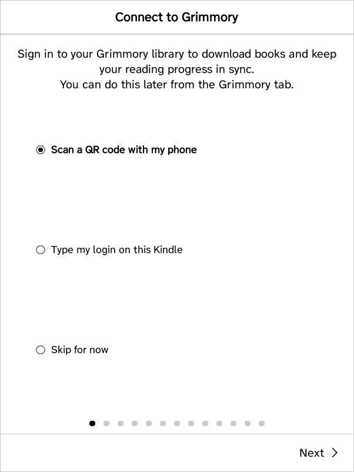<br><sub>Connect to Grimmory first</sub></td><td align="center" valign="top" width="33%"><br><sub>Sign in on your phone with the QR code</sub></td><td align="center" valign="top" width="33%">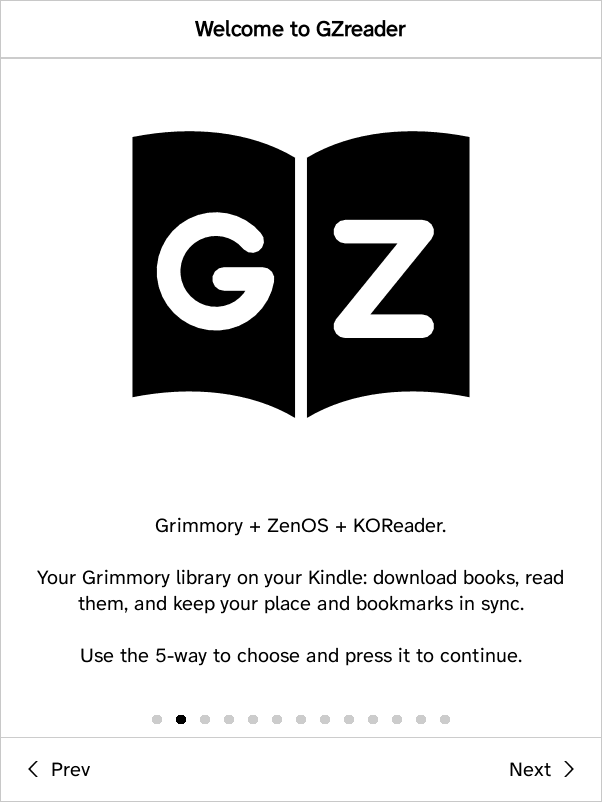<br><sub>Welcome</sub></td></tr>
<tr><td align="center" valign="top" width="33%">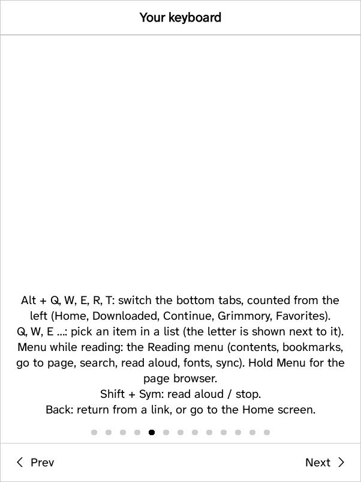<br><sub>The Kindle Keyboard's keys</sub></td><td align="center" valign="top" width="33%">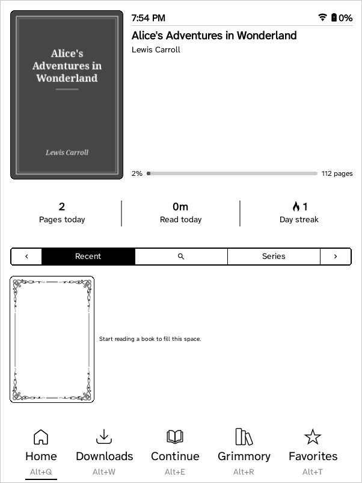<br><sub>Home: the book you're reading</sub></td><td align="center" valign="top" width="33%">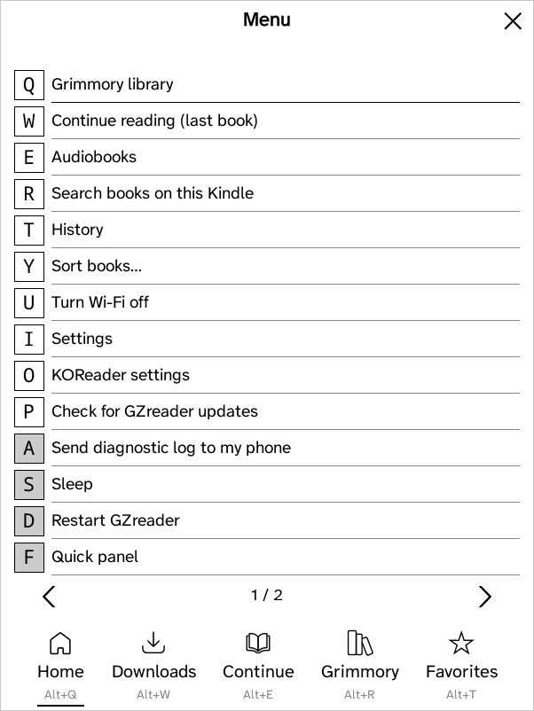<br><sub>Menu key at Home: every entry has a letter key</sub></td></tr>
</table>

### Your Grimmory library and downloads

<table>
<tr><td align="center" valign="top" width="33%">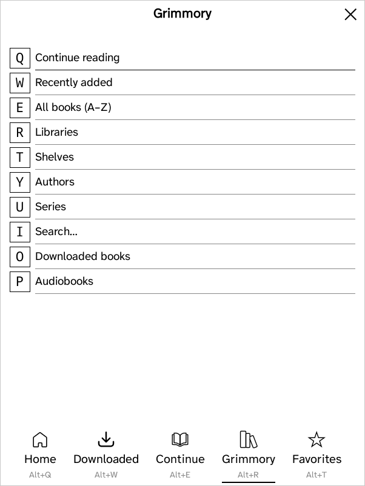<br><sub>The Grimmory tab</sub></td><td align="center" valign="top" width="33%">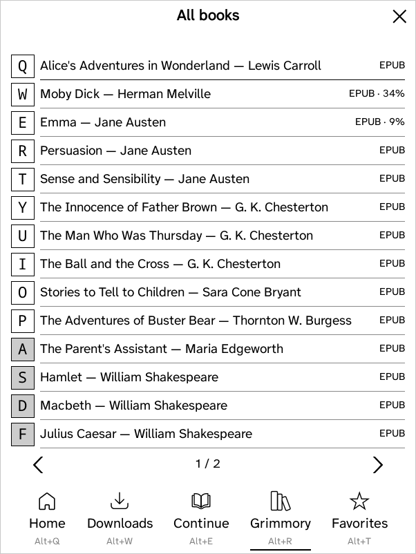<br><sub>All books, with reading progress</sub></td><td align="center" valign="top" width="33%">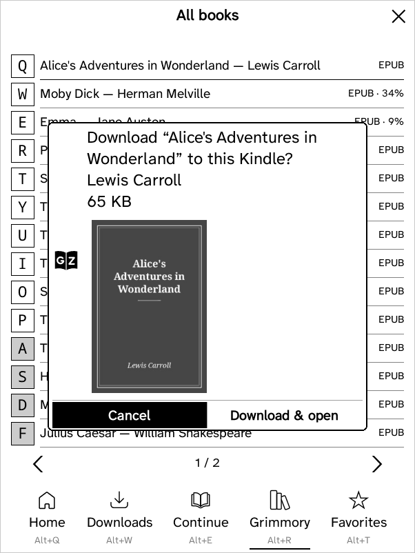<br><sub>Download and open</sub></td></tr>
<tr><td align="center" valign="top" width="33%">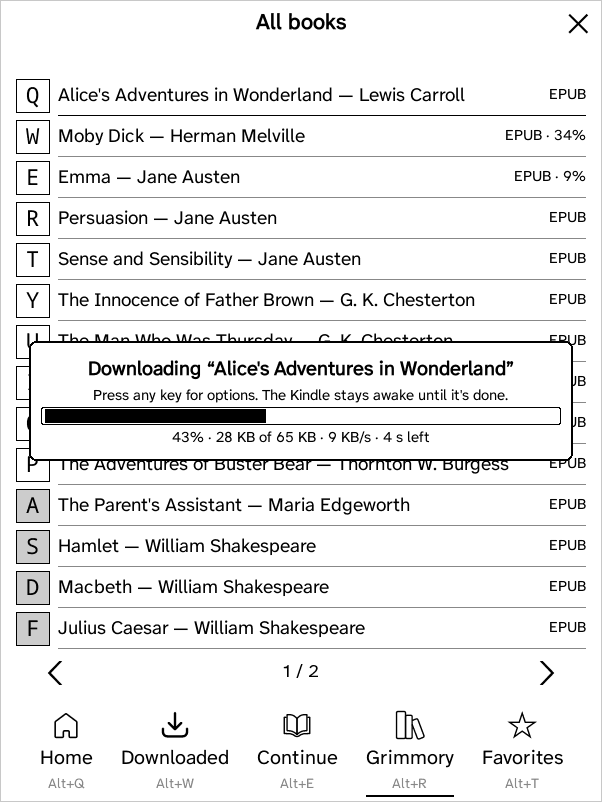<br><sub>Downloading in the background</sub></td><td align="center" valign="top" width="33%">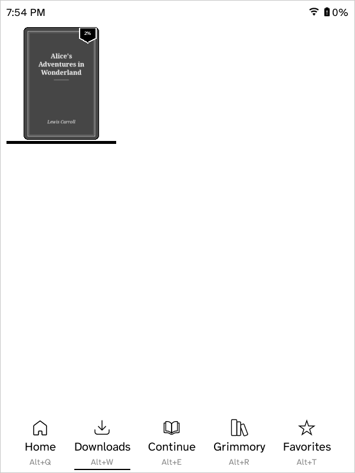<br><sub>The Downloads tab</sub></td><td align="center" valign="top" width="33%">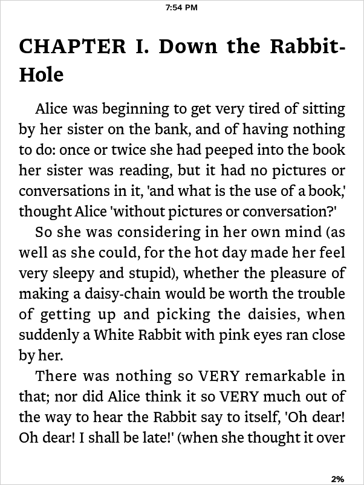<br><sub>Reading</sub></td></tr>
</table>

### Reading menu and read aloud

<table>
<tr><td align="center" valign="top" width="33%">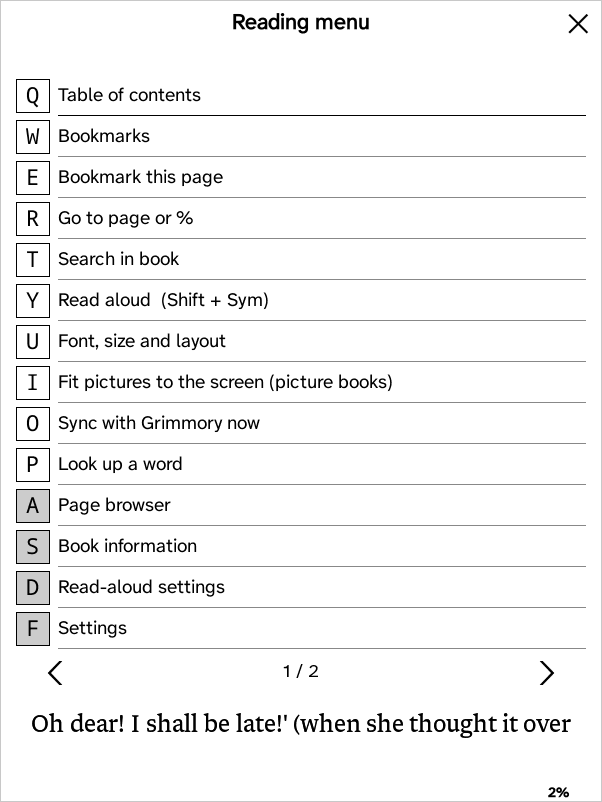<br><sub>Menu key while reading</sub></td><td align="center" valign="top" width="33%">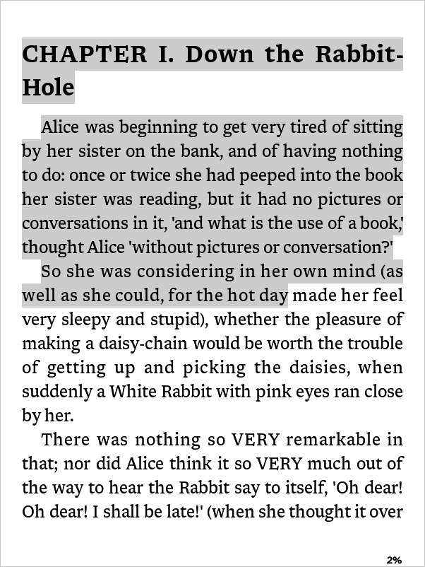<br><sub>Read aloud (Shift + Sym): the sentence being read is highlighted</sub></td></tr>
</table>

### Notes (Memos)

<table>
<tr><td align="center" valign="top" width="33%">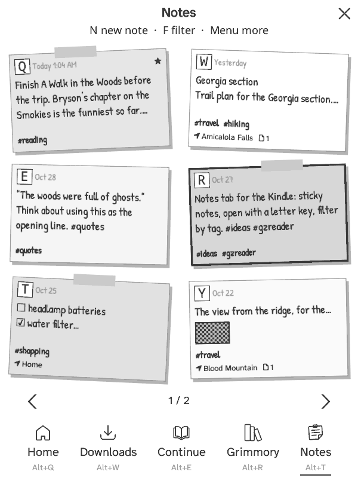<br><sub>The Notes tab: Memos notes as sticky notes</sub></td><td align="center" valign="top" width="33%">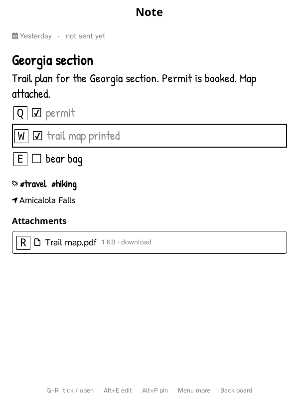<br><sub>A note: tick checklist items with their letter key</sub></td><td align="center" valign="top" width="33%">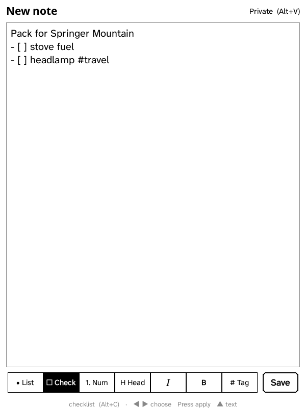<br><sub>Writing a note, with the Markdown toolbar</sub></td></tr>
</table>

## Features

### 📚 Your Grimmory library
- **Sign in with a QR code.** The Kindle shows a code, you scan it with your phone and
  sign in there (no typing passwords on the Kindle keyboard). Single sign-on (OIDC:
  Authentik, Pocket ID, Authelia, Keycloak…) works too. Only Grimmory's login tokens
  are kept, never your password.
- **Browse** Continue reading, Recently added, All books, **Libraries**, **Authors**,
  **Series** (in reading order) and Search. Audiobooks are left out.
- **Background downloads** with a progress bar; keep using the Kindle while a book
  downloads. Books go to a `GZreader` folder, shown in the **Downloads** tab.

### 🔄 Sync with Grimmory
- **Reading position** syncs with Grimmory's own progress (the web reader's), not the
  KOReader sync endpoint, to the exact page (EPUB CFI). Pick up on the Kindle where you
  left off on the web, and the other way round.
- **Bookmarks** sync both ways, deletions included.
- **Remote debugging** (optional): freezes, crashes and hard reboots are reported to
  your own feed by a small watchdog process, with what the Kindle was doing.
- **Unfinished downloads** (dead battery, sleep, crash) are offered again at the next
  start: continue where it stopped, delete, or ignore.
- **Highlights and notes** in EPUBs sync both ways with Grimmory's web reader: new
  ones, colours, notes and deletions (conversion and merge from
  [Grimmory-KOReader-Client](https://github.com/ManorianOTP/Grimmory-KOReader-Client), MIT).
- **The Grimmory tab opens instantly**, even offline or while Wi‑Fi connects: lists
  show their saved copy first and refresh in the background.
- **Shelves**, and **auto-download a shelf**: put books on a Grimmory shelf and
  they land on the Kindle by themselves.
- Syncing happens in the background: the page never waits for the network.
- **Works offline:** changes are saved on the Kindle and sent when Wi‑Fi is back.
- Reading sessions feed Grimmory's reading statistics.

### 📝 Notes (Memos)
- The **Notes tab** shows your [Memos](https://usememos.com) notes as sticky notes in
  a handwriting font, six to a page. Open one with its letter key.
- **Tick checklist items**, see pictures, tags, places and attachments (PDFs open in
  the reader). Filter by tag, date, place, attachments, pinned or text.
- **Write and edit notes** on a full-page editor with a Markdown toolbar (lists,
  checklists, headings, italic, bold, tags). New notes are private.
- Works offline: notes are kept on the Kindle and changes are sent when Wi‑Fi is back.

### 📅 Calendar (CalDAV)
- The **Calendar tab** shows your CalDAV calendars (Nextcloud, iCloud, Fastmail,
  Google, Radicale…) as an agenda, a day timeline, a week or a month.
- Works offline; Wi‑Fi only to sync. Connect with a QR code from your phone.

### ⌨️ Made for the Kindle Keyboard
- **Reading menu** on the **Menu** key: contents, bookmarks, go to page, search, read
  aloud, fonts, sync, dictionary, book info. Every entry has a letter key.
- **GZreader menu** on the **Menu** key at Home: library, continue reading,
  audiobooks, search, Wi‑Fi, settings, updates, sleep, restart — also
  with letter keys.
- **Z, X, C, V, B** switch the bottom tabs (Home, Downloads, Grimmory, Notes,
  Calendar); **Q, W, E…** and **A, S, D…** open the books and tabs on Home.
- **Back** returns from a link, otherwise goes Home (never back to the book's start).

### 🔊 Read aloud
- Uses the **Kindle's own voice**. **Shift + Sym** starts and stops, like the stock
  Kindle's Text-to-Speech.
- The sentence being read is **highlighted** and **pages turn by themselves**.
- Speed and volume controls; the Kindle's volume buttons work while reading.

### 🎧 Audiobooks (experimental)
- Browse Grimmory's **audiobooks**, download them (M4B or MP3 tracks) and listen
  through the speaker or headphones.
- **Chapters**, ±30 seconds, **sleep timer** (15/30/60 minutes or end of chapter),
  volume; playback continues while you browse.
- Listening position **syncs with Grimmory's web player**.
- Plays through the Kindle 3's own hardware MP3/AAC decoders. M4B files are
  converted on the Kindle after download (no re-encoding) so they can start
  anywhere; downloads resume after a dropped connection. **Test audio playback**
  checks which player works on your firmware.

### 🔋 Battery
- **Wi‑Fi only when needed:** turned on by itself for browsing, downloads,
  updates and syncing when a book opens or closes, and off again after a minute.

### 🌙 And more
- **Sleep screen:** the book's cover while reading, a picture from the `screensavers`
  folder on Home and in menus.
- **English dictionary** built in (Open English WordNet, 128,000 words).
- **Updates from GitHub releases**, installed from Settings → General → Updates.
  Your books, settings and progress are kept.
- **Faster on a Kindle 3:** unused plugins, fonts and translations removed, slow
  Home widgets off by default.
- **Diagnostic log** you can save and share (passwords and tokens are never written).

## Usage statistics

GZreader sends anonymous usage statistics to its developer's
[Tianji](https://tianji.dev) server, so problems on real Kindles can be found
and fixed. You choose the level in the setup guide or in
**Settings → General → Usage statistics**:

| Level | What's sent |
| --- | --- |
| **Basic** (default) | GZreader's version, the Kindle model and firmware at each start; whether the previous run ended without closing normally; downloads that worked or failed; slow operations; keys the screen didn't answer |
| **Full** | Basic, plus time on Home, Downloads, Grimmory, in books and menus; menu entries used; reading sessions (format, picture book or not, minutes, pages, pages per minute, battery use per hour); read aloud; download size, speed and resumes; sync results and Grimmory's answer times; Wi‑Fi on-time |
| **Off** | Nothing is recorded or sent |

Never sent: book titles, authors, file names, your Grimmory address or account,
or anything you type. Each Kindle is counted by a random ID, not its serial
number. Statistics wait in a small file and go out in one batch at most every 15
minutes, only while Wi‑Fi is already on; GZreader never turns Wi‑Fi on for them.

## Install

1. Jailbreak the Kindle and install **KUAL** (see [kindlemodding.org](https://kindlemodding.org)).
2. Download `gzreader-kindle-legacy-<version>.zip` from the
   [latest release](https://github.com/9retirement6irk/GZreader/releases/latest).
3. Unzip it and copy the `koreader`, `extensions` and `launchpad` folders to the root of
   the Kindle's USB drive, merging with what's there.
4. Eject, then open **KUAL → GZreader → Start GZreader**.

The setup guide starts by connecting to your Grimmory server. Later versions install
from **Settings → General → Updates**.

## Connecting to Grimmory

Open the **Grimmory** tab and choose **Connect with QR code**. For single sign-on, add
`http://<kindle-ip>:8642/oauth2-callback` as an extra redirect URI for Grimmory's client
at your identity provider; the exact address is shown on the QR page. Grimmory itself
needs no changes. Connection and sync options are in **Settings → Connections** (Grimmory, and Memos for the Notes tab);
read aloud is in **Settings → Reader**, and Wi‑Fi saving and the diagnostic log are in
**Settings → General**.

## Publishing a release

1. Bump [`GZREADER_VERSION`](GZREADER_VERSION) and add an entry to
   [`gzreader_changelog.lua`](plugins/gzreader.koplugin/gzreader_changelog.lua).
2. Create a GitHub release tagged `v<version>` and publish it.

The [release workflow](.github/workflows/gzreader-release.yml) builds and attaches the
install zip and the update package. Kindles check for new releases once a day.

To build locally:

```sh
tools/gzreader/package-kindle-legacy.sh koreader-kindle-legacy-v2026.07.1.zip out/
```

The build reuses the native binaries of the official KOReader kindle-legacy release of
the same version and overlays GZreader's Lua code, plugins and dictionary.

## What's inside

| Part | Role |
| --- | --- |
| [`plugins/gzreader.koplugin`](plugins/gzreader.koplugin) | GZreader itself: Grimmory sign-in, browser, downloads, progress, bookmark and highlight sync, Reading menu, read aloud, updater |
| [`plugins/zenos.koplugin`](plugins/zenos.koplugin) | ZenOS 4.2.0 interface, adapted for GZreader and the Kindle keyboard |
| `frontend/`, `reader.lua` | KOReader v2026.07.1 with GZreader changes (branding, keyboard, sleep screen, speed fixes) |
| [`tools/grimmory`](tools/grimmory) | Packaging, dictionary builder, release script |

## Credits and license

GZreader is built on **[KOReader](https://github.com/koreader/koreader)** (AGPL-3.0) and
**[ZenOS](https://github.com/xZenLabs/zen-os)**, and connects to
**[Grimmory](https://grimmory.org)**. The dictionary is
[Open English WordNet](https://en-word.net) (CC BY 4.0).

GZreader is free software under the [GNU Affero General Public License v3](COPYING).
KOReader's original README is kept in [README.koreader.md](README.koreader.md).
