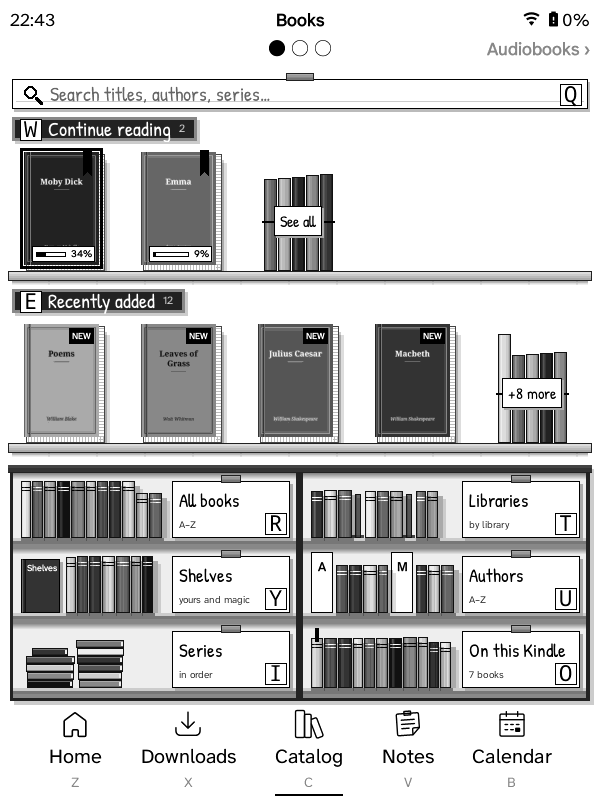
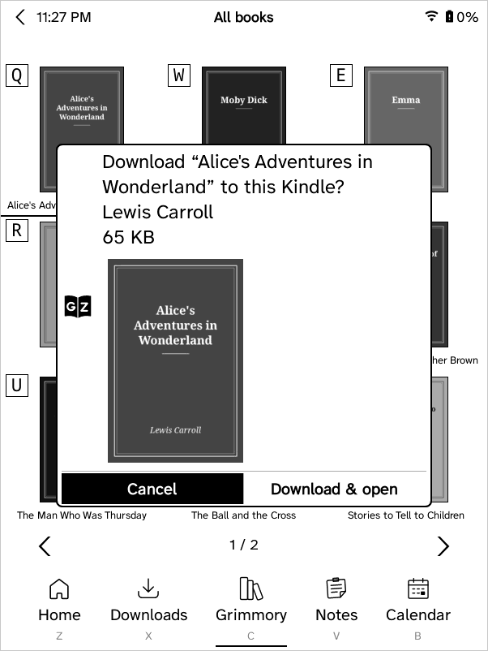

Browsing your Grimmory library on the device, and downloading books. Keeping them in sync with Grimmory: [Grimmory sync](Grimmory-Sync).

## The Catalog tab

The **Catalog** tab (called Grimmory before 1.27.x) holds what's on your
servers, in pages:

1. **Books**: your Grimmory books (below). The tab always opens here.
2. **Audiobooks**: Grimmory's audiobooks ([Audiobooks](Audiobooks-and-Read-Aloud)).
3. **Music**: your Plex music ([Music](Music)).

Audiobooks and Music are only on Kindles with a speaker or headphone jack
(Kindle 2, 3, DX, Touch); the others have the Books page alone, with no
strip under the title: the search bar sits right below it.

 

The title says which page you're on. Under it, a strip shows the page
before (‹ Books), a dot for each page with the current one filled, and the
next page (Audiobooks ›). To turn to another page:

- **Touch**: swipe left for the next page, right for the one before, or tap
  the page's name on the strip;
- **Keys**: the page-turn buttons (or the next-page arrow at the bottom of a
  list view).

The pages go round: turning back from Books goes to Music, and on from Music
to Books (the strip shows ‹ Music on Books and Books › on Music).

A page whose list is longer than one screen turns through its own screens
first. Inside a page's lists (All books, an author…) the strip is blank and
swipes turn that list's pages, as before.

Kept from the Grimmory tab: its place in the tab bar, and a name you gave
it yourself. If it was still called Grimmory, it's renamed Catalog.

**Not signed in to Grimmory?** The Catalog opens all the same: Music, and
audiobooks from Plex, don't need Grimmory. The Books page, and the
Audiobooks page when your audiobooks come from Grimmory, have empty shelves
and say **Sign in to Grimmory to browse the catalog**. Tap that line (or the
**Grimmory** card) for the ways to sign in: a QR code for your browser,
typing, or copying from another GZreader. Once you're signed in, the page
fills in. (A Kindle without Wi‑Fi signs in through the sync page.)

**The Grimmory card** fills the bottom-right compartment of the Books
page's bookcase (and the Audiobooks page's, for Grimmory's audiobooks). It
shows who you're signed in as and where, like the Plex card on the Music
page. It opens Rebuild library
and reconnecting. What's on the Kindle is in the Downloads tab.

**An Audiobooks tab** (off until you turn it on: Settings → Interface →
Navbar → Tabs → Audiobooks, or the setup guide's tab page; Kindles with a
speaker or headphone jack) opens the Catalog's Audiobooks page on its own:
its tab is underlined, and there's no strip and nothing to swipe to. The
Music tab (Settings → Interface → Navbar → Tabs → Music) stays as it was.

## Browsing Grimmory

**Search Grimmory…** (first on the Books page), Continue reading, Recently added,
All books (A–Z), **Libraries**, **Authors** (with search), **Series** (in
series order, with search). Audiobooks are left out everywhere: Authors, Series and Libraries come from a local index of the
readable books (built in the background, refreshed daily), so authors or
series with only audiobooks don't appear, and the lists open instantly.
To build it again now (books removed from Grimmory still listed, new ones
missing): **Refresh list from Grimmory** at the top of Authors or Series, or
**Settings → Connections → Grimmory → Rebuild library**, which also forgets
the saved lists below.
If Grimmory's `/app/libraries` endpoint fails (HTTP 500, a server bug seen
on some installs), the web app's library list is used instead.

Saved lists (`gzreader_listcache.lua`): the first page of every list fetched
(Continue reading, Recently added, All books, a library, shelf, author or
series, the library and shelf lists, Audiobooks) is kept on the Kindle, per
server and account (`cache/grimmory-lists`, newest 60). The Catalog tab
opens at once, without waiting for Wi‑Fi; a list with a saved copy appears
straight away (its title ends in "· saved"), Wi‑Fi comes up quietly in the
background, and the fresh list replaces it in place (same page) when it
arrives, unless you've moved on. With no Wi‑Fi the saved copies are what you
get. "Load more" and Search always ask Grimmory.

The 5-way's selection stays on the book (or card) you moved to when the page
is drawn again: when the fresh copy of a list or the first page's Continue
reading / Recently added arrive, when covers come in, and after Download on a
book's page. (Before, each of these put it back on the first book.) A book's
page shows the same cover as the list; one not on the Kindle yet is fetched
into the same cache.

Search looks for the words in a book's title, series or authors (Grimmory's
book list with `search=`, readable formats only, A–Z, paged like All books).
All books has "Search Grimmory…" at the top; a library, shelf or author's
books have "Search in <name>…", which searches only there. Older Grimmory
servers whose book list ignores `search=` get their own search endpoint
instead (the whole library, newest first).

A search that finds nothing says "No books found containing “…”" with what
you searched for. In the Bookshelf view it's the same shelves a search's books
stand on, empty, with cobwebs on them and the message on a card; "Search
again…" stays at the top, with what you typed already filled in.

Big libraries: a book list keeps at most 8 pages (200 books) of Grimmory's
results. "Load more" past that lets the earliest page go, and "Earlier books"
at the top brings it back. Each book keeps only the dozen fields GZreader
uses (Grimmory sends about forty). Covers shown on the page being drawn are
never freed (1.12.2 and older could free one still on screen).

The Catalog tab is part of ZenOS's tab bar while it's open: the bar stays
at the bottom with the Catalog tab underlined, and the title shows ZenOS's
status bar (clock, battery, Wi‑Fi, downloads) with the list's name and, in
a sub-list, a back arrow.

## Home folder and downloads

The GZreader folder (`GZreader` at the top of the Kindle's drive, `/mnt/us/GZreader`) is the home folder; the
**Downloads** tab shows it. It can't be changed: Settings → Home → Folders has no Home folder
menu and KOReader's menus have no Home folder settings or "Set as HOME folder", since GZreader relies on it (it's set back to the GZreader folder at every start). Books sent from your browser (quick panel → Send
books) go there too. Books download in a background process with a
progress bar (percentage, MB received of the total; the Kindle stays awake
until it's done). Picking more books while one downloads queues them; they
download one after another (lists show "queued"; the download options can
empty the queue) (press any key for Stop / Continue in background / Keep
watching); a transfer that stalls for 90 s is stopped.

A backup list of downloaded books (`.gzreader-library.json`) is kept in the
GZreader folder. If KOReader's settings are lost (for example the `koreader`
folder was replaced), the books are re-linked to Grimmory from it, or by file
name from the library index, so progress sync and "on Kindle" marks keep
working.

## Downloads screen and title bar

While anything downloads, **Downloads (N)** is a tile in the quick panel's
Home tiles (`gzreader_tasks.lua`). It lists the current book download, the
queue, audiobook downloads and the audiobook preparing step, one row each:
an icon for what's happening (downloading, preparing, a clock while
waiting), the title, and on the right where it's at (*38% of 77.0 MB*,
*waiting*). Select a row to reopen its progress bar, stop the download or
take a book out of the queue; the last row empties the queue. While it's open its percentages are kept current every 5 s: only the
lines that changed are refreshed on the screen, on the page you're on (the
whole list is redrawn when a download finishes or one is added). ZenOS's
status bar gets a `gz_downloads` item next to the clock
(added once; movable/removable in its settings): a download icon with the
percentage and the number waiting, refreshed every 3 s while active (only
that item is refreshed on the screen, without a flash).

While a book downloads, the Grimmory tab still comes first: when it (or
anything else) asks Grimmory for something, a book's details and cover say,
the download waits until that's answered (its process is paused; 20 s at
most each time) and then carries on. On a Kindle 3 a download took the Wi‑Fi
and the processor, and the tab's requests timed out. The log says how long
each download waited (`download book=… waited … s`).

## Unfinished downloads

Every book download (running or queued) and every audiobook download and
"preparing the audio" is noted when it starts and crossed off when it ends
(`gzreader_recovery.lua`). If GZreader stops in between (battery ran out,
the Kindle slept or restarted, a crash), it asks about each one a few
seconds after the next start: **Continue** (books continue from the part
already downloaded with an HTTP Range request; audiobooks continue
downloading their tracks and preparing the ones not yet converted, after
stopping any conversion still running from before), **Delete** (removes
the part) or **Ignore** (stops asking, keeps the part: downloading it again
later still continues from there). A stalled download now also keeps its
part. Stopping a download yourself, taking it out of the queue, or a "not
found" from Grimmory clears it.

## The first open of a new book

The first time a big book is opened, the Kindle lays the whole book out
(10–30 s on a Kindle 3) and keeps the result for the next opens. While the
Kindle charges and Home is on screen, GZreader does that in the background
for downloaded books you haven't opened yet, one at a time and at the lowest
priority, so their first open is as quick as any other (Settings → Reader →
**Lay out new books while charging**, on by default; not on the Kindle 2 and
DX, which don't have the memory for it). It waits while books download,
stops as soon as you unplug the Kindle, open a book or start a download, and
the books don't show as opened or read.

## Shelves and auto-download

Catalog tab → Books → **Shelves** lists your shelves and smart (magic) shelves.
Settings → Connections → Grimmory → **Auto-download shelf** picks one: books on it that
aren't on the Kindle download in the background through the download queue
when Wi-Fi connects (at most every 30 minutes) and with "Download new books
from the shelf now". Books taken off the shelf stay on the Kindle. (Idea from
krisboho/connecto-library's Shelf Sync.)

## Putting a book on a shelf

The book menu (quick panel → **Manage “book”** for the highlighted book, or
hold a book on a touch Kindle) has **Add to shelf** where ZenOS had Add to
collection; so does the menu for several selected books (Select). GZreader
has no Add to collection anywhere.

- **Add to shelf** lists your own Grimmory shelves by name; the ones the
  book is already on are ticked and greyed out. Pick one and the book is on
  it ("Added to “Kindle”.").
- **Remove from shelf** appears when the book is on one of your shelves and
  takes it off straight away. On several, it's **Remove from shelves**,
  which asks which one, or **All** of them.
- Only your own regular shelves: smart (magic) shelves fill themselves from
  their rules, and Grimmory doesn't let you put books on someone else's
  public shelf. Make new shelves in Grimmory's web app.
- Not signed in to Grimmory: Add to shelf is there and says to sign in
  first. A book not from Grimmory (copied onto the Kindle another way) can't
  go on a Grimmory shelf, and Add to shelf says so.

**Your shelves are kept on the Kindle**: every one of your shelves and every
book on it, also books that aren't on the Kindle, so the menus work without
a network and show at once.

- **With Wi‑Fi**, a change goes to Grimmory straight away. Without a
  connection it waits on the Kindle (the menus already show it) and goes
  when Wi‑Fi connects. The shelves are read again from Grimmory when Wi‑Fi
  connects (at most every 30 minutes) and after each change, and a book's
  shelves whenever it opens, so changes made in Grimmory's web app show up
  on the Kindle.
- **Kindle 2 and DX** (and any Kindle set to sync through a computer): a
  change waits on the Kindle and the [sync page](Sync-with-a-Computer) sends
  it to Grimmory at the next sync, then brings your shelves back with the
  library copy, with changes made in Grimmory since.
- Only the shelves you changed are sent, so a change made meanwhile in the
  web app to another shelf stays.

## Book covers when downloading

Picking a book in the Grimmory browser asks whether to download it and shows
Grimmory's cover thumbnail (250 x 350, `/api/v1/media/book/<id>/thumbnail`),
fetched in the background and kept in `koreader/cache/gzreader-thumbs/`
(renewed when the cover changes in Grimmory). The Grimmory lists and a
book's page use `cache/gzreader-covers/`.

## Subtitles

Grimmory's subtitle is added to the title ("Diary of a Wimpy Kid: Old
School") in the Grimmory lists and, for downloaded books, as KOReader custom
metadata (`.sdr/custom_metadata.lua`, like Book information → edit title),
so Home, Downloads, history and the reader show it. The app API's lists have
no subtitles, so they come from the library index (Grimmory's web book list,
`/api/v1/books/page`) and from the book itself after a download. Titles you
edited yourself are left alone.
