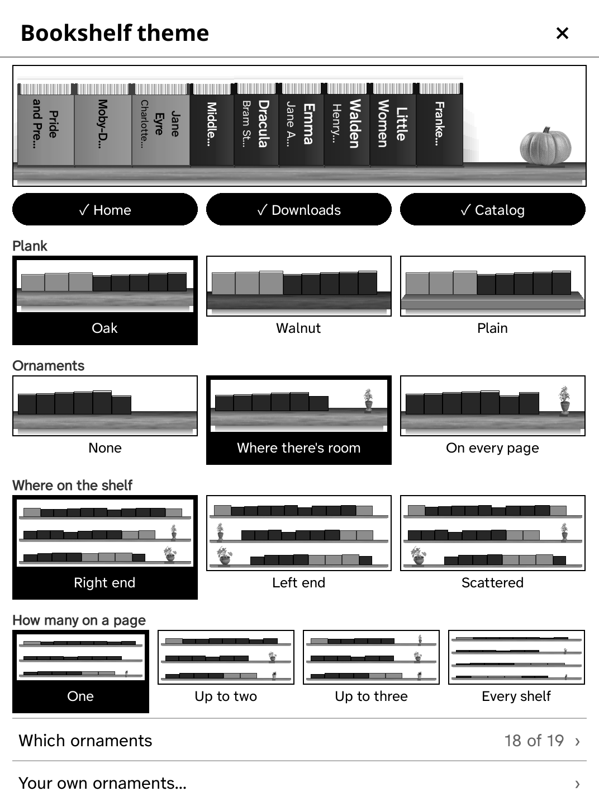
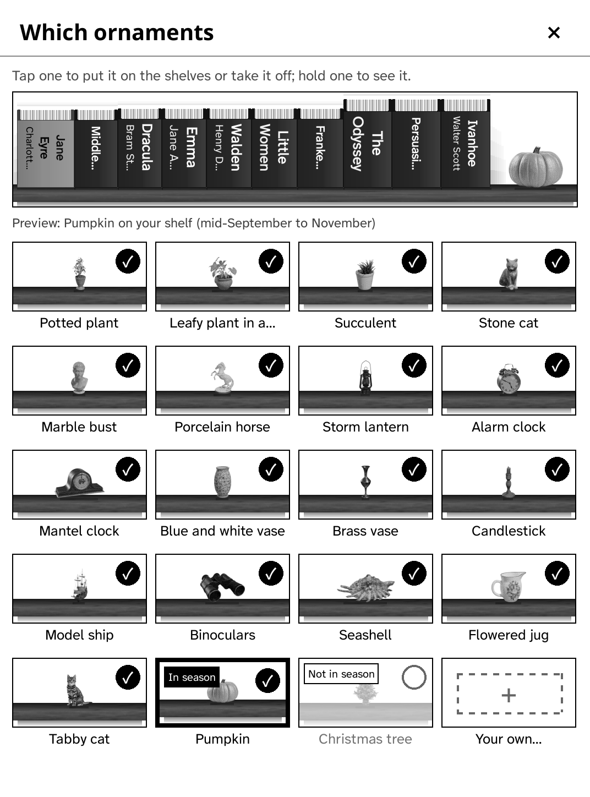
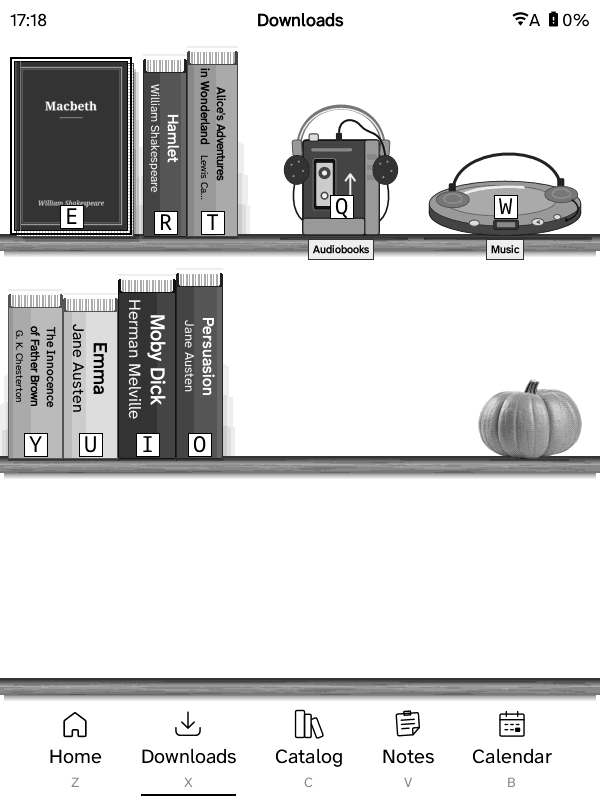

Home, the Downloads tab's bookshelves, the reading stats on Home and the sleep screen.

## Bookshelves (the View)

Books stand on bookshelves by default, on Home and in Downloads: spines out
(title, author, number in a series, a letter key at the foot), rounded and
shaded, casting shadows, on shelves with depth. The book the 5-way is on, or
that you tap, turns to show its cover; tap it again, Press or its letter opens
it, and holding it opens Manage book (Open, Delete from this Kindle, then
the book's menu). The book you're reading (top of Home) is
drawn as a book too: its pages behind the cover and a drop shadow.
Covers have square corners in this view: Settings → Home and tabs → Downloads tab → Appearance →
Covers → Rounded cover corners is greyed out while it's on, and your choice
for the tiles and lists comes back when you switch to one of them.

Home's status bar (clock, Wi‑Fi, battery) sits beside the book you're
reading. Before you've read a book (or after clearing your reading history),
it runs across the top of Home as on the other tabs, and moves back beside
the book once you open one.

- **Downloads** has as many shelves as the screen holds, a page at a time
  (on the DX four, so the books are bigger), each filled with as many books
  as their spines leave room for. On a Kindle with a keyboard the letter keys
  go from Q to L (19 books); the books after L on a page have no letter (the
  5-way reaches them), and Del isn't one of them. Folders stand as light grey
  spines with a tab on top. A book that finishes downloading while
  Downloads is on screen appears in it straight away. Its title bar says
  *Downloads* between the clock and the battery, as the other tabs name
  themselves (or the tab's own name, if you renamed it in Settings → Home and tabs → Tab bar); inside a folder it shows the folder's name.
- **Home** has one shelf of your most recent books; the DX and the Kindle
  Scribe (any screen more than 5 inches across) have two (the first filled
  before the second). On the Scribe, the Downloads tab has four shelves a
  page, as tall as Home's two and level with them, so the books are the same
  size on both.
- **The spines** are drawn after
  [Bookshelf](https://github.com/AndyHazz/bookshelf.koplugin), AndyHazz's
  KOReader plugin: the shelf is seen from a little above, so each book shows
  the top of its page block between its boards. The whole title runs along the
  spine: a long one takes two or three lines of smaller type instead of
  being cut off. The author comes after it in smaller type, or on a line of
  its own where there's no room after the title.
  A book's number in its series is level at the foot of the spine. The books
  cast a soft shadow on the wall behind them, and the board shows its top.

- **Theme and ornaments** (Settings → Home and tabs → Downloads tab → Appearance → **Bookshelf
  theme**), for Home's shelf, Downloads and the Catalog's ledges:
  - the plank: **Oak** (to begin with; Bookshelf's oak plank, in greys),
    **Walnut** (darker) or **Plain** (flat greys);
  - ornaments, standing on a shelf's free end like a plant on a half-empty
    shelf: **where there's room** (to begin with: no book moves for them, so
    a full shelf has none), **on every page** (the shelves that get one keep
    room for it, so a page holds a book or two fewer), or **none**;
  - **where and how many**:
    - *On Home*, *In Downloads*, *In the Catalog*: untick one to have no
      ornaments there (only on Home, say);
    - *One on a page* (to begin with), *Up to two*, *Up to three*, or *One
      on every shelf*. A page's lowest shelves with books get them. Two or
      three on a page are different ones. In Downloads the top shelf has
      none while the walkman (Audiobooks) or the CD player (Music) stands
      on it;
    - *At the right end of the shelf* (to begin with), *At the left end*
      (the books start after it), or *Scattered*: the first on the right,
      the next on the left, then the right again. In the Catalog an ornament
      stands in a ledge's free place, on the right, whatever this says;
  - **which ornaments**: seventeen photorealistic ones stand all year:
    pictures of [Poly Haven](https://polyhaven.com)'s CC0 objects (three
    potted plants, a stone cat, a marble bust, a porcelain horse, an alarm
    clock and a mantel clock, two vases, a storm lantern, a candlestick, a
    model ship, binoculars, a seashell, a flowered jug) and a tabby cat.
    Two seasonal ones stand in their season and then take about two places
    of three: a **Christmas tree** (20 November to 6 January) and a pumpkin
    (mid-September to November). Each stands level on its base, flush
    with the plank (your own pictures stand as you made them: crop them
    with the base level). **Which
    ornaments** has a tick for each: tick a seasonal one to have it all
    year, untick any to never see it; *Seasonal ones in their season again*
    undoes that. It's a grid of the ornaments, each standing on a piece of
    plank: a tick for those on the shelves, the others faded, and a
    seasonal one tagged *In season* or *Not in season*. A tap puts one on
    the shelves or takes it off; a hold only shows it, on your shelf at the
    top (the one shown has a thick frame). The page keys turn its pages when
    your own ornaments make more than fit;
  - **on a colour screen** (the Colorsoft and Scribe Colorsoft) the
    ornaments are in colour, your own too, and so are the walkman and the CD
    player (a red walkman with orange headphones, a blue CD player with
    yellow ones). Grey screens show them in greys;
  - **your own ornaments**: connect the Kindle to a computer and put PNG or
    SVG pictures in `GZreader/app/settings/gzreader/ornaments` (Settings shows
    the folder and makes it). A picture's bottom edge stands on the plank;
    keep its background transparent. Bold, dark shapes read best on e-ink.
    A shaded picture should be a PNG: the Kindle draws an SVG's gradients
    far too dark (flat colours in an SVG are fine).
  - **the screen**: each choice is a tile with a small picture of what it
    does, and a preview of your shelf (your recent books' spines) at the
    top shows the result as you choose; the shelves themselves are drawn
    again when you close it. Chips under the preview turn the ornaments on
    or off on **Home**, in **Downloads** and in the **Catalog**. On a Kindle
    with keys the 5-way moves between the tiles and Press chooses;
  - **Hold an ornament** (on Home, in Downloads or in the Catalog, on a
    touch Kindle) to open this screen straight away, as holding a Home
    widget opens its settings. Back (or the ×) returns to the shelves.

   

- **Audiobooks** stand on the top shelf to the right of the books as a
  cassette walkman with its headphones sitting on it, and **Music** (downloaded from Plex) as a
  CD player with headphones. In lists and tiles both folders are always first,
  whatever the sort.
- **Inside Audiobooks and Music** each audiobook is a cassette and each album
  or playlist a CD, always facing out with its cover showing, and its name on
  a little plate on the shelf under it. A tap (or Press, or its letter) opens
  it straight away; the one the 5-way is on has a frame around it.
- **Sort** (quick panel → Sort) orders Downloads and Home's shelf: title,
  author, series, date downloaded, reading progress, size or file name;
  *Last read* puts the most recent first.
- **View** (quick panel → View) switches between Bookshelf, List with details,
  Simple list and Tiles; Home's strip shows covers in the other views. The
  setup guide asks too.

## Recently read on every device

Home's current book and its Recent strip normally show what you've read on this
Kindle. With **Recently read on every device** turned on, they also show the
books and audiobooks you're in the middle of on your other devices, from
Grimmory or BookOrbit, newest first: also the ones that aren't on this Kindle.

- **Turn it on:** Settings → Home and tabs → Home → Widgets → Featured book (or
  Book strip) → *Recently read on every device*. It's one setting for both,
  and it's off until you choose it. It's listed when that widget's content is
  *Recently read*.
- **A book that isn't on this Kindle** has a small arrow in the corner of its
  cover. A tap shows its page, with *Download* and *Download & open*.
- **Audiobooks show as cassettes**, the ones on the Kindle too. On the
  bookshelf a cassette stands on its side among the books; picked, it turns to
  face out, as a book shows its cover. One that isn't on the Kindle has the
  arrow; a tap asks to download it.
- **A book that is on this Kindle** keeps its place in the list, and moves up
  when you read it later somewhere else.
- **The current book** is the most recent of them all, so it can be one that
  isn't here yet.
- The list is what the server calls in progress: started and not finished.
  It's fetched when Wi-Fi is already on (Wi-Fi isn't turned on for it), at most
  every ten minutes, and kept, so Home shows the last list when you're offline.
- **BookOrbit:** books come with the e-reader sign-in; audiobooks need the
  [API key](BookOrbit#the-api-key-what-to-tick).

## Reading stats on Home

Home shows **Reading stats (every device)** by default: three numbers on a notebook
page, counted by your book server over every device that reads with your account
(each Kindle and the server's web reader send their reading; the server adds
it up). The numbers come from Grimmory or from BookOrbit, whichever this Kindle
is signed in to. Choose the three in Settings → Home and tabs → Home →
Widgets → Reading stats (every device) → Stat slot 1–3.

With Grimmory:

- Read this week (time), Books this week
- Day streak (as tally marks up to 10), Longest streak, Days read
- Sessions this month, Finished this year

With BookOrbit:

- Read today, Read this week, Read this month, Read this year (time)
- Day streak, Longest streak, Days read this year
- Finished this year, Reading goal (books finished of your goal), Badges (earned of all)
- Books in the library, Reading now

A slot set to a number the other server doesn't have shows Read this week
after you switch servers.

**Tap the widget** for the reading stats page (on a Kindle with keys: Catalog →
the Grimmory or BookOrbit card → Reading stats). With BookOrbit it shows the
last seven days as bars, the past year as a grid of days (darker for more
reading), your reading goal and next badge as progress bars, the book you were
reading a year ago, this year's finished books and the highlight of the day.
With Grimmory: this week's books as bars, the month as a calendar of days read,
and books finished by month. As much as fits the screen is shown. Tap or
press a key to close.

They're fetched from the server when Home shows them and they're over 15
minutes old (only while Wi‑Fi is on), and again after this Kindle's reading
sessions reach Grimmory; the last ones stay for when it's offline. Your
Grimmory user needs permission to see statistics (Grimmory → user settings →
permissions); without it the widget shows dashes and the diagnostic log says
why.

On a colour Kindle (Colorsoft, Scribe Colorsoft) the notebook page is an
exercise book's: blue lines, a red margin, the numbers and tally marks in
blue ballpoint and yellow tape at the top. The Reading goals widget's bars
are green there (a deeper green once a goal is reached).

The earlier **Local reading stats** widget (pages and time today, this
Kindle only) is gone from Home and from Settings → Home and tabs → Home → Widgets; a Home that
still showed it keeps its other widgets.

The book you're reading shows its progress as the book's page edges, read
pages darker, with a ribbon bookmark where you are.

## The daily paper on Home

A folded **newspaper** can stand on Home's bookshelf beside your books, on its
side as they are: the day's headlines from the news feeds you choose, fetched
once a day. Picked, it shows its front page; another tap opens it, laid out
as a newspaper. It's off until you turn it on in **Settings → Home →
Daily paper**. → [Daily paper](Daily-Paper)

## Sleep screen

While a book is open: its cover. From Home and menus: a random picture from
the USB drive's `screensavers` folder (created by the setup guide), falling
back to the Kindle's own sleep pictures. Chosen in the setup guide, or in
**Settings → Sleep and wallpaper → Sleep → Wallpaper**: each sleep screen is a tile
showing what it looks like (this one, the last book's cover, a picture from
the screensavers folder, reading progress, book status, or the screen left
as it is); tap one, or press its letter on a Kindle with keys. The cover's
fill, rotation and fit, when to ignore a book's cover and the wake-up delay
are in **Wallpaper options** next to it. (There is no custom image to
choose, and no sleep-screen presets.)

To have the cover fill the whole screen with no bars at the edges, tick
**Wallpaper options → Border fill, rotation, and fit → Scale cover to fill
screen**: the cover (or picture) keeps its proportions and is scaled up until
it covers the screen; the parts that don't fit (the top and bottom of a tall
cover, the sides of a wide one) are cut off. While it's on, **Stretch cover
to fit screen** just above it, which pulls the cover out of shape instead, is
greyed out.

On a colour Kindle (Colorsoft, Scribe Colorsoft) the cover is shown in colour,
and so are the pictures you add: the sync page and the setup page make them in
colour for a colour Kindle (in grey for the others, which keeps them small).

### Pictures from Immich

With an [Immich](https://immich.app) album you can have your own photos on
the sleep screen and as the Home wallpaper. Set it up in **Settings → Accounts and services → Photos** (or on the [setup page](Setup-Page-and-Connections#immich)
in your phone's browser; Kindles without Wi‑Fi on the
[sync page](Sync-with-a-Computer)):

- **Connect**: your Immich address and an API key (Immich → your picture
  → Account Settings → API Keys → New API Key, with at least `album.read`,
  `asset.read` and `asset.view`, or all permissions; add `user.read` to see
  your name in GZreader's Immich settings). Pasting an album's
  address from your browser chooses that album too. The key is kept like the
  other sign-ins and never written to the log.
- **Album**: which album's pictures to use (yours and the ones shared with
  you; photos only, no videos).
- **Sleep screen**: *Book cover while reading, an Immich picture elsewhere*,
  or *An Immich picture, always*. These are also two more tiles in
  **Settings → Sleep and wallpaper → Sleep → Wallpaper** once an album is chosen. With no
  pictures yet, the screensavers folder's show.
- **Home wallpaper**: a picture from the album behind Home and the tabs
  (the same as **Settings → Sleep and wallpaper → Home background → Picture from Immich**).
  Turning it off puts back the wallpaper you had before; choosing an image
  by hand there turns it off.
- **Pictures kept on the Kindle**: 10, 20 or 50. They're made to fit the
  screen, in grey (in colour on a Colorsoft or Scribe Colorsoft), and kept
  on the Kindle (`gzreader-immich/` in GZreader's app folder), so they show
  without Wi‑Fi.
- **Get new pictures now**. Otherwise, whenever Wi‑Fi comes on and the last
  time was over 6 hours ago, about half of them are swapped for others from
  the album (all of them when the album changed), and the wallpaper changes
  to another one.
- **Disconnect**: the pictures are removed, the sleep screen goes back to the
  screensavers folder and the wallpaper to what it was.
- The same connection also lets you put **photos in a note or a drawing**
  (Notes: **+ Photos** in the editor, **Picture from Immich…** in a
  drawing's ⋮), when your Memos server doesn't have an Immich connection of
  its own. See [Notes](Notes).

### Immich from the sync page

The sync page runs in your browser on GitHub's site, and Immich only answers
web pages from other sites when it's told to: without that the page says
*Couldn't reach Immich from this page*. If Immich is behind a reverse proxy
(it has to be on `https://` for the page anyway), add these headers there for
the page's address. Caddy:

    photos.example.com {
        @gzsync header Origin https://9retirement6irk.github.io
        header @gzsync Access-Control-Allow-Origin "https://9retirement6irk.github.io"
        header @gzsync Access-Control-Allow-Headers "x-api-key, content-type"
        header @gzsync Access-Control-Allow-Methods "GET, POST, OPTIONS"
        @gzsync_preflight {
            method OPTIONS
            header Origin https://9retirement6irk.github.io
        }
        respond @gzsync_preflight 204
        reverse_proxy immich-server:2283
    }

nginx: a `map` next to the `server` block, and four lines in the `location`
that passes requests on to Immich:

    map $http_origin $gzsync_origin {
        default "";
        "https://9retirement6irk.github.io" $http_origin;
    }
    server {
        …
        location / {
            add_header Access-Control-Allow-Origin $gzsync_origin always;
            add_header Access-Control-Allow-Headers "x-api-key, content-type" always;
            add_header Access-Control-Allow-Methods "GET, POST, OPTIONS" always;
            if ($request_method = OPTIONS) { return 204; }
            proxy_pass http://immich-server:2283;
            …
        }
    }

(nginx then ignores `add_header` lines of the `server` block in that
location: repeat any you have there.) Only that one site is let in, and it
still needs your API key for everything.
Wi‑Fi Kindles don't need any of this: they ask Immich themselves.
