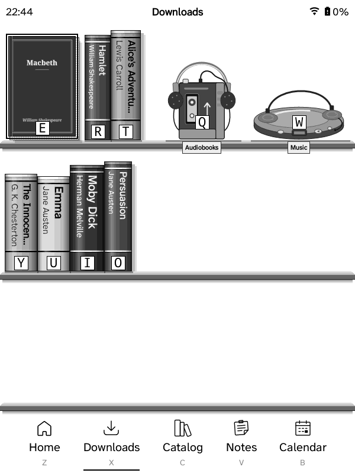

Home, the Downloads tab's bookshelves, the reading stats on Home and the sleep screen.

## Bookshelves (the View)

Books stand on bookshelves by default, on Home and in Downloads: spines out
(title, author, number in a series, a letter key at the foot), rounded and
shaded, casting shadows, on shelves with depth. The book the 5-way is on, or
that you tap, turns to show its cover; tap it again, Press or its letter opens
it, and holding it opens its menu. The book you're reading (top of Home) is
drawn as a book too: its pages behind the cover and a drop shadow.

Home's status bar (clock, Wi‑Fi, battery) sits beside the book you're
reading. Before you've read a book (or after clearing your reading history),
it runs across the top of Home as on the other tabs, and moves back beside
the book once you open one.

- **Downloads** has as many shelves as the screen holds, a page at a time
  (on the DX four, so the books are bigger). Folders stand as light grey
  spines with a tab on top. A book that finishes downloading while
  Downloads is on screen appears in it straight away.
- **Home** has one shelf of your most recent books; the DX's taller screen
  has two (the first filled before the second).
- **Audiobooks** stand on the top shelf to the right of the books as a
  cassette walkman with headphones, and **Music** (downloaded from Plex) as a
  CD player with headphones. In lists and tiles both folders are always first,
  whatever the sort.
- **Sort** (quick panel → Sort) orders Downloads and Home's shelf: title,
  author, series, date downloaded, reading progress, size or file name;
  *Last read* puts the most recent first.
- **View** (quick panel → View) switches between Bookshelf, List with details,
  Simple list and Tiles; Home's strip shows covers in the other views. The
  setup guide asks too.

## Reading stats on Home

Home shows **Grimmory reading stats** by default: three numbers on a notebook
page, counted over every device that reads with your Grimmory account
(GZreader on each Kindle and Grimmory's web reader send their reading
sessions; Grimmory adds them up). Choose the three in Settings → Home →
Widgets → Grimmory reading stats → Stat slot 1–3:

- Read this week (time), Books this week
- Day streak (as tally marks up to 10), Longest streak, Days read
- Sessions this month, Finished this year

They're fetched from Grimmory when Home shows them and they're over 15
minutes old (only while Wi‑Fi is on), and again after this Kindle's reading
sessions reach Grimmory; the last ones stay for when it's offline. Your
Grimmory user needs permission to see statistics (Grimmory → user settings →
permissions); without it the widget shows dashes and the diagnostic log says
why.

**Local reading stats** (the earlier widget: pages and time today, this
Kindle only) is still there: turn it on in Settings → Home → Widgets, and the
Grimmory one off, to go back.

The book you're reading shows its progress as the book's page edges, read
pages darker, with a ribbon bookmark where you are.

## Sleep screen

While a book is open: its cover. From Home and menus: a random picture from
the USB drive's `screensavers` folder (created by the setup guide), falling
back to the Kindle's own sleep pictures. Chosen in the setup guide; picking
another option there, choosing a wallpaper in the sleep-screen menu, or
applying a ZenOS sleep-screen preset switches it off and uses that choice.

"Show custom image (book cover while reading)" (KOReader's "custom image or
cover"): the chosen image from Home and menus, the open book's cover while
reading. In KOReader it showed the custom image everywhere.
