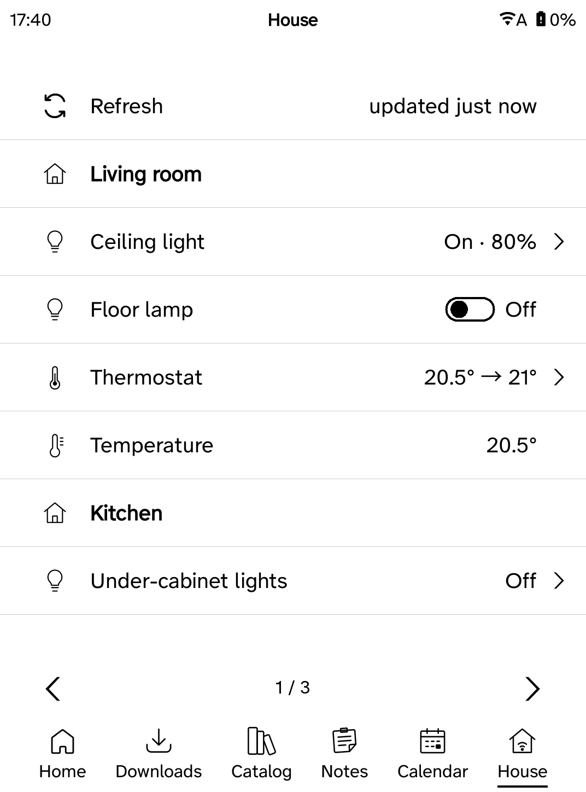
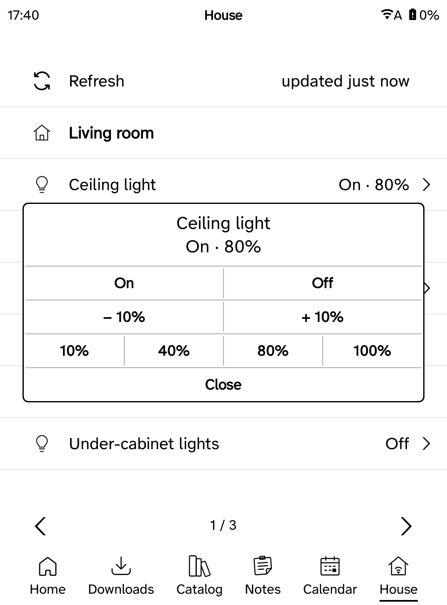
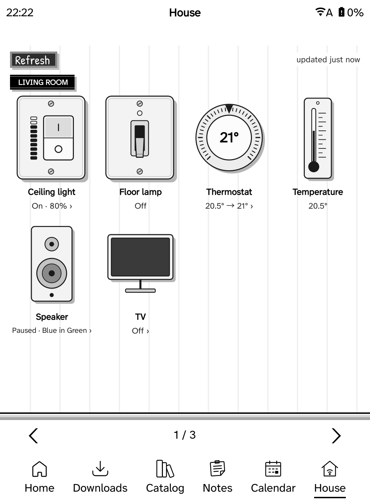
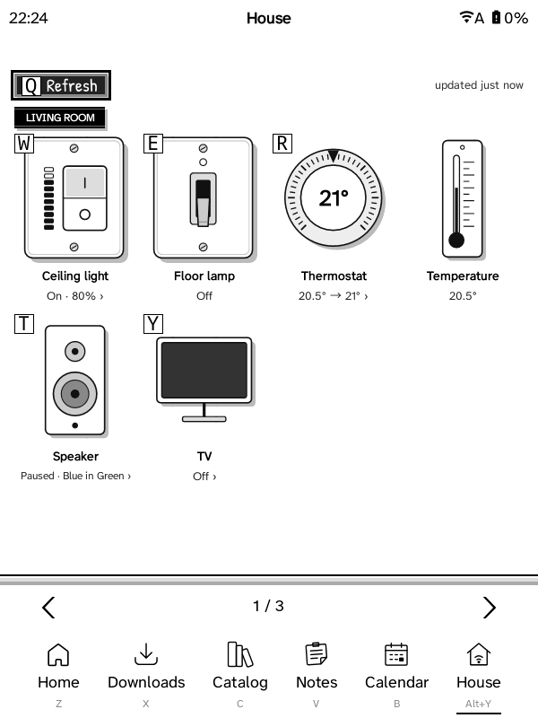
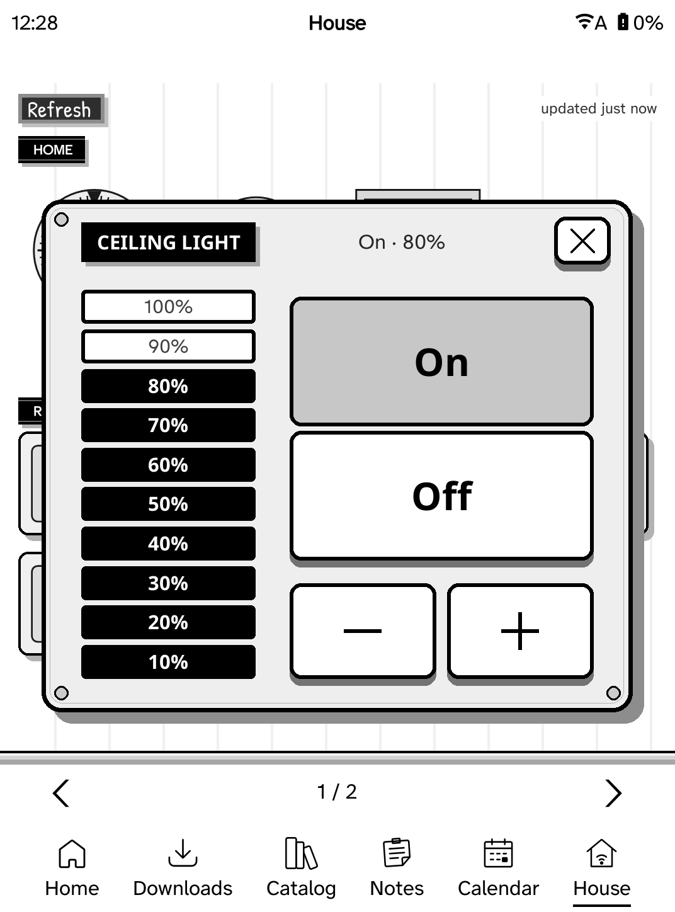
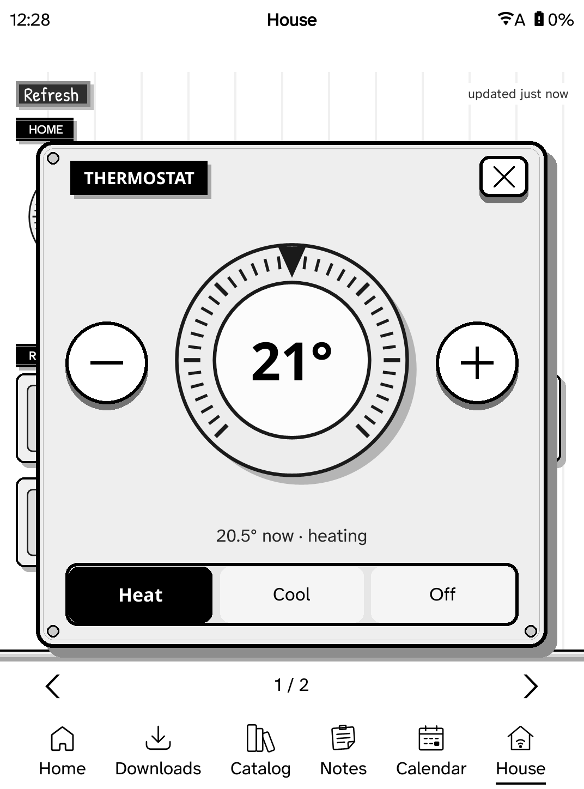
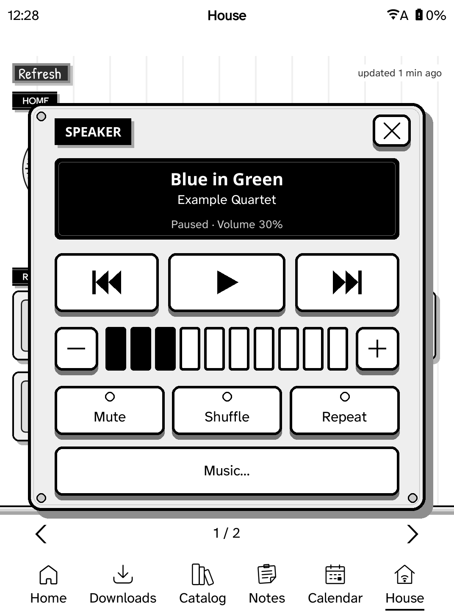
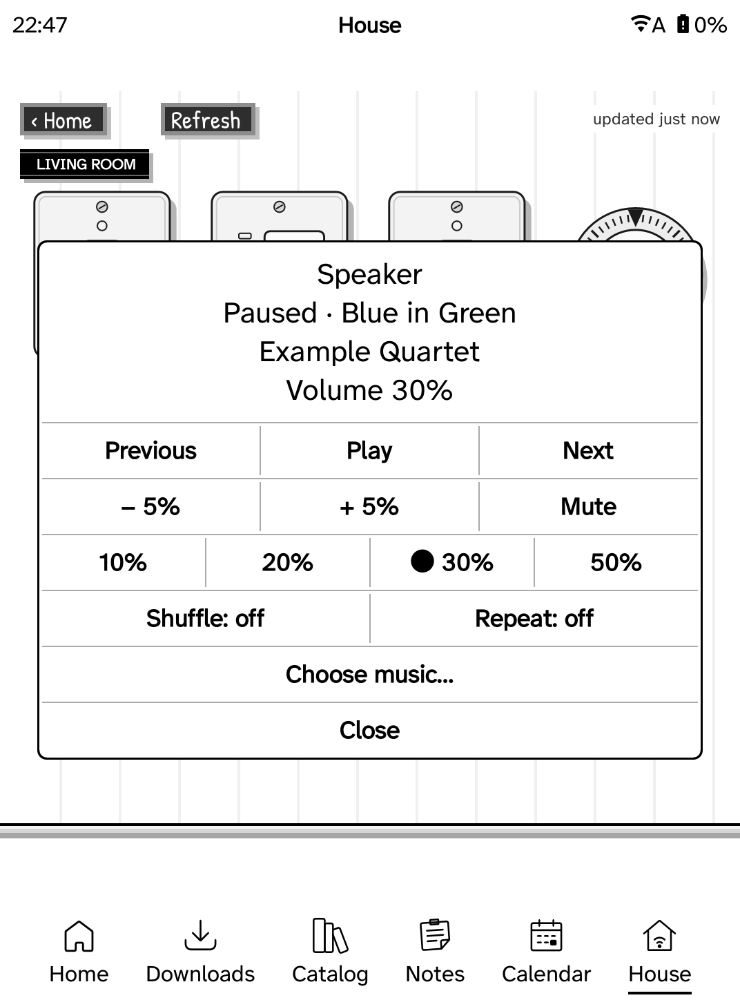

The **House** tab shows your [Home Assistant](https://www.home-assistant.io)
rooms with their lights, switches, thermostats, locks, garage doors,
speakers, TVs and scenes, so you can switch things from the Kindle. GZreader talks to Home
Assistant directly over your Wi‑Fi (its REST API): there's no web page or
browser involved, and nothing goes through anyone else's server.

Not on the Kindle 2 and DX: they have no Wi‑Fi.

 

## Turning it on

1. **Settings → Accounts and services → House**, and connect (below).
2. Tick **House tab** there. The tab goes at the end of the tab bar; move it
   or turn it off in **Settings → Home and tabs → Tab bar → Tabs** like any other
   tab. The bar holds 7 tabs: if it's full, turn one off first.

## Connecting

You need Home Assistant's address and a **long-lived access token**: in Home
Assistant open your profile (bottom left) → **Security** → **Long-lived access
tokens** → **Create token**, and copy it (Home Assistant shows it only once).

- **Connect with QR code**: the [setup page](Setup-Page-and-Connections) opens
  at its House tab; paste the address and the token on your phone.
- **Find Home Assistant on this Wi‑Fi**: the Kindle looks for Home Assistant's
  announcement on the network for a few seconds and fills in its address;
  then paste or type the token.
- **Connect by typing**: both on the Kindle's keyboard.

The address is the one you open Home Assistant with at home, e.g.
`homeassistant.local:8123` or `192.168.1.20:8123` (`:8123` is added when you
type no port). A Home Assistant Cloud or other `https://` address works too.

**Rooms** come from Home Assistant's areas, which only an **administrator's**
token can read. With another user's token the tab still works, grouped by kind
(Lights, Switches, Climate, Locks…) instead, and says why.

## What the tab shows

In the **Bookshelf** view (quick panel → **View**) the tab is a wall with
your devices mounted on it. With two rooms or more it starts in the
**hallway**, and each room is behind its plate:

 

- **Home**: what belongs to the whole home rather than one room:
  thermostats, locks, garage doors and gates. (They're in their rooms too.)
- **Rooms**: a plate for each room. Its lever is up when a light is on
  there, and beside it are how many of the room's lights are on, its
  temperature and humidity, and what is playing there. Tapping the plate
  (or its letter) opens the room. Things in no room are behind **Other**.
- **Scenes**: the scenes' keypad.
- **In a room**: its name on tape and all its fittings. A room with several
  lights has **All lights** first: it turns every light in the room off
  when any is on, and on when none is. The **‹ Home** sign, or the Back
  key, returns to the hallway.

With only one room, or a token that brings no rooms, everything is on the
one wall, room after room. The fittings:

- a room's name is on a strip of **label tape**, its devices in rows under
  it (four a row on a 6" Kindle, more on a bigger screen);
- a **dimmable light** is a rocker with ten indicator lights beside it,
  eight lit at 80%; a plain light, a switch, a fan or a helper is a
  **toggle**, its lever up and its pilot lamp lit when on;
- the **thermostat** is a round dial with the target in the middle and a
  pointer at it on the scale;
- a temperature sensor is a **wall thermometer**, humidity a round gauge, a
  door or window sensor a two-piece **contact** (apart when open);
- a **lock** is a deadbolt, its thumb-turn level when locked and upright
  when unlocked; a **garage door** or gate is a panelled door, rolled up
  when open; blinds are a window with its slats;
- a **speaker** is a speaker cabinet, with sound coming from it while it
  plays; a **TV** is a television, its screen lit when on;
- **scenes** and scripts are keys on a keypad.

Under each fitting are its name and what the list says about it
(`On · 80%`, `20.5° → 21°`, `Locked`). A tap, Press, or the letter beside
it on a Kindle with a keyboard, does what's described below. Letters go to
what does something (Refresh, devices, scenes), not to sensors or room
names. A page holds as many rooms as fit; the arrows or Page turn go on.
A scene Home Assistant doesn't let you run is a greyed key.

In the other views the tab is the list:

```
Refresh                       updated 1 min ago
Living room
  Ceiling light               On · 80%      ›
  Floor lamp                  Off      [toggle]
  Thermostat                  20.5° → 21°   ›
  Temperature                 20.5°
Outside
  Front door                  Locked        ›
  Garage door                 Closed        ›
Scenes
  Goodnight                                 ›
```

Each room (area) in Home Assistant's order, then **Other** (switchable things
in no room) and **Scenes**. A device's name loses its room's name in front
("Living room Ceiling light" → "Ceiling light"). Shown: lights, switches,
fans, helpers (input booleans), thermostats, locks, covers (garage doors,
blinds), media players (speakers, TVs), scripts and scenes, plus temperature
and humidity sensors and door and window sensors. Devices hidden in Home Assistant aren't shown.

What tapping (or the device's letter key) does:

- **Switch, fan, plain light**: on or off.
- **Dimmable light**: a dimmer with **On**, **Off**, **− 10%** / **+ 10%**
  (it stays open for another step) and **10% / 40% / 80% / 100%**. Steps
  instead of a slider: each press is one change and one screen refresh.
  A bulb that takes a colour also has **Warm, Red, Orange, Yellow, Green,
  Blue, Purple, Pink** (● marks the one it has).
- **Thermostat**: the temperature now and the target, a step down or up, and
  its modes: **Heat**, **Cool**, **Heat · cool**, **Auto**, **Off**, the ones
  it has (● marks the one it's in).
- **Lock**: unlocks (asks first) or locks.
- **Garage door, gate**: opens (asks first) or closes; blinds open and close
  without asking.
- **Speaker, TV** (a media player): its buttons, the ones it can do
  (below).
- **Scene, script**: runs it.
- **Sensors**: show their value only.

On a colour Kindle (Colorsoft, Scribe Colorsoft) a light that's on shows its
bulb in its colour (warm yellow when it has none of its own), and a
thermostat's icon is orange while it heats and blue while it cools.
On the wall that's the dimmer's indicator lights or the toggle's pilot lamp
and the thermostat's scale, and a thermometer's column is red.

### The controls in the Bookshelf view

  

In the Bookshelf view a dimmable light, a thermostat and a speaker open as
a panel drawn like the device. It does what the buttons described here do,
stays open, and shows what changed after each press. A tap outside it, **×**
or Back closes it.

- **Dimmer**: ten indicator lights, 10% at the bottom to 100% at the top,
  lit up to the light's level. Tap one to set that level. Beside them a
  rocker (**On** over **Off**, the half that's pressed sunk), **−** and
  **+** for a step of ten, and for a bulb that takes a colour its eight
  colours as round gels (the one it has ringed).
- **Thermostat**: its dial with the target in the middle, round **−** and
  **+** keys either side, what it reads now under it, and its modes on a
  slide switch with the one it's in pressed in.
- **Speaker, TV**: a display with the song, the artist and the volume;
  the transport keys; the volume as ten lights between **−** and **+**
  (tap a light for that level); **Mute**, **Shuffle** and **Repeat** with a
  lamp each that is lit when on; **Music…** and the power key. Only what
  the player can do is there.

On a Kindle with a keyboard each key carries a letter, and the 5-way moves
a frame from control to control (that's how to reach the indicator lights);
Press presses what's framed.

The lock's and garage door's question, and Music Assistant's lists, look as
they do in the other views.

### Speakers and TVs



A media player's row says what it's doing (`Playing · Blue in Green`,
`Paused`, `Idle`, `Off`). Tapping it opens its buttons, with the song, the
artist and the volume above them. Home Assistant says what each player can
do, and only those buttons are there (a TV that can only be switched has
just **Turn on** or **Turn off**):

- **Previous**, **Play** or **Pause**, **Next**.
- **− 5%** / **+ 5%**: the volume a step (the buttons stay open for another
  step), **Mute** or **Unmute**, and **10% / 20% / 30% / 50%** (● marks the
  one it's at). A player that only steps has **Quieter** and **Louder**.
- **Shuffle: on/off** and **Repeat: off/all/one**: each press goes to the
  next.
- **Turn on** or **Turn off**.
- **Choose music…** on a [Music Assistant](https://www.music-assistant.io)
  player: **Playlists**, **Albums**, **Artists** and **Radio** list Music
  Assistant's library by name (100 at a time, then **More…**), and
  **Search…** looks through the library and its providers for what you
  type. What you pick plays on that speaker, in place of its queue.

Home Assistant answers before the player has changed, so the list shows
what you asked for at once and what the player really does at the next
refresh, a couple of seconds later.

Choose music needs an **administrator's** token, the same one that brings
the rooms: it is how the Kindle learns which Music Assistant to ask.

**Refresh** (the first row) fetches everything again. The list also refreshes
every 30 seconds while the tab is on the screen, and is only drawn again (a
screen refresh) when something it shows changed. Wi‑Fi stays on while it's
open (in Auto it goes off a minute after you leave), also right after you
connect from inside the tab. The last list is kept on
the Kindle, so the tab opens at once with it and then updates. If Home
Assistant can't be reached, the last list stays with a line saying why.

## Settings

**Settings → Accounts and services → House**:

- **House tab**: in the tab bar or not.
- **Rooms and devices**: hide a room, or single devices in it (e.g. a
  Zigbee bulb's "child lock" switch). Open the House tab once first so the
  Kindle knows your rooms.
- **Ask before unlocking or opening** (on): locks, garage doors, gates and
  doors ask before they're unlocked or opened.
- **Disconnect**: removes the address and token from the Kindle. The token
  still works until you delete it in Home Assistant (your profile →
  Security).

## Privacy

The token is kept in GZreader's settings on the Kindle, like the Memos token,
and never written to the log. The log names Home Assistant's address, what
was switched (e.g. `light.turn_on light.porch`) and when, nothing else: not
what you searched Music Assistant for, nor what you chose to play. The
tab asks Home Assistant only for what it shows: one small request rendered by
Home Assistant's templates (with a token that isn't an administrator's, Home
Assistant's whole list of states, which is bigger).
