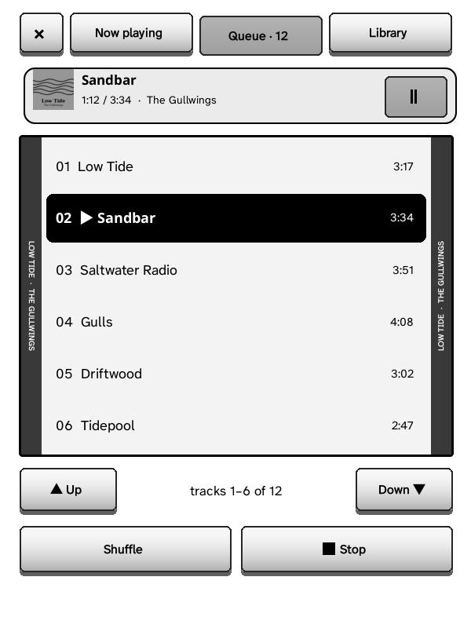
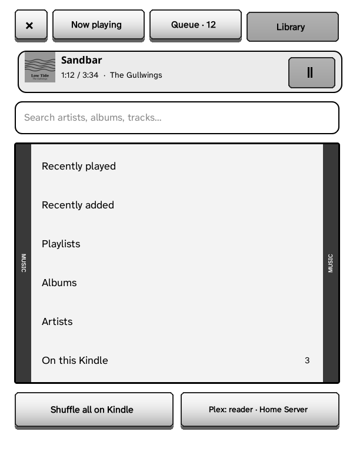

Albums and playlists from your Plex server, on Kindles with a speaker or headphone jack.

Kindles with a speaker or headphone jack (Kindle 2, 3, DX, Touch): albums and
playlists from your Plex Media Server, played while you read.

Music is the **Catalog** tab's third page: swipe left twice from Books, or
use the page-turn button ([the Catalog tab](Grimmory-Library#the-catalog-tab)).
Signed in to Plex, it's laid out like the Books page: **Search music…** at
the top, two shelves of CD cases, **Recently played** (what you played on
this Kindle, latest first, then what Plex's own players played) and
**Recently added** (Plex's newest albums, marked NEW), each ending in a
bundle that opens the whole list, then a bookcase with **Playlists**,
**Albums** and **Artists** (and *Now playing* when something plays), and
your Plex account's card in the bottom-right compartment. The card opens a
list drawn like Settings: who you're signed in as, the Plex server, the music
library, where audiobooks come from and the quality when converting (each
with its value on the right; tap to choose), the *Make bigger MP3 and AAC
smaller* switch, and Sign out. Music on the Kindle is in the Downloads tab. Albums and
playlists stand on the shelves as **CD cases**, face out: the album's cover
under the lid (Plex's own small copy, fetched while the list shows and kept
with the Catalog's covers; a plain insert with the title until it's here),
**ON KINDLE** on the ones downloaded, and a tag under each with the title
and the artist and year (a playlist: its number of tracks). An artist opens
to their albums, as CD cases too. Search results stay a list (artists,
albums and tracks together).

 

There is also a **Music tab**, off until you turn it on: Settings → Interface →
Navbar → Tabs → Music (or in the setup guide's tab page). The tab bar holds up
to 7 tabs. While music plays or is paused, the quick panel has a **Music**
tile (*Music ▶* while it plays), at Home and in a book: it opens Now playing.

The player has three tabs along the top, each a whole screen, with big keys
for touch (the × closes it; the music keeps playing):
- **Now playing**: a portable CD player with headphones, the album's cover
  printed over the whole disc and the track and time on its little display;
  the track; a progress bar you tap to jump to that time; previous · play /
  pause · next (play is the biggest), then Shuffle, Repeat (all, then one) and
  the volume (− +).
- **Queue**: what plays on a strip at the top (tap it for Now playing; its
  pause key), the tracks in big rows like the back of a CD case (tap one to
  play it), Up / Down for the other pages, Shuffle and Stop.
- **Library**: Recently played, Recently added, Playlists, Albums, Artists and
  On this Kindle on the same CD case, the search field above them, *Shuffle
  all on Kindle* and your Plex account below. Inside a list, *Back* and where
  you are (Library › Albums) are at the top.

 

Kindle 2, Keyboard and DX: each key's letter is on its button: Q previous,
W play / pause, E next, A shuffle, S repeat, D stop; Z Now playing, X Queue,
C Library (F still goes between the queue and the library). On Now playing
◀ ▶ go 10 s back or ahead and Press plays or pauses; in the queue and the
library ▲ ▼ choose (a thick outline), Press plays or opens, ◀ ▶ turn the
page. Back goes back up the library, then closes the player; the volume keys
show the level on Now playing.

Sign in, either way:
- on the Kindle: *Plex: sign in with a code*: go to **plex.tv/link** on a
  phone or computer and enter the 4 letters shown;
- on the setup page: Music → *Sign in with Plex*.

GZreader then uses your own Plex server (the one on the same Wi‑Fi first, or
another you choose). Browse **Artists**, **Albums**, **Playlists**, or
**Search**. An album or playlist: *Play*, *Shuffle*, *Download for offline*
(or *Delete the download*), and its tracks. *Play* on one that isn't
downloaded downloads it in order and starts as soon as the first track is in;
Wi‑Fi is on only while downloading. *Downloaded* lists what's on the Kindle
(`.music` in the GZreader folder); *Shuffle all downloaded* plays it all. Each
downloaded album or playlist is also in Downloads → **Music** (on the
bookshelf, the CD player), like audiobooks: open one to play it. On its
shelves each one is a CD facing out with its cover, its name on a plate under
it.

**Music library**: a Plex server can have several music libraries. GZreader
uses the server's first until you pick another in Settings → Connections →
Plex → **Music library** (or *Plex* in the Music tab, which shows you · server). Artists,
Albums, Recently added and Recently played come from the one picked; with
more than one music library on the server, Playlists and Search keep to it
too. The choice is kept per server, and the sync page (Kindles without
Wi‑Fi) lists the same library's albums. A library picked for
[audiobooks](Audiobooks-and-Read-Aloud#audiobooks-from-plex) is skipped
when nothing is picked here.

Formats: the Kindle plays MP3 and AAC. MP3 is downloaded as it is, AAC (M4A)
is downloaded and repacked on the Kindle (like audiobooks), anything else
(FLAC, ALAC, Ogg, Opus) is converted to MP3 by your Plex server (128, 192 or
320 kbps: *Plex* in the Music tab). To save room, **Make bigger
MP3 and AAC smaller** (in the same place) has Plex convert MP3 and AAC tracks
of a higher quality to MP3 at that quality too (more than 15 % above it, so a
file at about that quality stays as it is); music already downloaded stays as
it is. The sync page (Kindles without Wi‑Fi) shows the same two choices with
the Plex connection and uses them; changed there, the Kindle keeps them. Converting uses Plex's
transcoder; if your server refuses it, those tracks say so.

*Now playing*: pause, next, previous, shuffle, repeat (off, all, this track),
the queue. Music, audiobooks and read aloud play one at a time: starting one
pauses the others, and sleep pauses music. The Kindle's volume keys work
everywhere. The Plex token is kept like the other sign-ins and never logged
(it's sent as a header, never in an address).
