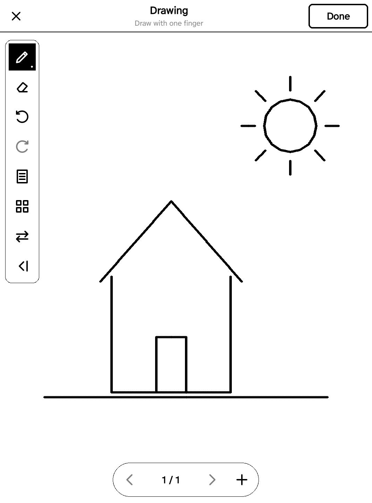
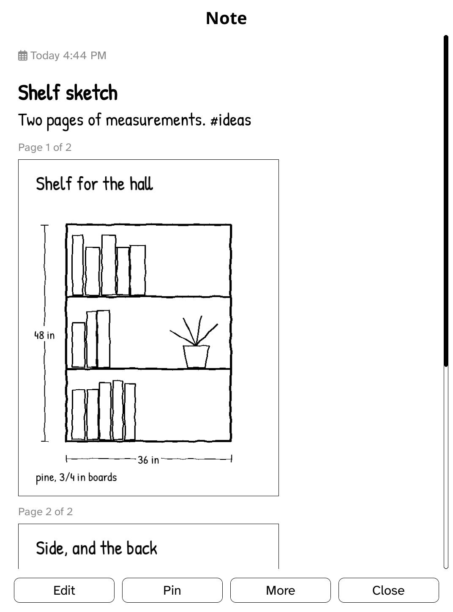

Your [Memos](https://usememos.com) notes on the device.

The Notes tab (it took Favorites' place in the tab bar, V) shows your
[Memos](https://usememos.com) notes as sticky notes, pinned first (six to a
page in the usual layout: see Layouts below). Written against Memos v0.31 (`/api/v1`); newer servers that moved the
API to `/api` are found too.

- **Favorites** is still in Settings → Interface → Navbar → Tabs, turned
  off; turn it on there (or on the setup guide's Navbar Tabs page, which also
  offers Notes) to have both.
- **Connect:** the first time, the tab offers *Connect with QR code* (the
  setup page, at its Notes section: the Memos address and an access token) or
  *Connect by typing*. Create the
  token in Memos → Settings → My account → Access Tokens. The Kindle keeps
  the token (never your password) in GZreader's settings; it's never written
  to the log. An address without `https://` falls back to `http://` for a
  Memos on your home network.
- **Board:** the letter on a note (Q, W, E…) opens it, ◀ ▶ (or the page keys) turn pages, the 5-way
  moves around the notes.
  - **Keyboard Kindles:** **N** new note, **J** journal entry, **K** search, **G** tags,
    **D** only the notes with drawings (again: all), **A** all notes, **F** filter,
    **L** layout, **S** sort, **M** connection. **H** lists every key. (Z X C V B
    switch the bottom tabs; the Menu key opens the quick panel.)
  - **Touch Kindles** have one row of buttons under the title: **Note** (a new
    note), **Draw** (a new note that opens on a page to draw on) and
    **Journal** (a journal entry), then icons for **Sort**, **Filter**,
    **Layout**, **Search** and **Full screen** (an **X** while in full screen,
    to leave it). Under it a row chooses what's shown: **All**, your three
    most used tags (and the tag being shown), and **Drawings** (only the
    notes with a drawing; tap it again for all). The one in use is in bold.
  - A **Kindle 4** has neither letter keys nor buttons: its **Menu** key on the board
    opens New note, Journal entry, Search…, Tags…, Only notes with drawings,
    Filter…, Layout, Sort…, Full screen and Connection….
- **Connection** (Filter → Memos connection… on a touch Kindle, M, or Menu → Connection… on a Kindle 4): your
  Memos account only: **Refresh** (with how many changes are waiting to be
  sent), **Connect again** (a new address or access token) and
  **Disconnect** (asks first; the notes kept on the Kindle are removed, your
  notes in Memos stay).
- **Sort** (the Sort button, S, or Menu → Sort… on a Kindle 4): *Sort notes by*
  **Date created** (the default) or **Date edited**, **Reverse order**
  (oldest first) and **Pinned first** (on by default). Memos is asked for the
  notes in that order (`order_by`), and the Kindle sorts what it keeps the same
  way (notes written here and not sent yet, a sync through a computer).
- **Layouts** (as in the Memos web app): **L** on the board (Layout on a touch
  Kindle, Menu → Layout on a Kindle 4, or Settings → Connections → Memos
  (Notes) → Layout) chooses how many notes side by side, and how long each is:
  - **List** (one note under another), **Two side by side** (the default),
    **Three side by side**, or **Auto**: as many side by side as fit the
    screen with room for about 22 characters a line (two upright, three
    sideways; at most four).
  - **Compact** (the default): every note the same size, three rows to a
    page (two sideways); a long note is cut off with "…" (open it to read it
    all). **Full:** each note as long as it needs, with all its pictures,
    nothing cut off, as many to a page as fit (each in the column with the
    most room, like Memos' masonry view). A note too long for the page goes
    on at the top of the empty column to its right, or on the next page,
    marked *continued*; its parts share one letter.
  - On the Kindles with keys a page holds at most ten notes, one per letter
    Q–P. After a change, the board shows the page with the note that was
    first on screen. The choice is kept.
  - **Scroll up and down** (touch Kindles, compact notes; off until you
    turn it on): the Notes tab becomes one long page. A swipe or a drag up
    or down moves the notes exactly as far as your finger went; notes cut
    off at the top and bottom show there's more (a part of the next row
    always shows). There's no page number or arrows under the notes. A swipe
    sideways moves most of a screenful. Full notes keep their pages.
  - **Full screen: no tab bar** (also the full-screen icon on a touch Kindle,
    and Menu on a Kindle 4) hides the tab bar at the bottom of the Notes tab, for more
    notes on a page. The X where the icon was (or Layout) brings
    it back; Back or the quick panel's Home leave the tab.
- **A note:** the text in Patrick Hand, checklist items with letter keys
  (press one to tick or untick it; the change goes to Memos), pictures from
  the note shown inline, its tags and place, and its attachments (PDFs and
  other documents open in the reader, pictures in the image viewer; each is
  downloaded once into `cache/gzreader-notes`). **Alt+E** edits, **Alt+P**
  pins, page keys scroll a long note.
- **Notes from Memos' rich editor** (Memos 26.11 and newer): its empty
  paragraphs (`&nbsp;`), characters written as codes (`&amp;`, `&#124;`) and
  backslash escapes (`\*`, `\#`) show as Memos shows them: blank lines and
  the characters themselves. On touch Kindles the editor shows them that way
  too (see **Editing on a touch Kindle**); on keyboard Kindles the editor
  shows the note as it's written.
- **Editing on a touch Kindle** works like Memos' web editor. The note shows
  formatted on one page (headings big, lists with • and numbers, checklists
  with ☐ ☑, **bold** and *italic*), with no Markdown and no `&nbsp;` to see,
  and you type straight into it.
  - **Tap** to put the cursor there. Tap a checklist item's **☐** to tick it.
  - **Hold** a word to select it, and drag to stretch the selection over
    words and lines. Typing replaces the selection; ⌫ deletes it.
  - The keyboard has **⮠ Enter** and **← →**. Enter starts a new line (the
    next item in a list; Enter on an empty item ends the list). ⌫ at the
    start of a line joins it to the line before. Swipe up or down to scroll a
    long note.
  - **The formatting bar** comes up at what you hold: a word (drag for
    more), or an empty line for the line itself. It works on the selection,
    or on the cursor's line:
    - **B** and ***I*** make the selection bold or italic.
    - **H** makes the lines a heading, then a smaller one, then text again.
    - **•**, **☐** and **1.** make the lines a list, a checklist or a numbered
      list; tap the same one again to make them text.
    - **#** adds a tag at the cursor.
    The button in use is black. The bar stays for another button; a tap on
    the text, or typing, puts it away. (It sits above the selection, or
    under it on the first line, where it covers the next line until it goes.)
  - The row under the title shows the note's **sheets** (its drawings) as
    small pictures: tap one to draw on it; **✎ Draw** adds the first.
    **Save** is at its right.
  - Code, quotes, tables and pictures show as their Markdown in grey and edit
    as text.
  - Save writes the note the way Memos' rich editor writes it. Lines you
    didn't change are kept exactly as they were.
- **The on-screen keyboard** keeps **⮠ Enter** and **← →** on its letters page
  in boxes where you type several lines (notes, KOReader's text editor).
  One-line boxes (search, names, passwords) keep the shorter bottom row, with
  Enter on the symbols page.
- **Editor (keyboard Kindles):** a full page with a toolbar at the bottom: List, Check, Num,
  Head, *I*, **B**, # Tag and Save. **Menu** jumps to the toolbar from
  anywhere in the text (on the tool used last) and the cursor stays where it
  is, so the tool applies there; Menu again (or ▲) goes back to the text. ▼
  from the last line also reaches the toolbar; ◀ ▶ choose, Press applies. Shortcuts:
  Alt+L list, Alt+C checklist, Alt+N numbered, Alt+H heading, Alt+K italic,
  Alt+B bold, Alt+G tag, Alt+S save, Alt+V who can see it, Alt+A its space.
  Alt + the top row types 1–0 here. New notes are **private** unless you
  change it. Back asks whether to save.
- **Spaces** (Memos v0.31 and newer): beside who can see the note, the editor
  shows its **space** (tap it, Alt+A, or on a Kindle 4 Menu → ◀ ▶ to it).
  Choose **No space** or one of the spaces you're a member of. A new note
  starts in the space the board is showing (Filter → Space…). In a space,
  who can see it also offers **Space members** (only that space's members);
  taking a note out of its space turns Space members into Private, as Memos
  does. The note's page says which space it's in. With an older Memos (no
  spaces) none of this shows.
- **Quick note:** the quick panel's **Quick note** tile (at Home and in a
  book, while Memos is connected) opens the same editor in a window over
  whatever is on the screen (the page stays visible around it; on touch
  Kindles it sits above the keyboard, and a tap outside it is the same as
  Back), so you can jot something down without leaving the book, Home or
  Settings. **Save** (or Back → Save) closes it and you're back where you
  were; "Note saved" says it's on its way. It's sent in the background a
  moment later (Wi‑Fi on Auto turns on for it; on Off it waits), and only the
  note is sent: the board's list isn't fetched while you read, so the Notes
  tab syncs the next time you open it. On a Kindle syncing through a
  computer it goes with the next sync. Hide the tile in **Settings →
  Interface → Quick panel**.
- **Drawings** (touch Kindles, Memos over Wi‑Fi): tap **Draw** on the Notes
  tab, or **✎ Draw** in a note's editor, for a page to draw on. A note can
  be just drawings.
  - **A new drawing** (**Draw** on the Notes tab): **Done** opens a small
    **New drawing** window, not the note's page: type a **title** (it
    becomes the note's heading; you can leave it empty), tap **# Tag** to
    add your tags (your most used ones, or **New tag…**; tap one again to
    take it off), then **Save**. **Back to drawing** goes back to the
    drawing. ✕ on an empty page just closes it.
  - **At the top:** **✕** (leave without keeping what you drew), the note's
    name and the page's paper, and **Done** (keeps the drawings with the
    note; **Save** in the editor sends them).
  - **The toolbar at the side:** the **pen** (tap it again for five
    thicknesses; the one you choose is kept; on a Kindle with a colour
    screen also eight **colours**, the ink and the seven of Memos' drawing
    editor, shown on the pen's button and kept too), the **eraser** (rubs out whole
    strokes, as in Memos; tap it again for **Clear page**), **Undo** and
    **Redo**, **Paper**, **All pages**, a button that puts the toolbar on the
    **other side** (for the other hand; kept), and one that **hides** it (a
    small button brings it back). Nothing is drawn under the toolbar: start
    a stroke beside it.
  - **The bar at the bottom:** ◀, the page (**2 / 3**), ▶ and **+** for a new
    page after this one.
  - **All pages:** every page as a small picture, three across. Tap one to
    choose it, tap it again (or **Open**) to go to it. **+ Add after**,
    **Duplicate**, **◀ Move**, **Move ▶** and **Delete** (asks first) work on
    the chosen page. Memos gets the pages in this order.
  - **Pages:** in Memos each page is a drawing of its own,
    in the order of the pages (Memos v0.31 and newer: GZreader sets the
    order after sending, since Memos lists a note's newest attachment first). A page rubbed out to nothing is left out (or
    taken off the note, when it's already in Memos).
  - **Paper:** shows each paper as a picture: **Blank**, **College ruled**,
    **Wide ruled**, **Gregg ruled**, **Dot grid**, **Graph**, **Checklist**
    and **Cornell notes**. Tap one to put the page on it. New pages start on
    the paper you chose last. The paper goes to Memos with the drawing as its
    background, as Memos' own drawing editor keeps one (a locked picture
    under everything), so Memos shows and keeps it; on the Kindle it's grey.
    **Your own paper:** put a PNG file in `koreader/settings/gzreader-notepaper`
    on the Kindle (at most 1440 pixels on its longer side and 600 KB); it's
    offered after the others, named after the file.
    On paper you draw only on the paper: a stroke stops at its edge and goes
    on where it comes back onto it. In Memos it's an attachment named
  `drawing-<date>-<time>.canvas.png`: Memos with drawings (its version after
  26.11.0) opens it as a drawing you can edit there; an older Memos shows it
  as a picture. Until it's sent, the board shows the note with the drawing.
  - **Editing drawings** (touch Kindles): **Edit** on a note with drawings
    opens them, a page each (pictures added in Memos show too). Draw more, rub out (strokes made in Memos too),
    Undo, Redo, Clear page; **Done** goes back to the note's text and **Save** sends
    both. The new drawing goes over the old one in Memos (the same
    attachment, as Memos' Edit drawing does); an older Memos gets it added
    and the old one taken off; someone else's drawing keeps theirs and gets
    yours beside it. A drawing bigger than the screen is shrunk to fit.
    Shapes and text made in Memos stay as they are (they can't be changed
    on the Kindle). Done on an empty page takes the drawing off the note.
    Any note can get a drawing: ✎ Draw in its editor.
  - **Seeing drawings** (made on the Kindle or in Memos): on the Notes tab a
    note with a drawing shows its heading (if it has one) and the drawing
    as big as the note allows; **Layout → Full** shows it bigger, with all
    the note's text. Open the note for everything: its text, then the
    drawing as wide as the page (tap it to see it on its own). A note with
    several shows them one under another, each with its page (*Page 2 of 3*).
    Drawings come down by themselves on Wi‑Fi, like the notes' other pictures.
  - **Kindles without a touch screen** (keyboard Kindles, the Kindle 4) show
    drawings and never change them: every page is in the note (its letter,
    or ▲ ▼ and Press, opens one full screen), there is no Draw, and Edit
    opens the note's text and leaves its drawings as they are.
  - **Colours:** Memos gets each stroke in its colour. A stroke coloured
    in Memos keeps its colour when the drawing is saved from any Kindle; a
    black-and-white screen shows it in black.
  - **With a pen** (Kindle Scribe): only the pen draws. Fingers on the page
    draw nothing, and while the pen is near the screen, and for a moment
    after it leaves, your hand can rest anywhere on it: it's ignored (palm
    rejection). The pen's other end rubs out. With the pen away, a finger
    can tap the buttons.
  - **With a finger** (every other touch Kindle): one finger draws; a second
    finger at the same time is ignored.
  - Not on Kindles syncing through a computer (the sync page doesn't send
    drawings).

   

- **Journal** (the **Journal** button, **J**, or Menu → Journal entry on a
  Kindle 4): a journal entry, as the journaling mode of the Memos fork at
  [github.com/9retirement6irk/memos](https://github.com/9retirement6irk/memos)
  makes them.
  - **How have you felt?** **Overall today** or **Right now**, and seven
    steps from *very unpleasant* to *very pleasant* (the chosen step again
    takes it back). With a step chosen: **What best describes this feeling?**
    (the ten words nearest the step; **More feelings…** has them all) and
    **What's behind it…** (work, family, health…).
  - **What did you do?** your activities. **Goals:** tick the ones you did.
  - A **prompt** (**Another prompt** for the next one) and **Write about
    it…**, a box for the words.
  - **Save** makes a private note: the prompt as a quote and your words, the
    goals as a checklist, then the tags, like
    `#mood/pleasant #mood/today #felt/grateful #impact/work #did/reading`.
    It's written exactly as the fork's web editor writes an entry, so its
    Insights count entries from the Kindle; any Memos shows it as a note.
  - With that fork, your **activities, goals, tag prefixes, hidden causes,
    whether a prompt and a date heading are used, and your journal space**
    come from Memos at each sync (Settings → Journal in its web app), and
    entries go to the journal space. With stock Memos the fork's defaults
    are used. Place and weather aren't added on the Kindle.
  - Every button works with a tap, or with the 5-way and Press. On a
    keyboard Kindle: **Alt+Q … U** (1–7) the step, **T** today / right now,
    **F** feelings, **I** what's behind it, **A** what you did, **G** goals,
    **P** another prompt, **W** write, **S** save. Back asks whether to save.
- **Filters:** **Drawings** (the notes with a drawing), tag, date (today, 7 days, 30 days, a year), pinned and search
  are Memos filters; place and "with attachments" are picked out on the
  Kindle (Memos v0.31 can't filter by them).
  **Space…** (when your Memos has spaces): **No space** or one of your
  spaces, with how many notes each has; the board's title says which.
- **Settings → Connections → Memos (Notes):** the Memos connection (connect again, disconnect);
  **Sync** all notes or only notes with chosen tags (Memos has no notebooks,
  so tags are the way to pick, and Filter → Space… for spaces; the list comes from Memos' tag
  counts, `users/<id>:getStats`, and the filter is `tag in [...]`);
  **Storage used** with *Free up space* (downloaded attachments, kept
  notes); **Notes kept on the Kindle** (50–500, fetched a page at a time);
  **Attachment storage limit** (10–100 MB or none; the attachments used
  longest ago go first).
- **Wi‑Fi:** only to sync (when the tab opens, at most every 5 minutes, or with
  changes waiting; M → Refresh any time), to send a change, and to open an
  attachment not on the Kindle yet. Pictures in notes are downloaded while
  syncing (up to 2 MB each, within the attachment limit).
- **Offline:** the last list of notes is kept on the Kindle
  (`settings/gzreader-notes.json`); new notes, edits, ticks and pins made
  without Wi‑Fi wait in a queue and are sent the next time the Notes tab can
  reach Memos ("not sent yet" on the note meanwhile). The Notes tab keeps
  Wi‑Fi up while it's open (Wi‑Fi on Auto).
