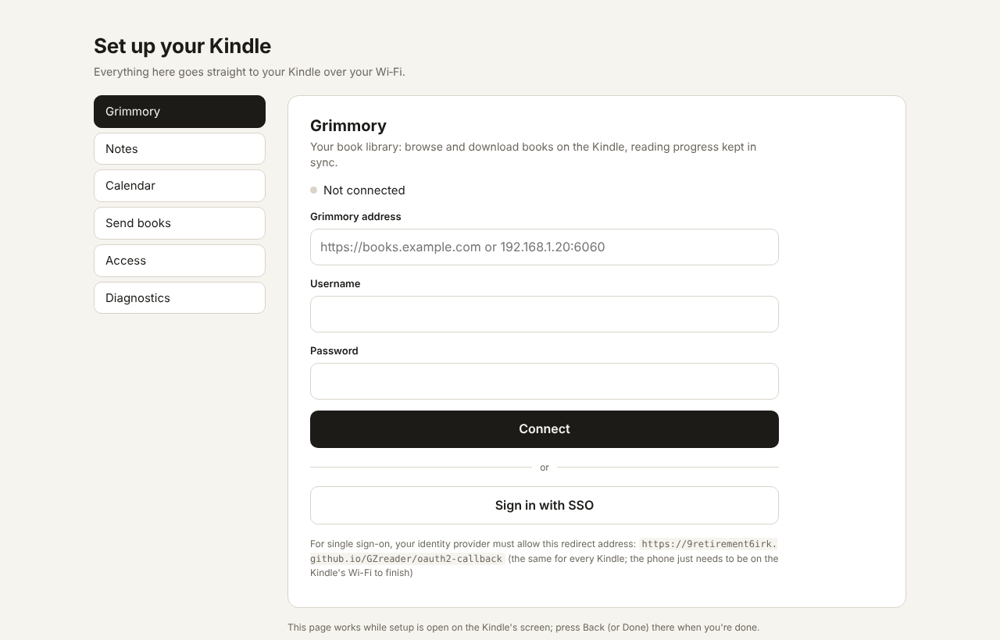

Connecting GZreader to your servers: the setup page in your browser, Grimmory (with single sign-on), copying connections from another GZreader, and servers behind Cloudflare. Kindles without Wi‑Fi do this on a computer: [Sync with a computer](Sync-with-a-Computer).

## The setup page (from your browser)

One page in your browser sets up everything. The Kindle shows a QR code, its
address and a 6-digit PIN:

- **With a phone:** scan the QR code. No PIN needed.
- **With any browser** (a computer, a tablet, a phone without a camera): type
  the address into the browser, for example `192.168.1.20` (some Kindles show
  `192.168.1.20:8642`: type that). The browser asks for the PIN on the Kindle's
  screen. After 5 wrong PINs the PIN stops working; the QR code still works,
  and opening the page again on the Kindle makes a new PIN.

The page is served by the Kindle itself over your Wi‑Fi (browser and Kindle on
the same network). It fits any screen: tabs along the top on a phone, down
the side on a computer. There's a tab for each connection (it opens at the one
you came from; without JavaScript they're one under the other):

- **Books**: your book server. Choose Grimmory (connect with a password or single sign-on) or [BookOrbit](BookOrbit) (connect with an API key, or its KOReader sync user name and password), or disconnect.
- **Notes (Memos)**: the Memos address and an access token, or disconnect.
- **Calendar**: your calendars, each with *Show its events*; calendar links
  can be renamed, given a new link (Proton's links change when you reshare)
  or removed; add new links (several at once, a name and a link field for
  each); show the holidays and choose their country; connect or disconnect a
  CalDAV account.
- **House** (Kindles with Wi‑Fi): your Home Assistant address and a
  long-lived access token, or disconnect ([House](House)).
- **Recipes** (Kindles with Wi‑Fi): your Mealie address with an API token, or
  *Sign in with single sign-on* for a Mealie that uses an identity provider,
  or disconnect ([Recipes](Recipes)).
- **Music** (Kindles with audio): *Sign in with Plex* (Plex's own sign-in
  page, which comes back to the setup page), the Plex server to use, sign out.
- **Immich**: your Immich address and an API key, the album, whether its
  pictures are the sleep screen and the Home wallpaper, how many the Kindle
  keeps, *Get new pictures now*, disconnect (below).
- **Send books**: pick books in the browser (EPUB, PDF, MOBI, AZW3, FB2, CBZ,
  TXT, DOCX…, up to 1 GB each) and they go straight into the GZreader folder
  (the Downloads tab). No Grimmory needed. A name already there gets
  "(2)"; a book is written to a temporary file first, so a dropped Wi‑Fi
  leaves nothing half-copied; it is refused when the Kindle is short of
  space.
- **Sleep screen**: your own pictures for the sleep screen. Pick photos in
  the browser; they're made there to fit the Kindle's screen (filling it, or
  whole with white edges), in grey (in colour on a colour Kindle), and go
  into the `screensavers` folder.
  The pictures already there are listed (*Take off* removes one), and you
  choose which sleep screen: the book's cover while reading and a picture
  elsewhere, a picture always, or the same with Immich's pictures. An iPhone
  photo: choose it from Photos (the phone sends a JPEG).
- **Access**: the key for a Cloudflare rule (below).
- **Diagnostics** (while diagnostic logging is on, Settings → Privacy and diagnostics → Advanced → Diagnostic logging): download the diagnostic log.

Each change shows a short note on the Kindle, and the page shows what
happened and stays open for the next thing. Press **Back** on the Kindle when
you're done (or leave it 10 minutes): a summary shows what changed, and the
page stops working. The QR code's address has a random code in it, and the typed address needs
the PIN; passwords
and tokens are sent once to the Kindle and only Grimmory's login tokens,
the Memos token and the CalDAV password are kept (never logged).

**Addresses without `https://`.** An address typed without `http://` or
`https://` is tried over HTTPS. Only when the server is on your home network
(an address like `192.168.1.20`, `10.0.0.5` or `100.x` for Tailscale, a name
with no dot such as `nas`, or one ending in `.local`, `.lan`, `.home` or
`.internal`) does GZreader try plain HTTP by itself when HTTPS doesn't answer.
A server on the internet isn't: someone on the same Wi‑Fi could block its
HTTPS to have your password or token sent again in the clear. If such a
server really has no HTTPS, type its address with `http://` in front. This
goes for Grimmory, Memos, CalDAV accounts, `webcal://` calendar links,
Immich and Home Assistant (which, on the home network, is still tried at
`http://…:8123` first).

Where to open it: the setup guide's first page (**Set up from your browser**),
the quick panel → **Connect**, the Catalog, Notes and Calendar tabs'
*Connect with QR code*, Settings → Accounts and services → Books / Memos / Calendar /
Immich.

## Immich

Pictures from one of your [Immich](https://immich.app) albums for the sleep
screen and the Home wallpaper: **Settings → Accounts and services → Photos**,
*Connect with QR code* (the setup page's Immich tab) or *Connect by typing*.
You need the address and an API key (Immich → Account Settings → API Keys;
at least `album.read`, `asset.read` and `asset.view`). What it does and its
settings: [Home and bookshelves](Home-and-Bookshelves#pictures-from-immich).

### Immich with single sign-on

If your Immich has OAuth turned on (Administration → Settings →
Authentication), you don't need to make an API key yourself: on the setup
page's Immich tab, type the address and press **Sign in with single sign-on
(SSO)**. You sign in at your identity provider, and the Kindle is connected.

One-time setup, the same for every Kindle: add

    https://9retirement6irk.github.io/GZreader/oauth2-callback

as an extra redirect URI on **Immich's** client at your identity provider
(next to Immich's own `…/auth/login`, `…/user-settings` and
`app.immich:///oauth-callback`). It's the same page as for
[Grimmory's single sign-on](#single-sign-on-sso--oidc), and it follows the
same *Redirect* choice (your own copy of the page, or this Kindle's own
address); the Immich tab shows the address in use.

What the Kindle keeps: after the sign-in it makes an API key of its own in
Immich, named "GZreader (*this Kindle*)", with `album.read`, `asset.read`,
`asset.view` and `user.read`, and ends the sign-in's session. Only that key
is kept (never logged), as when you paste one, so the Kindle stays connected
when your sign-in at the identity provider ends. To cut a Kindle off, delete
its key in Immich (Account Settings → API Keys); **Disconnect** on the
Kindle forgets the key but leaves it listed there.

- The phone has to be on the Kindle's Wi‑Fi while signing in, as for the rest
  of the setup page.
- Through the hand-off page, your identity provider has to offer PKCE
  (Authentik, Pocket ID, Authelia and Keycloak do). Without it, use
  *Redirect: this Kindle's own address*, or an API key.
- Kindles without Wi‑Fi (the sync page) still use an API key.

## Connect to Grimmory

*(Using BookOrbit instead of Grimmory? Choose **BookOrbit** under **Book server** in the same form: see [BookOrbit](BookOrbit).)*

Open the **Catalog** tab. Grimmory's options (connection, sync, bookmarks,
highlights, auto-download shelf) are in **Settings → Accounts and services → Books**
; Memos (the Notes tab) is in **Settings →
Accounts and services → Notes**. Read aloud is in Settings → Audio; Wi‑Fi only
when needed in Settings → Wi‑Fi, the diagnostic log in Settings → Privacy and
diagnostics; updates in Settings → General → Software update.

- **Connect with QR code**: opens the setup page (above) at its Grimmory
  section. The Kindle keeps only Grimmory's login tokens (never the
  password).
- **Connect to Grimmory by typing** / **Connect to BookOrbit by typing**: the
  same, using the Kindle's keyboard. The server you're signed in to has its
  row first; the other one is there to switch to it.

### Single sign-on (SSO / OIDC)

(Grimmory only: signed in to BookOrbit, Settings → Accounts and services →
Books has no single sign-on row. BookOrbit's KOReader sign-in is a user name
and password, or the API key.)

If Grimmory has SSO turned on, the setup page shows **Sign in with <provider>**.
One-time setup, the same for every Kindle: add

    https://9retirement6irk.github.io/GZreader/oauth2-callback

as an extra redirect URI on Grimmory's client at your identity provider
(Authentik, Pocket ID, Authelia, Keycloak…), next to Grimmory's own
`…/oauth2-callback`. If `ALLOWED_ORIGINS` is set in Grimmory, add
`https://9retirement6irk.github.io` there too. The address is also shown on the
setup page and under **Settings → Accounts and services → Books → (the first row,
Connected to Grimmory as … or Not connected) → Single sign-on (SSO) → How to set it up**.

How it works: the identity provider sends the phone back to that page
([docs/oauth2-callback.html](https://github.com/9retirement6irk/GZreader/blob/main/docs/oauth2-callback.html), a few lines of
JavaScript with no server behind it), which hands the sign-in code straight
to the Kindle; the Kindle then finishes signing in with Grimmory. The code is
useless without a secret only the Kindle has (PKCE), and the page only
forwards to a Kindle's address on a private network (port 8642). So:

- Grimmory and the identity provider can be anywhere the Kindle can reach,
  e.g. on the internet through Cloudflare. Nothing has to point at a Kindle's
  IP, and readers can sign in from their own homes.
- While signing in, the phone has to be on the same Wi‑Fi as the Kindle
  (any Wi‑Fi: the reader's own, or the Kindle on the phone's hotspot), like
  the rest of the setup page.
- The first time a phone signs in through the page, it shows **Sign in at**
  and your sign-in server's name, with a **Continue** button, instead of
  going there by itself; that browser goes straight there after that. The
  page only opens a sign-in request that comes back to it (so a link to it
  can't be used to send someone to another site).

Under **Single sign-on (SSO)** you can also choose:

- **Redirect: your own copy of the page**: host `oauth2-callback.html` yourself
  on HTTPS at an address ending in `/oauth2-callback` (e.g.
  `https://books.example.com/gzreader/oauth2-callback`, served next to Grimmory
  behind Cloudflare), type that address on the Kindle, and register it at the
  identity provider instead.
- **Redirect: this Kindle's own address**: `http://<kindle-ip>:8642/oauth2-callback`,
  as before 1.11 (one entry per Kindle; reserve its IP in your router; add
  `http://<kindle-ip>:8642` to `ALLOWED_ORIGINS` if it's set). Kindles that
  already signed in this way keep using it.

## AI

**Settings → Accounts and services → AI**, and the setup page's **AI** tab
(*Set up from your browser (QR code)* at the top of that settings page opens
it there). One key of your own for everything in GZreader that asks an AI
service something:

- [handwriting to text](Notes#handwriting-to-text) on Kindles that draw;
- the daily paper's [AI edition](Daily-Paper#the-ai-edition): a summary of
  each story;
- whatever uses AI next.

Two kinds of service:

- **Claude** (Anthropic): an API key from console.anthropic.com → API keys
  (**Claude key**; paid by use: reading a few handwritten words costs a
  fraction of a cent). **Claude model** is `claude-haiku-5-5` unless you
  change it.
- **Online service (OpenAI-style)**: any service that speaks OpenAI's Chat
  Completions API: OpenAI, or a model you run yourself. Give its **address**
  (`https://…/v1`; plain `http://` only to a computer on your network), a
  **key** and a **model**. For handwriting the model must read pictures.

**Story guide** (in a book, the quick panel's tile, with a key set up; books
that reflow, such as EPUBs): **People**, **Places** and **Terms** up to
where you are (each with a line on who or what it is, and in how many parts
it came up), then **So far**: what happened, or what was explained, in each
part. It's made from the book's own text, a part (a chapter) at a time: the
first time, it asks before sending the text you've read (it says about how
many words); each finished part is kept with the book, so later only what
you've read since goes. Sent: the book's title and author, and the parts'
text (about 9,000 words of a part at most). It's told to use only that text,
so nothing after your page is given away. An AI made it and it can be
wrong.

BookOrbit builds story guides on the server, but serves them only to its
own iPhone app (its server asks for Apple's App Attest and refuses API
keys), so GZreader can't show BookOrbit's: it makes its own from the book.

With both set up, the one ticked is used. **Try it** asks the service for
one word, to check the key, the model and the address. **Used for** lists
what uses the key now. **Remove the keys** takes both off the Kindle.

A key by itself sends nothing. Each use is switched on where it lives
(handwriting: Settings → Notes → Handwriting to text → With AI; the paper:
Daily paper → AI edition), and then only what it needs is sent: the writing
being read, as a black-and-white picture, or a news story's headline and
text for its summary. Wi‑Fi turns on for it.

The setup page never shows a saved key back: it says the key is set, and a
key field left empty keeps it. Keys are kept with GZreader's other sign-ins,
off the Kindle's USB drive, and never written to the log. Kindles without
Wi‑Fi (Kindle 2, DX) have no AI row.

### Explain what you selected

With an AI key set up, the menu that comes up when you select text in a book
has a **question mark**. Tap it and the service is asked to explain the
selected text: a word or a name as it's meant there, or what a longer
passage is saying, in about 150 words and without giving away what happens
later. The answer shows in a window over the page, under the text you
selected. It also works from an existing highlight's menu.

Under the answer are four buttons that carry on about the same selection:

- **Ask…**: type a question of your own about it.
- **Simpler**: the selected text said again in simpler words.
- **Summarize**: a few sentences.
- **Translate…**: pick a language.

The window then shows the new answer first, with what you asked over it, and
the earlier ones under **Earlier**. Each new question goes with the
conversation so far, so "it" is understood.

**Dictionary with AI.** With a key set up, the selection menu's
**Dictionary** asks your AI service what the word or phrase means in the
sentence it's in: how it's said, its part of speech, its meaning there, other
common meanings, a few synonyms and where it comes from. The answer comes in
the same window with the same buttons, and **Built-in dictionary** under them
opens the Kindle's own dictionaries for the word. Sent: the word or phrase,
the sentence round it (in a PDF, the word alone), and the book's title and
author. Turn it off in **Settings → Accounts and services → AI → Dictionary
with AI**: Dictionary is then the Kindle's own, as before. A long press on a
single word that opens the dictionary straight away (KOReader's "Dictionary
on single word selection") still opens the Kindle's own.

**Keeping an answer.** Under those is **Save as a note on this text**: the
text you selected becomes a highlight and the newest answer its note, signed
as an AI's (a question you typed is kept over its answer). From an existing
highlight's menu the button is **Add to the highlight's note**, and the
answer goes under the note that's there. Another answer in the same window
can be added under the first with the same button. The note is an ordinary one from then on: it
shows in the book, and goes to BookOrbit or Grimmory with your other
highlights and notes.

**Translate with AI.** With a key set up, the selection menu's **Translate**
opens a list of languages: GZreader's own language first (or the one you
picked last), then fourteen others. The translation comes from your AI
service, in the same window with the same four buttons. The list's last row,
**Without AI (Google Translate)**, is the translator that was there
before.

Sent, only when you tap one of these: the selected text (its first
3,000 characters or so), the book's title and author, and that window's own
questions and answers. Nothing else of the book. Nothing asked or answered
is kept once the window closes (unless you saved it as a note), or written to the log. An AI wrote the
answers and they can be wrong; the window says so. Without a key there is no
question mark, and Translate is KOReader's own.

## Copy connections from another GZreader

(Connections, settings, the game board and the downloads.)

Set one GZreader up and copy its connections to the others over the Wi‑Fi,
instead of scanning the QR code on each:

1. On the one that has them: **Send connections to another GZreader**
   (Settings → General → Transfer or reset → Copy to or from another GZreader, or its setup
   guide's first page). It shows its name ("Kindle Paperwhite 3 · 3F2A"), a
   6-digit PIN and what it has.
2. On the new one: **Copy from another GZreader** (the setup guide's first
   page, Settings → General → Transfer or reset → Copy to or from another GZreader, the Notes
   or Calendar tab while not connected, Settings → Accounts and services → Books). It
   lists the GZreader devices sending on the Wi‑Fi; pick it and enter the PIN.
3. Tick what to copy (everything this one doesn't have yet, with Settings, Game
   board and Downloads; from the Notes tab only Notes, from the Calendar tab
   only calendars) and **Copy**.

What's copied:
- **Notes:** the Memos address and access token.
- **Calendar:** the CalDAV account (address, user name, app password, which of
  its calendars are hidden) and each calendar link (its name, shown or hidden).
- **Grimmory:** the address and user name. Grimmory gives every device its own
  sign-in (a refresh token used on two devices signs both out) and GZreader
  never keeps your password, so the new one then signs in: type the password
  (address and user name filled in), or the setup page for single sign-on.
- **Settings:** GZreader's and ZenOS's own (Home, the tabs, the quick panel,
  the shelf…), the reader's defaults for books, the status bar, the sleep
  screen, sorting, and the daily paper's feeds and choices, Notes' and the
  calendar's preferences and the auto-download shelf. Never a password, token,
  key or PIN, and nothing that belongs to the device itself (its rotation, pen,
  screen, light). They apply once GZreader restarts: it offers to restart
  (after signing in to Grimmory, when that comes first).
- **Game board:** its history, achievements, themes and your books' words,
  joined with any on the new one (each puzzle once), and today's paper puzzles
  as far as they've got.
- **Downloads:** what's on the other Kindle is downloaded again on this one,
  through the usual download queue: books (narrated books with their
  narration), audiobooks and Plex music. Books and audiobooks start once this
  Kindle is signed in to the same book server (straight after signing in, or at
  the next Wi‑Fi connection); music once it's connected to Plex. What's already
  here isn't downloaded again. Books you copied onto the Kindle yourself (not
  from the book server) can't be fetched this way.

Each copy is checked by connecting with it, as when typed in. Both must be on
the same Wi‑Fi. Finding each other is mDNS / DNS‑SD (`_gzreader._tcp`, what
AirPrint and Chromecast use); some routers block it (client isolation, guest
networks): then **Type its address…** and enter the address at the bottom of
the send screen.

Security: the PIN is used in a SPAKE2 key exchange (RFC 3526's 2048-bit group,
the device's libcrypto), and everything after it is AES-256-GCM. Someone else
on the Wi‑Fi sees nothing they can read, and can't test PIN guesses offline;
each guess is a try on the sending device, which allows 5. A PIN is good for
one copy; the send screen closes after 10 minutes. Tokens and passwords are
never logged. (`gzreader_copy.lua`, `gzreader_spake.lua`, `gzreader_mdns.lua`.)

## Access (Cloudflare)

If your servers are behind Cloudflare and its bot checks block the Kindle,
GZreader can send a secret key with each request to them, for a rule that lets
it through. Setup page → **Access**: tick *Send the key*, add other host names
if needed (your Grimmory, Memos and CalDAV servers are included; each name
covers its subdomains), Save. The page then shows the rule to paste:

1. Cloudflare → your domain → **Security → WAF → Custom rules → Create rule**.
2. *Edit expression*, paste the rule (it checks the host names and the
   `X-GZreader-Key` header).
3. Action **Skip**: All remaining custom rules, All rate limiting rules, All
   managed rules, All Super Bot Fight Mode rules, and under *More*: Browser
   Integrity Check and Security Level. Deploy, and move it to the top.
4. **Bot Fight Mode** (Security → Bots) can't be skipped by a rule: if it blocks
   the Kindle, turn it off.

Behind **Cloudflare Access** (Zero Trust login)? Make a service token there
(Access → Service auth), allow it in the application's policy (action
*Service Auth*), and enter its Client ID and Secret on the Access tab.

The key and token go only to those servers (never to calendar links on other
sites, plex.tv or GitHub) and are never written to the log.

**Redirects.** When one of your servers answers with a redirect to another
server (a sign-in proxy's page, a file host), GZreader follows it without
your sign-in: Grimmory's token, the Memos, Plex and Home Assistant tokens,
the Immich key and the Access key and Cloudflare token stay with your own
server (the Access key still goes to the hosts listed on the Access tab).
A redirect from `https://` to `http://` isn't followed. A CalDAV account's
password follows a redirect only within the same site (iCloud's
`caldav.icloud.com` → `p12-caldav.icloud.com` works); to another site the
connection stops with a note saying so.
