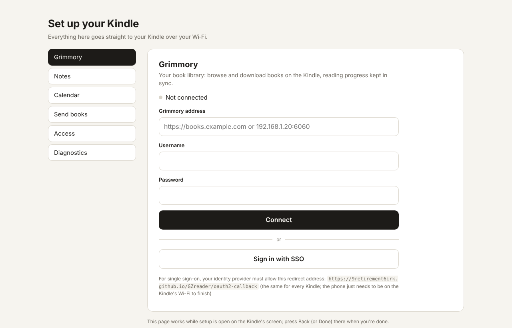

Connecting GZreader to your servers: the setup page in your browser, Grimmory (with single sign-on), copying connections from another GZreader, and servers behind Cloudflare. Kindles without Wi‑Fi do this on a computer: [Sync with a computer](Sync-with-a-Computer).

## The setup page (from your browser)

One page in your browser sets up everything. The Kindle shows a QR code, its
address and a 6-digit PIN:

- **With a phone:** scan the QR code. No PIN needed.
- **With any browser** (a computer, a tablet, a phone without a camera): type
  the address into the browser, for example `192.168.1.20` (some Kindles show
  `192.168.1.20:8642`: type that). The browser asks for the PIN on the Kindle's
  screen. After 5 wrong PINs the PIN stops working; the QR code still works,
  and opening the page again on the Kindle makes a new PIN.

The page is served by the Kindle itself over your Wi‑Fi (browser and Kindle on
the same network). It fits any screen: tabs along the top on a phone, down
the side on a computer. There's a tab for each connection (it opens at the one
you came from; without JavaScript they're one under the other):

- **Grimmory**: connect with a password or single sign-on, or disconnect.
- **Notes (Memos)**: the Memos address and an access token, or disconnect.
- **Calendar**: your calendars, each with *Show its events*; calendar links
  can be renamed, given a new link (Proton's links change when you reshare)
  or removed; add new links (several at once); connect or disconnect a CalDAV
  account.
- **Music** (Kindles with audio): *Sign in with Plex* (Plex's own sign-in
  page, which comes back to the setup page), the Plex server to use, sign out.
- **Immich**: your Immich address and an API key, the album, whether its
  pictures are the sleep screen and the Home wallpaper, how many the Kindle
  keeps, *Get new pictures now*, disconnect (below).
- **Send books**: pick books in the browser (EPUB, PDF, MOBI, AZW3, FB2, CBZ,
  TXT, DOCX…, up to 1 GB each) and they go straight into the GZreader folder
  (the Downloads tab). No Grimmory needed. A name already there gets
  "(2)"; a book is written to a temporary file first, so a dropped Wi‑Fi
  leaves nothing half-copied; it is refused when the Kindle is short of
  space.
- **Sleep screen**: your own pictures for the sleep screen. Pick photos in
  the browser; they're made there to fit the Kindle's screen (filling it, or
  whole with white edges), in grey, and go into the `screensavers` folder.
  The pictures already there are listed (*Take off* removes one), and you
  choose which sleep screen: the book's cover while reading and a picture
  elsewhere, a picture always, or the same with Immich's pictures. An iPhone
  photo: choose it from Photos (the phone sends a JPEG).
- **Access**: the key for a Cloudflare rule (below).
- **Diagnostics** (while diagnostic logging is on, Settings → General →
  Advanced → Diagnostic logging): download the diagnostic log.

Each change shows a short note on the Kindle, and the page shows what
happened and stays open for the next thing. Press **Back** on the Kindle when
you're done (or leave it 10 minutes): a summary shows what changed, and the
page stops working. The QR code's address has a random code in it, and the typed address needs
the PIN; passwords
and tokens are sent once to the Kindle and only Grimmory's login tokens,
the Memos token and the CalDAV password are kept (never logged).

Where to open it: the setup guide's first page (**Set up from your browser**),
the quick panel → **Send books**, the Catalog, Notes and Calendar tabs'
*Connect with QR code*, Settings → Connections → Grimmory / Memos / Calendar /
Immich.

## Immich

Pictures from one of your [Immich](https://immich.app) albums for the sleep
screen and the Home wallpaper: **Settings → Connections → Immich (Photos)**,
*Connect with QR code* (the setup page's Immich tab) or *Connect by typing*.
You need the address and an API key (Immich → Account Settings → API Keys;
at least `album.read`, `asset.read` and `asset.view`). What it does and its
settings: [Home and bookshelves](Home-and-Bookshelves#pictures-from-immich).

## Connect to Grimmory

Open the **Catalog** tab. Grimmory's options (connection, sync, bookmarks,
highlights, auto-download shelf) are in **Settings → Connections → Grimmory**
; Memos (the Notes tab) is in **Settings →
Connections → Memos (Notes)**. Read aloud is in Settings → General → Audio; Wi‑Fi only
when needed in Settings → General, the diagnostic log in Settings → General →
Advanced; updates in Settings
→ General → Updates.

- **Connect with QR code**: opens the setup page (above) at its Grimmory
  section. The Kindle keeps only Grimmory's login tokens (never the
  password).
- **Connect by typing**: the same, using the Kindle's keyboard.

### Single sign-on (SSO / OIDC)

If Grimmory has SSO turned on, the setup page shows **Sign in with <provider>**.
One-time setup, the same for every Kindle: add

    https://9retirement6irk.github.io/GZreader/oauth2-callback

as an extra redirect URI on Grimmory's client at your identity provider
(Authentik, Pocket ID, Authelia, Keycloak…), next to Grimmory's own
`…/oauth2-callback`. If `ALLOWED_ORIGINS` is set in Grimmory, add
`https://9retirement6irk.github.io` there too. The address is also shown on the
setup page and under **Settings → Connections → Grimmory → Single sign-on (SSO)
→ How to set it up**.

How it works: the identity provider sends the phone back to that page
([docs/oauth2-callback.html](https://github.com/9retirement6irk/GZreader/blob/main/docs/oauth2-callback.html), a few lines of
JavaScript with no server behind it), which hands the sign-in code straight
to the Kindle; the Kindle then finishes signing in with Grimmory. The code is
useless without a secret only the Kindle has (PKCE), and the page only
forwards to a Kindle's address on a private network (port 8642). So:

- Grimmory and the identity provider can be anywhere the Kindle can reach,
  e.g. on the internet through Cloudflare. Nothing has to point at a Kindle's
  IP, and readers can sign in from their own homes.
- While signing in, the phone has to be on the same Wi‑Fi as the Kindle
  (any Wi‑Fi: the reader's own, or the Kindle on the phone's hotspot), like
  the rest of the setup page.

Under **Single sign-on (SSO)** you can also choose:

- **Redirect: your own copy of the page**: host `oauth2-callback.html` yourself
  on HTTPS at an address ending in `/oauth2-callback` (e.g.
  `https://books.example.com/gzreader/oauth2-callback`, served next to Grimmory
  behind Cloudflare), type that address on the Kindle, and register it at the
  identity provider instead.
- **Redirect: this Kindle's own address**: `http://<kindle-ip>:8642/oauth2-callback`,
  as before 1.11 (one entry per Kindle; reserve its IP in your router; add
  `http://<kindle-ip>:8642` to `ALLOWED_ORIGINS` if it's set). Kindles that
  already signed in this way keep using it.

## Copy connections from another GZreader

Set one GZreader up and copy its connections to the others over the Wi‑Fi,
instead of scanning the QR code on each:

1. On the one that has them: **Send connections to another GZreader**
   (Settings → Connections → Copy to or from another GZreader, or its setup
   guide's first page). It shows its name ("Kindle Paperwhite 3 · 3F2A"), a
   6-digit PIN and what it has.
2. On the new one: **Copy from another GZreader** (the setup guide's first
   page, Settings → Connections → Copy to or from another GZreader, the Notes
   or Calendar tab while not connected, Settings → Connections → Grimmory). It
   lists the GZreader devices sending on the Wi‑Fi; pick it and enter the PIN.
3. Tick what to copy (everything this one doesn't have yet; from the Notes tab
   only Notes, from the Calendar tab only calendars) and **Copy**.

What's copied:
- **Notes:** the Memos address and access token.
- **Calendar:** the CalDAV account (address, user name, app password, which of
  its calendars are hidden) and each calendar link (its name, shown or hidden).
- **Grimmory:** the address and user name. Grimmory gives every device its own
  sign-in (a refresh token used on two devices signs both out) and GZreader
  never keeps your password, so the new one then signs in: type the password
  (address and user name filled in), or the setup page for single sign-on.

Each copy is checked by connecting with it, as when typed in. Both must be on
the same Wi‑Fi. Finding each other is mDNS / DNS‑SD (`_gzreader._tcp`, what
AirPrint and Chromecast use); some routers block it (client isolation, guest
networks): then **Type its address…** and enter the address at the bottom of
the send screen.

Security: the PIN is used in a SPAKE2 key exchange (RFC 3526's 2048-bit group,
the device's libcrypto), and everything after it is AES-256-GCM. Someone else
on the Wi‑Fi sees nothing they can read, and can't test PIN guesses offline;
each guess is a try on the sending device, which allows 5. A PIN is good for
one copy; the send screen closes after 10 minutes. Tokens and passwords are
never logged. (`gzreader_copy.lua`, `gzreader_spake.lua`, `gzreader_mdns.lua`.)

## Access (Cloudflare)

If your servers are behind Cloudflare and its bot checks block the Kindle,
GZreader can send a secret key with each request to them, for a rule that lets
it through. Setup page → **Access**: tick *Send the key*, add other host names
if needed (your Grimmory, Memos and CalDAV servers are included; each name
covers its subdomains), Save. The page then shows the rule to paste:

1. Cloudflare → your domain → **Security → WAF → Custom rules → Create rule**.
2. *Edit expression*, paste the rule (it checks the host names and the
   `X-GZreader-Key` header).
3. Action **Skip**: All remaining custom rules, All rate limiting rules, All
   managed rules, All Super Bot Fight Mode rules, and under *More*: Browser
   Integrity Check and Security Level. Deploy, and move it to the top.
4. **Bot Fight Mode** (Security → Bots) can't be skipped by a rule: if it blocks
   the Kindle, turn it off.

Behind **Cloudflare Access** (Zero Trust login)? Make a service token there
(Access → Service auth), allow it in the application's policy (action
*Service Auth*), and enter its Client ID and Secret on the Access tab.

The key and token go only to those servers (never to calendar links on other
sites, plex.tv or GitHub) and are never written to the log.
