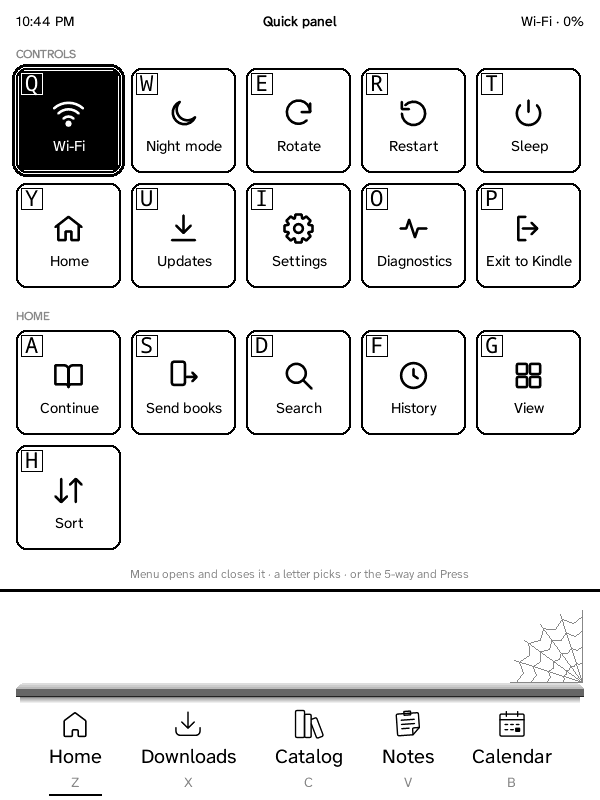

How you drive GZreader on each device: the quick panel (the same on all of them), then keys, the 5-way and touch. The Nooks: [Nook 1st Edition](Nook-1st-Edition), [Nook Simple Touch](Nook-Simple-Touch).

## The quick panel

One panel of square tiles, on every Kindle and Nook: **Menu** opens it (on a
touch Kindle, swipe down from the top). Each tile has a letter for the
keyboard; the 5-way moves between them too. A highlighted tile shows white on
black when it's on (Wi‑Fi, night mode, a bookmark on this page).

- **Controls:** Wi‑Fi (on the Kindle 2 and DX: **Sync**, [with a
  computer](Sync-with-a-Computer)), Night mode, Rotate, Restart, Sleep, Home,
  Updates, Settings, Diagnostics (while diagnostic logging is on, Settings →
  General) and Exit to Kindle (Exit to Nook).
- **Home:** Manage book (the highlighted book), Continue, Send books, Search,
  History, View and Sort; **Music** and **Audiobook** while one plays or is
  paused (they open its player: music and audiobooks are browsed in the
  Catalog tab), and **Downloads (N)** while something downloads.
- **This book** (while reading): Sync with Grimmory, Contents, Bookmark,
  Bookmarks, Go to page, Search book, Font (the list of fonts), Layout (size,
  margins, spacing: KOReader's bottom panel), Fit pictures, Read aloud, and
  Music and Audiobook while one plays or is paused.

On a touch Kindle with a frontlight the panel also has a light slider (the swipe that opens the panel leaves the light alone; tap or
drag it; − and + step), and
holding a book at Home or in Downloads opens Manage book.

### Choosing the tiles

**Settings → Interface → Quick panel** lists the tiles of each group
(**Controls**, **Home**, **This book**): untick one to take it off the panel,
tick it to put it back, or **Show every tile** to bring them all back.
**Home**, **Settings** and **Exit to Kindle** are always there. Tiles that
only appear sometimes say when (Diagnostics while logging is on, Manage book
for the book highlighted, and so on). The letters follow the tiles shown, so
hiding one moves the letters of the tiles after it. A group with every tile
hidden isn't shown.

## Keyboard (Kindle 2, 3, DX)

The Kindle 2 and DX have a number row, so 1–9 switch the tabs there too.

| Where | Key | Does |
| --- | --- | --- |
| Home / lists | Z, X, C, V, B | Switch the bottom tabs, counted from the left: Z Home, X Downloads, C Grimmory, V Notes, B Calendar (also Alt + Q, W, E, R, T…: Alt + the top row is how the Kindle Keyboard types 1–9). Shown under each tab. |
| Home | Q, W…; A, S, D… | Q the book you're reading, W, E, R… the books in the strip, A, S, D… the strip's tabs (shown in squares). |
| Any list or menu | Q, W, E, … | Pick the entry with that letter (shown next to it), in lists, the ZenOS settings and KOReader's menus. |
| KOReader's menus | Alt + Q, W, E, … | Switch the menu's tabs. |
| Home / lists | Menu | The quick panel (Controls and Home tiles; see *The quick panel*). Each tile has a letter. Menu or Back closes it. |
| Home / Downloads, book highlighted | Menu → Q | Manage book: Open, Delete from this Kindle (asks first; Grimmory keeps it), then ZenOS's book menu (without its Edit submenu: Delete is already there). |
| Reading | Menu | The quick panel with This book: sync, contents, bookmark, bookmarks, go to page, search, font, layout, fit pictures, read aloud, music. |
| Reading | AA | Fonts and layout. |
| Reading | Shift + Sym | Read aloud / stop. |
| Reading | Back | Return from a followed link or TOC jump; otherwise go to Home. |
| Settings, audiobook player, tab views | Home | Home (the default tab). The audiobook keeps playing. |
| Any text box | Sym | The symbols menu, like the Kindle's own: the 5-way picks a symbol, Press types it, Sym or Back closes it (it opens on the one you used last). Sym + a letter still types its symbol (Sym + G #, Sym + Q !…); Shift + Home shows the whole on-screen keyboard. |
| Anywhere | Volume buttons | Speaker volume for audiobooks and read aloud (a note shows the level). |
| Note editor | Menu | To the formatting toolbar and back; the cursor stays where it is. |

## Kindle 4 (5-way)

No keyboard and no touch screen: the 5-way, its centre button (Press),
Menu, Back, Home, the keyboard key and the page keys on both sides.

- **Tabs:** Down from the bottom of Home reaches the tab bar; Left and Right
  choose a tab, Press opens it.
- **Menu:** the quick panel at Home and in a book (see *The quick panel* above); in Notes and Calendar their options (new note, filter, refresh;
  today, Agenda / Day / Week / Month, refresh, settings).
- **Notes:** the 5-way moves between the sticky notes, Press opens one; in a
  note ▲ ▼ choose a checklist item or attachment and Press ticks or opens
  it; Menu: edit, pin. The editor shows the on-screen keyboard (the 5-way
  types on it); Menu goes to the toolbar (lists, checklists, headings,
  italic, bold, tags, Save, and who can see the note) and back.
- **Calendar:** the page keys go back and forth; the 5-way picks an event.
- The 8-bit screen has inverted grey levels, which KOReader's fast drawing
  code can't handle (like the Kindle 3's 4-bit one): GZreader draws into an
  ordinary buffer and copies it to the screen, about a sixth less processor
  time per key press in testing, and night mode costs nothing.

## Touch Kindles (Kindle Touch, Paperwhite 3)

The Kindle Touch (4th generation) and the Paperwhite 3 (7th generation)
run the same GZreader with ZenOS's touch interface:

- **Tabs** at the bottom: Home, Downloads, Grimmory, Notes, Calendar.
- **Swipe down from the top** for the quick panel (above), with a light
  slider on Kindles with a frontlight. A tap below it closes it.
- **Hold a book** at Home or in Downloads for Manage book (Open, Delete from
  this Kindle, then the book's menu).
- **Notes:** New note, Filter and More are buttons under the title; a note
  opens with a tap, checklist items tick with a tap, and Edit, Pin, More and
  Close are buttons at the bottom. The editor shows the on-screen keyboard;
  its toolbar (lists, checklists, headings, italic, bold, tags) and Save are
  above the text, and the visibility (Private, Signed-in users, Public) is a
  button in the title.
- **Calendar:** ◀, Today, ▶ and More under the title (or swipe left and
  right); tap an event for its details, a day in Week or Month to open it.
- **The setup page:** tap Done on the Kindle when you're done (instead of
  Back).
- **On the Kindle's own home screen** (firmware 5), GZreader shows as a
  "GZreader" book with its logo (`documents/GZreader.sh`); tapping it starts
  GZreader. It replaces ZenOS's "ZenOS" one from earlier versions.
- **Reading:** tap the right side for the next page, the left side for the
  previous one, the top for the menu (contents, bookmarks, search, fonts…);
  swipe up for the page browser.
- **The first-time tour:** after the setup guide, a short tour opens the
  quick panel and shows how to open and close it, Settings and the Home
  tiles (on the first book, if it didn't run at Home: This book's tiles). It
  closes the panel when it ends. On the first book, a tip then shows the
  swipe up for the page browser. Both come again after Settings → About →
  Setup Guide.
- **Audio:** the Kindle Touch plays audiobooks; the player has buttons for
  chapters, ±30 s, play / pause, sleep timer, volume, the description and
  close (Settings → Reader → Test audiobook playback finds what works on
  its firmware). It also reads aloud with the Kindle's voice: in a book,
  swipe down from the top and tap **Listen** in the quick panel (again to
  stop); the first time, a short test finds the Kindle's voice. The
  Paperwhite has no speaker or headphone jack, so neither is offered there.
- Everything is sized for the screen (the Paperwhite's 1072 × 1448 at 300
  dpi): Home's text is the same size as on a Kindle 3. The Kindle's own time zone is used (the time zone setting is for the
  Kindles without one).
