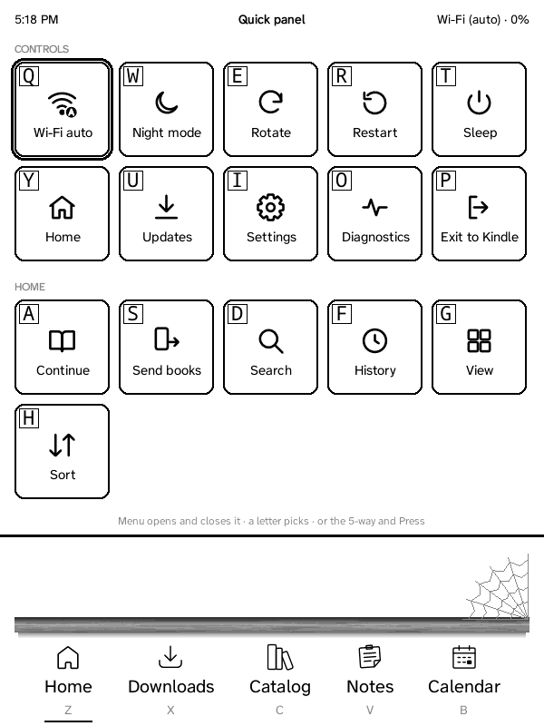

How you drive GZreader on each device: the quick panel (the same on all of them), then keys, the 5-way and touch. Kobos are used as touch Kindles: [Kobo](Kobo). The Nooks: [Nook 1st Edition](Nook-1st-Edition), [Nook Simple Touch](Nook-Simple-Touch).

## The quick panel

One panel of square tiles, on every Kindle, Kobo and Nook: **Menu** opens it (on a
touch Kindle or a Kobo, a tap at the top or a swipe down from the top; [which of
them](Using-GZreader#how-it-opens)). Each tile has a letter for the
keyboard; the 5-way moves between them too. A highlighted tile shows white on
black when it's on (Wi‑Fi, night mode, a bookmark on this page).
Five tiles go across; on a big touch screen (the Kindle Scribe) as many as
keep each tile under an inch wide (seven on a Scribe, eight turned sideways).

- **Controls:** Wi‑Fi (a tap goes on → off → [auto](Wi-Fi), and the panel stays open; on the Kindle 2
  and DX: **Sync**, [with a computer](Sync-with-a-Computer)), [Bluetooth](Bluetooth) (Kindles with Bluetooth: a tap turns it
  on or off, the panel staying open; a hold opens Bluetooth devices), Night mode, Rotate, Restart, Sleep, Home,
  Updates, Settings, Diagnostics (while diagnostic logging is on, Settings →
  Privacy and diagnostics) and Exit to Kindle (Exit to Kobo, Exit to Nook).
- **Home:** Manage book (the highlighted book), Continue, Connect (your phone or computer: send books, set up), Search,
  History, View and Sort; **Quick note** while [Memos](Notes) is connected;
  **Music** and **Audiobook** while one plays or is
  paused (they open its player: music and audiobooks are browsed in the
  Catalog tab), and **Downloads (N)** while something downloads.
- **This book** (while reading): Sync with Grimmory, **Reader tools** (what a
  swipe up from the bottom of the page opens, as set in Settings → Reader →
  Bottom swipe gesture: font, layout, search, bookmarks, highlights),
  Bookmark, Read aloud, the tiles made from the book (Story guide, Flashcards),
  **Mark up** (draw on the page, kept as a note) while [Memos](Notes) is
  connected, Music and Audiobook while one plays or is paused, and
  **Quick note** last (while Memos is connected).

On a touch Kindle with a frontlight the panel also has a light slider (the swipe that opens the panel leaves the light alone; tap or
drag it; − and + step), and
holding a book at Home or in Downloads opens Manage book.

### How it opens

On a touch Kindle, **Settings → Home and tabs → Quick panel** starts with **Open
with a tap at the top** and **Open with a swipe down from the top** (both by
default; in a book too). Untick one to keep only the other: one always stays
ticked. They're KOReader's "Activate menu", which no longer shows in Settings →
KOReader (nor its "Auto-show bottom menu", which does nothing in GZreader).

While you write or draw a note (the [note editor](Notes), a drawing, a
journal entry) a **swipe down from the top** opens the panel too, over what
you're doing, which is still there when it closes. In a drawing, pull down
from the top bar (or, with the bar folded away, from the very top edge):
that never draws. On the Scribe a finger pulls; the pen still draws up to
the edge. While the panel is open the keyboard steps aside.

### Choosing the tiles

**Settings → Home and tabs → Quick panel** lists the tiles of each group
(**Controls**, **Home**, **This book**): untick one to take it off the panel,
tick it to put it back, or **Show every tile** to bring them all back.
**Home**, **Settings** and **Exit to Kindle** are always there. Tiles that
only appear sometimes say when (Diagnostics while logging is on, Manage book
for the book highlighted, and so on). The letters follow the tiles shown, so
hiding one moves the letters of the tiles after it. A group with every tile
hidden isn't shown.

**Arrange tiles** puts each group's tiles in your order: pick a group and move
its tiles in KOReader's arrange window. On Kindles with keys the letters
follow the new order. **Back to the usual order** undoes it.

**Your tiles** adds tiles of your own, shown as a third group on the panel at
Home and in a book (up to ten):

- **Add a plugin's screen**: any plugin that has a screen or menu to open.
  This is how you open a plugin you've copied into `GZreader/app/plugins/`,
  since the quick panel stands where KOReader's menu was.
- **Add one of KOReader's menus**: any of KOReader's own submenus (Screen,
  Taps and gestures, Document…). A book's menus are listed when you open
  Settings from a book.
- A tile only shows where it can open: a book's menu isn't on the panel at
  Home. Tap **Take off: …** to remove one.

### Turning the screen

**Rotate** (in Controls) turns the screen a quarter turn. Home and books stay
turned: going Home from a book read sideways keeps the screen sideways, and
the next book opens the same way. (That's KOReader's **Keep current rotation
across views**, ticked by GZreader; untick it in Settings → Privacy and diagnostics → Advanced
→ KOReader settings → Screen → Rotation to give Home and each book their own
rotation again.)

On a Kindle that turns the screen by itself when you turn it (Oasis,
Scribe), Controls also has **Auto-rotate**: a tap turns that on or off (on
by default; the tile is white on black while it's on). Notes turn with the
screen too: a note open from the Notes tab, the note editor (what you've
typed, its tags, space and drawings stay), a quick note's window and a
journal entry are laid out again for the new shape, and so is the Notes tab
when you go back to it. The drawing screen keeps the shape it opened with.

On a Kindle with a light sensor (Voyage, Oasis 2 and 3, Paperwhite 5
Signature, Scribe, Colorsoft), Controls also has **Auto light** (off until
you turn it on). On, the front light follows the room: dim in the dark,
brighter in a bright room, changing gently every 15 seconds or so while the
Kindle is awake, and at once when it wakes. Move the light's slider yourself
while it's on and it remembers how much brighter or dimmer you like it. A
light you've turned off stays off. Before each change it reads where the
light really is, so a light moved some other way (the Kindle's own
brightness) is followed from there instead of jumping back.

**Settings → General → Schedules → Brightness** has Auto light too, at the
top, with its adjustments:

- **Brighter or dimmer**: from −40% to +40% of the light's range, or as the
  room asks. (The slider sets this as well.)
- **Never dimmer than** and **Never brighter than**: a level it keeps
  between, e.g. never brighter than 12 at night in bed.
- **Follows the room**: slowly (every 30 seconds, small steps), normally
  (every 15) or quickly (every 5; a little more battery).
- **Forget my adjustments**: back to as the room asks, the light's whole
  range and normal speed.
- **Now**: what the sensor reads (in lux) and the light's level; tap it to
  read again.

Auto light and the brightness schedule (or Light mode / Dark mode
brightness) turn each other off: both would set the light.

## Keyboard (Kindle 2, 3, DX)

The Kindle 2 and DX have a number row, so 1–9 switch the tabs there too.

| Where | Key | Does |
| --- | --- | --- |
| Home / lists | Z, X, C, V, B | Switch the bottom tabs, counted from the left: Z Home, X Downloads, C Grimmory, V Notes, B Calendar (also Alt + Q, W, E, R, T…: Alt + the top row is how the Kindle Keyboard types 1–9). Shown under each tab. |
| Home | Q, W…; A, S, D… | Q the book you're reading, W, E, R… the books in the strip, A, S, D… the strip's tabs (shown in squares). |
| Any list or menu | Q, W, E, … | Pick the entry with that letter (shown next to it), in lists, the ZenOS settings and KOReader's menus. |
| KOReader's menus | Alt + Q, W, E, … | Switch the menu's tabs. |
| Home / lists | Menu | The quick panel (Controls and Home tiles; see *The quick panel*). Each tile has a letter. Menu or Back closes it. |
| Home / Downloads, book highlighted | Menu → Q | Manage book: Open, Delete from this Kindle (asks first; Grimmory keeps it), then ZenOS's book menu (without its Edit submenu: Delete is already there). |
| Reading | Menu | The quick panel with This book: sync, reader controls, bookmark, search, read aloud, music. |
| Reader controls | 1, 2, 3… · F, L, T | 1, 2, 3… the tabs along the bottom, counted from the left; F Font, L Layout, T Themes (C, P, D on a PDF: Contrast, Page, Document). The 5-way moves and changes a setting, Press chooses, Back closes. A line under the controls says so. |
| Reading | AA | Fonts and layout. |
| Reading | Shift + Sym | Read aloud / stop. |
| Reading | Back | Return from a followed link or TOC jump; otherwise go to Home. |
| Settings, audiobook player, tab views | Home | Home (the default tab). The audiobook keeps playing. |
| Any text box | Sym | The symbols menu, like the Kindle's own: the 5-way picks a symbol, Press types it. The menu stays up for more symbols (letters type too) until you press Sym again (or Back); it opens on the one you used last. Sym + a letter still types its symbol (Sym + G #, Sym + Q !…); Shift + Home shows the whole on-screen keyboard. |
| Anywhere | Volume buttons | Speaker volume for audiobooks and read aloud (a note shows the level). |
| Note editor | Menu | To the formatting toolbar and back; the cursor stays where it is. |

## Kindle 4 (5-way)

No keyboard and no touch screen: the 5-way, its centre button (Press),
Menu, Back, Home, the keyboard key and the page keys on both sides.

- **Tabs:** Down from the bottom of Home reaches the tab bar; Left and Right
  choose a tab, Press opens it.
- **Menu:** the quick panel at Home and in a book (see *The quick panel* above); in Notes and Calendar their options (new note, journal entry, search, filter, refresh;
  today, Agenda / Day / Week / Month, refresh, settings).
- **Notes:** the 5-way moves between the sticky notes, Press opens one; in a
  note ▲ ▼ choose a checklist item or attachment and Press ticks or opens
  it; Menu: edit, pin. The editor shows the on-screen keyboard (the 5-way
  types on it); Menu goes to the toolbar (lists, checklists, headings,
  italic, bold, tags, Save, and who can see the note) and back.
- **Calendar:** the page keys go back and forth; the 5-way picks an event.
- The 8-bit screen has inverted grey levels, which KOReader's fast drawing
  code can't handle (like the Kindle 3's 4-bit one): GZreader draws into an
  ordinary buffer and copies it to the screen, about a sixth less processor
  time per key press in testing, and night mode costs nothing.

## Touch Kindles (Kindle Touch, Paperwhite 3, Scribe)

The Kindle Touch (4th generation), the Paperwhite 3 (7th generation), the
Kindle Scribe and the other touch Kindles run the same GZreader with ZenOS's
touch interface (on the Scribe the pen taps like a finger, and draws in
notes: [Notes](Notes)):

- **Tabs** at the bottom: Home, Downloads, Grimmory, Notes, Calendar.
- **Swipe down from the top** for the quick panel (above), with a light
  slider on Kindles with a frontlight: a small sun on its − button, a big
  bright one on +. A tap below it closes it.
- **Warmth:** on Kindles whose light can be made warmer (Paperwhite 5 and
  newer, Oasis 3, Scribe, Colorsoft) a second slider under the light's goes
  from cool to warm, with a snowflake on − and a flame on +: tap or drag it,
  − and + step. The swipe that opens the panel moves neither slider.
- **Volume:** on touch Kindles with sound, a slider under those sets the
  volume: on Kindles with Bluetooth (Scribe, Paperwhite 5 and newer…) the
  Kindle's own Bluetooth volume, in the same 8 steps as Amazon's slider; on
  the Kindle Touch its speaker and headphones, 0 to 15, the volume read
  aloud and audiobooks use. Its − has a quiet speaker, + a loud one. Tap −
  or +, tap the bar, or drag. (The Kindle 2,
  3 and DX use their volume buttons.)
- **Hold a book** at Home or in Downloads for Manage book (Open, Delete from
  this Kindle, then the book's menu).
- **Notes:** Note, Draw (a new note on a page to draw on) and Journal (a journal entry), then icons for Sort, Filter (with Memos connection), Layout, Search and Full screen, are buttons under the title, with a row of your tags and Drawings under them; a note
  opens with a tap, checklist items tick with a tap, and Edit, Pin, More and
  Close are buttons at the bottom. The editor shows the on-screen keyboard;
  its toolbar (lists, checklists, headings, italic, bold, tags) and Save are
  above the text, and the visibility (Private, Signed-in users, Public) is a
  button in the title.
- **Calendar:** ◀, Today, ▶ and More under the title (or swipe left and
  right); tap an event for its details, a day in Week or Month to open it.
- **The setup page:** tap Done on the Kindle when you're done (instead of
  Back).
- **On the Kindle's own home screen** (firmware 5), GZreader shows as a
  "GZreader" book with its logo (`documents/GZreader.sh`); tapping it starts
  GZreader. It replaces ZenOS's "ZenOS" one from earlier versions.
- **Reading:** tap the right side for the next page, the left side for the
  previous one, the top for the menu (contents, bookmarks, search, fonts…);
  swipe up for the page browser. A tap on the bottom status bar hides it
  and a second tap shows it again (Settings → Reader → Appearance → Bottom
  status bar → Hide on tap: Off makes that tap turn the page instead).
- **The first-time tour:** after the setup guide, a short tour opens the
  quick panel and shows how to open and close it, Settings and the Home
  tiles (on the first book, if it didn't run at Home: This book's tiles). It
  closes the panel when it ends. On the first book, a tip then shows the
  swipe up for the page browser. Both come again after Settings → General →
  Setup Guide.
- **Audio:** the Kindle Touch plays audiobooks; the player has buttons for
  chapters, ±30 s, play / pause, sleep timer, volume, the description and
  close (Settings → Audio → Test audiobook playback finds what works on
  its firmware). It also reads aloud with the Kindle's voice: in a book,
  swipe down from the top and tap **Listen** in the quick panel (again to
  stop); the first time, a short test finds the Kindle's voice. The
  Paperwhite has no speaker or headphone jack, so neither is offered there.
- Everything is sized for the screen (the Paperwhite's 1072 × 1448 at 300
  dpi): Home's text is the same size as on a Kindle 3. The Kindle's own time zone is used (the time zone setting is for the
  Kindles without one).

## A secret

As on an Android phone, tap GZreader's version in **Settings → About**
seven times (from the fourth tap it counts down). An animation plays: an
open book whose pages turn by themselves, each turn writing the next letter
of "GZreader". It plays three times and rests on its last page. A tap, Back
or the 5-way's Press closes it.
